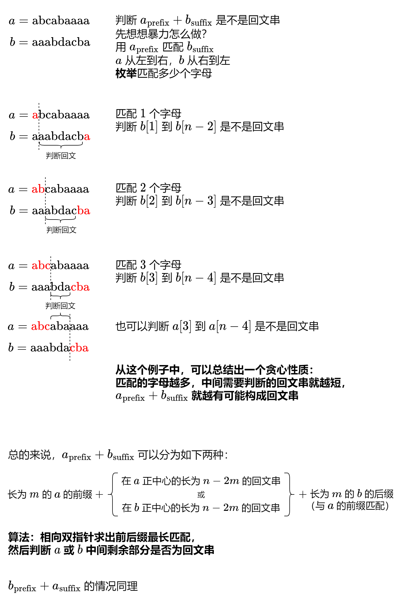

# 没想明白？一张图秒懂！（Python/Java/C++/Go）

> **[1616. 分割两个字符串得到回文串](https://leetcode.cn/problems/split-two-strings-to-make-palindrome/solutions/2175393/mei-xiang-ming-bai-yi-zhang-tu-miao-dong-imvy/) · Medium · 难度分 1868**

> **所属题单**
> - [滑动窗口与双指针 · 三、单序列双指针](../../../刷题路径/灵神原版题单/滑动窗口与双指针/三、单序列双指针.md) · §3.2 相向双指针
> - [贪心算法 · 三、字符串贪心](../../../刷题路径/灵神原版题单/贪心算法/三、字符串贪心.md) · §3.2 回文串贪心

> **题目描述**
> 给你两个字符串 `a` 和 `b` ，它们长度相同。请你选择一个下标，将两个字符串都在 **相同的下标** 分割开。由 `a` 可以得到两个字符串： `a_prefix` 和 `a_suffix` ，满足 `a = a_prefix + a_suffix`<sub> </sub>，同理，由 `b` 可以得到两个字符串 `b_prefix` 和 `b_suffix` ，满足 `b = b_prefix + b_suffix` 。请你判断 `a_prefix + b_suffix` 或者 `b_prefix + a_suffix` 能否构成回文串。
>
> 当你将一个字符串 `s` 分割成 `s_prefix` 和 `s_suffix` 时， `s_suffix` 或者 `s_prefix` 可以为空。比方说， `s = "abc"` 那么 `"" + "abc"` ， `"a" + "bc" `， `"ab" + "c"` 和 `"abc" + ""` 都是合法分割。
>
> 如果 **能构成回文字符串** ，那么请返回 `true`，否则返回 `false` 。
>
> **注意**， `x + y` 表示连接字符串 `x` 和 `y` 。
>
> **示例 1：**
>
> ```
>
> 输入：a = "x", b = "y"
> 输出：true
> 解释：如果 a 或者 b 是回文串，那么答案一定为 true ，因为你可以如下分割：
> a_prefix = "", a_suffix = "x"
> b_prefix = "", b_suffix = "y"
> 那么 a_prefix + b_suffix = "" + "y" = "y" 是回文串。
> ```
>
> **示例 2：**
>
> ```
>
> 输入：a = "xbdef", b = "xecab"
> 输出：false
> ```
>
> **示例 3：**
>
> ```
>
> 输入：a = "ulacfd", b = "jizalu"
> 输出：true
> 解释：在下标为 3 处分割：
> a_prefix = "ula", a_suffix = "cfd"
> b_prefix = "jiz", b_suffix = "alu"
> 那么 a_prefix + b_suffix = "ula" + "alu" = "ulaalu" 是回文串。
> ```
>
> **提示：**
>
> - `1 <= a.length, b.length <= 10⁵`
>
> - `a.length == b.length`
>
> - `a` 和 `b` 都只包含小写英文字母

> **题解**
> 
>
> 注意，双指针前后缀匹配结束后，两个指针指向的位置恰好就是接下来要判断的回文串的左右边界，所以这两块代码逻辑可以无缝对接。
>
> ```python
> class Solution:
>     def checkPalindromeFormation(self, a: str, b: str) -> bool:
>         # 如果 a_prefix + b_suffix 可以构成回文串则返回 True，否则返回 False
>         def check(a: str, b: str) -> bool:
>             i, j = 0, len(a) - 1  # 相向双指针
>             while i < j and a[i] == b[j]:  # 前后缀尽量匹配
>                 i += 1
>                 j -= 1
>             s, t = a[i: j + 1], b[i: j + 1]  # 中间剩余部分
>             return s == s[::-1] or t == t[::-1]  # 判断是否为回文串
>         return check(a, b) or check(b, a)
> ```
>
>
> ### 复杂度分析
>
> - 时间复杂度：$O(n)$，其中 $n$ 为 $a$ 的长度。
> - 空间复杂度：$O(1)$。仅用到若干额外变量。
>
> > 注：Python 也可以像其它语言那样手动判断回文，从而避免切片产生的额外空间。
>
> ---
>
> 附：我的 [每日一题·高质量题解精选](https://github.com/EndlessCheng/codeforces-go/blob/master/leetcode/SOLUTIONS.md)，已分类整理好。
>
> 欢迎关注[【biIibiIi@灵茶山艾府】](https://space.bilibili.com/206214)，高质量算法教学，持续更新中~
