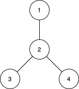
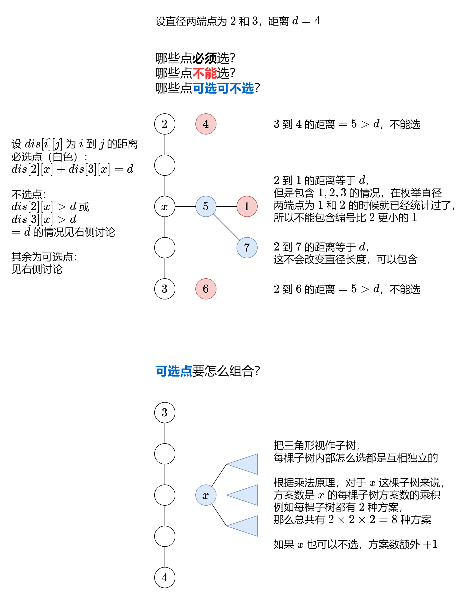

# 【图解】回溯/二进制枚举/O(n^3)枚举直径端点（Python/Java/C++/Go）

> **[1617. 统计子树中城市之间最大距离](https://leetcode.cn/problems/count-subtrees-with-max-distance-between-cities/solutions/2162612/tu-jie-on3-mei-ju-zhi-jing-duan-dian-che-am2n/) · Hard · 难度分 2309**

> **所属题单**
> - [链表、二叉树与回溯 · 三、一般树](../../../刷题路径/灵神原版题单/链表、二叉树与回溯/三、一般树.md) · §3.5 树的直径
> - [链表、二叉树与回溯 · 四、回溯](../../../刷题路径/灵神原版题单/链表、二叉树与回溯/四、回溯.md) · §4.2 子集型回溯
> - [动态规划 · 十二、树形 DP](../../../刷题路径/灵神原版题单/动态规划/十二、树形%20DP.md) · §12.1 树的直径
> - [数学算法 · 二、组合数学](../../../刷题路径/灵神原版题单/数学算法/二、组合数学.md) · §2.1 乘法原理

> **题目描述**
> 给你 `n` 个城市，编号为从 `1` 到 `n` 。同时给你一个大小为 `n-1` 的数组 `edges` ，其中 `edges[i] = [u_i, v_i]` 表示城市 `u_i` 和 `v_i`<sub> </sub>之间有一条双向边。题目保证任意城市之间只有唯一的一条路径。换句话说，所有城市形成了一棵 **树** 。
>
> 一棵 **子树** 是城市的一个子集，且子集中任意城市之间可以通过子集中的其他城市和边到达。两个子树被认为不一样的条件是至少有一个城市在其中一棵子树中存在，但在另一棵子树中不存在。
>
> 对于 `d` 从 `1` 到 `n-1` ，请你找到城市间 **最大距离** 恰好为 `d` 的所有子树数目。
>
> 请你返回一个大小为 `n-1` 的数组，其中第 `d` 个元素（**下标从 1 开始**）是城市间 **最大距离** 恰好等于 `d` 的子树数目。
>
> **请注意**，两个城市间距离定义为它们之间需要经过的边的数目。
>
> **示例 1：**
>
> 
>
> ```
>
> 输入：n = 4, edges = [[1,2],[2,3],[2,4]]
> 输出：[3,4,0]
> 解释：
> 子树 {1,2}, {2,3} 和 {2,4} 最大距离都是 1 。
> 子树 {1,2,3}, {1,2,4}, {2,3,4} 和 {1,2,3,4} 最大距离都为 2 。
> 不存在城市间最大距离为 3 的子树。
> ```
>
> **示例 2：**
>
> ```
>
> 输入：n = 2, edges = [[1,2]]
> 输出：[1]
> ```
>
> **示例 3：**
>
> ```
>
> 输入：n = 3, edges = [[1,2],[2,3]]
> 输出：[2,1]
> ```
>
> **提示：**
>
> - `2 <= n <= 15`
>
> - `edges.length == n-1`
>
> - `edges[i].length == 2`
>
> - `1 <= u_i, v_i <= n`
>
> - 题目保证 `(u_i, v_i)` 所表示的边互不相同。

> **题解**
> # 方法一：枚举子集+树的直径
>
> ### 前置知识：子集型回溯
>
> 见 [78. 子集](https://leetcode.cn/problems/subsets/)。
>
> 讲解见[【基础算法精讲 14】](https://www.bilibili.com/video/BV1mG4y1A7Gu/)。
>
> > APP 用户可以分享到 wx 后打开链接。
>
> ### 前置知识：二叉树的直径
>
> 见 [543. 二叉树的直径](https://leetcode.cn/problems/diameter-of-binary-tree/)。
>
> 推荐从这题开始学习树形 DP。
>
> 简单来说就是枚举从 $x$ 往左儿子走的最长链和往右儿子走的最长链，这两条链可能会组成直径。枚举所有点作为 $x$ 就能找到答案。
>
> 每个节点都需要返回「往左走的最长链长度和往右走的最长链长度的最大值」给父节点，这样父节点才知道往这边走的最长链的长度是多少。
>
> ### 前置知识：树的直径
>
> 见 [1245. 树的直径](https://leetcode.cn/problems/tree-diameter/)。
>
> 考虑到这题需要会员，可以做做这些相似题目：
>
> - [2246. 相邻字符不同的最长路径](https://leetcode.cn/problems/longest-path-with-different-adjacent-characters/)
> - [2538. 最大价值和与最小价值和的差值](https://leetcode.cn/problems/difference-between-maximum-and-minimum-price-sum/)
>
> 树的直径可以用两次 DFS 或者树形 DP，我在 [周赛 328](https://www.bilibili.com/video/BV1QT41127kJ/) 的第四题讲了树形 DP 的做法，在二叉树直径的基础上略作修改。
>
> ### 思路
>
> 本题结合了 78 题和 1245 题：枚举城市的子集（子树），求这棵子树的直径。
>
> 需要注意的是，枚举的子集不一定是一棵树，可能是森林（多棵树，多个连通块）。我们可以在计算树形 DP 的同时去统计访问过的点，看看是否与子集相等，只有相等才是一棵树。
>
> ```python
> class Solution:
>     def countSubgraphsForEachDiameter(self, n: int, edges: List[List[int]]) -> List[int]:
>         # 建树
>         g = [[] for _ in range(n)]
>         for x, y in edges:
>             g[x - 1].append(y - 1)
>             g[y - 1].append(x - 1)  # 编号改为从 0 开始
>
>         ans = [0] * (n - 1)
>         in_set = [False] * n
>         def f(i: int) -> None:
>             if i == n:
>                 vis = [False] * n
>                 diameter = 0
>                 for v, b in enumerate(in_set):
>                     if not b: continue
>                     # 求树的直径
>                     def dfs(x: int) -> int:
>                         nonlocal diameter
>                         vis[x] = True
>                         max_len = 0
>                         for y in g[x]:
>                             if not vis[y] and in_set[y]:
>                                 ml = dfs(y) + 1
>                                 diameter = max(diameter, max_len + ml)
>                                 max_len = max(max_len, ml)
>                         return max_len
>                     dfs(v)
>                     break
>                 if diameter and vis == in_set:
>                     ans[diameter - 1] += 1
>                 return
>             
>             # 不选城市 i
>             f(i + 1)
>
>             # 选城市  i
>             in_set[i] = True
>             f(i + 1)
>             in_set[i] = False  # 恢复现场
>         f(0)
>         return ans
> ```
>
>
> ### 复杂度分析
>
> - 时间复杂度：$O(n2^n)$。$O(2^n)$ 枚举子集，$O(n)$ 求直径，所以时间复杂度为 $O(n2^n)$。
> - 空间复杂度：$O(n)$。
>
> # 方法二：二进制枚举
>
> 这个做法相当于对方法一的优化。
>
> 集合/布尔数组可以用二进制表示，二进制从低到高第 $i$ 位为 $1$ 表示 $i$ 在集合中，为 $0$ 表示 $i$ 不在集合中，例如集合 $\{0,2,3\}$ 对应的二进制数为 $1101_{(2)}$。
>
> ```python
> class Solution:
>     def countSubgraphsForEachDiameter(self, n: int, edges: List[List[int]]) -> List[int]:
>         # 建树
>         g = [[] for _ in range(n)]
>         for x, y in edges:
>             g[x - 1].append(y - 1)
>             g[y - 1].append(x - 1)  # 编号改为从 0 开始
>
>         ans = [0] * (n - 1)
>         #  二进制枚举
>         for mask in range(3, 1 << n):
>             if (mask & (mask - 1)) == 0:  # 需要至少两个点
>                 continue
>             # 求树的直径
>             vis = diameter = 0
>             def dfs(x: int) -> int:
>                 nonlocal vis, diameter
>                 vis |= 1 << x  # 标记 x 访问过
>                 max_len = 0
>                 for y in g[x]:
>                     if (vis >> y & 1) == 0 and mask >> y & 1:  # y 没有访问过且在 mask 中
>                         ml = dfs(y) + 1
>                         diameter = max(diameter, max_len + ml)
>                         max_len = max(max_len, ml)
>                 return max_len
>             dfs(mask.bit_length() - 1)  # 从一个在 mask 中的点开始递归
>             if vis == mask:
>                 ans[diameter - 1] += 1
>         return ans
> ```
>
>
> ### 复杂度分析
>
> - 时间复杂度：$O(n2^n)$。$O(2^n)$ 枚举子集，$O(n)$ 求直径，所以时间复杂度为 $O(n2^n)$。
> - 空间复杂度：$O(n)$。
>
> # 方法三：枚举直径端点+乘法原理
>
> ### 前置知识：树的深度
>
> 见[【基础算法精讲 09】](https://www.bilibili.com/video/BV1UD4y1Y769/)。
>
> ### 前置知识：乘法原理
>
> 见 [乘法原理](https://baike.baidu.com/item/%E4%B9%98%E6%B3%95%E5%8E%9F%E7%90%86/7538447)。
>
> ### 思路
>
> 暴力枚举 $i$ 和 $j$ 作为直径的两个端点 ，那么从 $i$ 到 $j$ 的这条简单路径是直径，这上面的每个点都必须选。
>
> 还有哪些点是可以选的？
>
> 
>
> 为了计算树上任意两点的距离 $\textit{dis}$，枚举 $i$ 作为树的根，计算 $i$ 到其余点的距离。这通常用 BFS 来做，但是对于树来说，任意两点的简单路径是唯一的，所以 DFS 也可以。
>
> 那么通过 $n$ 次 DFS，就可以得到树上任意两点的距离了。
>
> ### 答疑
>
> **问**：还有类似的「需要避免重复统计」的题目吗？
>
> **答**：例如 [15. 三数之和](https://leetcode.cn/problems/3sum/)、[90. 子集 II](https://leetcode.cn/problems/subsets-ii/) 等。
>
> ```python
> class Solution:
>     def countSubgraphsForEachDiameter(self, n: int, edges: List[List[int]]) -> List[int]:
>         # 建树
>         g = [[] for _ in range(n)]
>         for x, y in edges:
>             g[x - 1].append(y - 1)
>             g[y - 1].append(x - 1)  # 编号改为从 0 开始
>
>         # 计算树上任意两点的距离
>         dis = [[0] * n for _ in range(n)]
>         def dfs(x: int, fa: int) -> None:
>             for y in g[x]:
>                 if y != fa:
>                     dis[i][y] = dis[i][x] + 1  # 自顶向下
>                     dfs(y, x)
>         for i in range(n):
>             dfs(i, -1)  # 计算 i 到其余点的距离
>
>         def dfs2(x: int, fa: int) -> int:
>             # 能递归到这，说明 x 可以选
>             cnt = 1  # 选 x
>             for y in g[x]:
>                 if y != fa and \
>                    (di[y] < d or di[y] == d and y > j) and \
>                    (dj[y] < d or dj[y] == d and y > i):  # 满足这些条件就可以选
>                     cnt *= dfs2(y, x)  # 每棵子树互相独立，采用乘法原理
>             if di[x] + dj[x] > d:  # x 是可选点
>                 cnt += 1  # 不选 x
>             return cnt
>         ans = [0] * (n - 1)
>         for i, di in enumerate(dis):
>             for j in range(i + 1, n):
>                 dj = dis[j]
>                 d = di[j]
>                 ans[d - 1] += dfs2(i, -1)
>         return ans
> ```
>
>
> ### 复杂度分析
>
> - 时间复杂度：$O(n^3)$。$O(n^2)$ 枚举直径端点，$O(n)$ 计算方案数，所以时间复杂度为 $O(n^3)$。
> - 空间复杂度：$O(n^2)$。
>
> ---
>
> 附：我的 [每日一题·高质量题解精选](https://github.com/EndlessCheng/codeforces-go/blob/master/leetcode/SOLUTIONS.md)，已分类整理好。
>
> 欢迎关注[【biIibiIi@灵茶山艾府】](https://space.bilibili.com/206214)，高质量算法教学，持续更新中~
