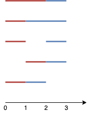

# 1621. 大小为 K 的不重叠线段的数目

Medium · 难度分 2198 · [力扣原题](https://leetcode.cn/problems/number-of-sets-of-k-non-overlapping-line-segments/)

所在刷题路径：灵神题单·数学算法

| 作者 | 题解 | 动画讲解 |
|---|---|---|
| 灵茶山艾府 | [📄 题解](灵茶山艾府.md) | [▶︎ 1621 大小为 K 的不重叠线段的数目 · 灵茶山艾府.mp4](1621%20大小为%20K%20的不重叠线段的数目%20·%20灵茶山艾府.mp4) |
| yiduobo | [📄 题解](yiduobo.md) | [▶︎ 1621 大小为 K 的不重叠线段的数目 · yiduobo.mp4](1621%20大小为%20K%20的不重叠线段的数目%20·%20yiduobo.mp4) |

## 题目描述

给你一维空间的 `n` 个点，其中第 `i` 个点（编号从 `0` 到 `n-1`）位于 `x = i` 处，请你找到 **恰好** `k` **个不重叠** 线段且每个线段至少覆盖两个点的方案数。线段的两个端点必须都是 **整数坐标** 。这 `k` 个线段不需要全部覆盖全部 `n` 个点，且它们的端点 **可以** 重合。

请你返回 `k` 个不重叠线段的方案数。由于答案可能很大，请将结果对 `10⁹ + 7` **取余** 后返回。

**示例 1：**



```

输入：n = 4, k = 2
输出：5
解释：
如图所示，两个线段分别用红色和蓝色标出。
上图展示了 5 种不同的方案 {(0,2),(2,3)}，{(0,1),(1,3)}，{(0,1),(2,3)}，{(1,2),(2,3)}，{(0,1),(1,2)} 。
```

**示例 2：**

```

输入：n = 3, k = 1
输出：3
解释：总共有 3 种不同的方案 {(0,1)}, {(0,2)}, {(1,2)} 。
```

**示例 3：**

```

输入：n = 30, k = 7
输出：796297179
解释：画 7 条线段的总方案数为 3796297200 种。将这个数对 10⁹ + 7 取余得到 796297179 。
```

**示例 4：**

```

输入：n = 5, k = 3
输出：7
```

**示例 5：**

```

输入：n = 3, k = 2
输出：1
```

**提示：**

- `2 <= n <= 1000`

- `1 <= k <= n-1`

---
[↑ 返回 1600-1699](../README.md) · [总索引](../../../索引.md) · [仓库首页](../../../README.md)
