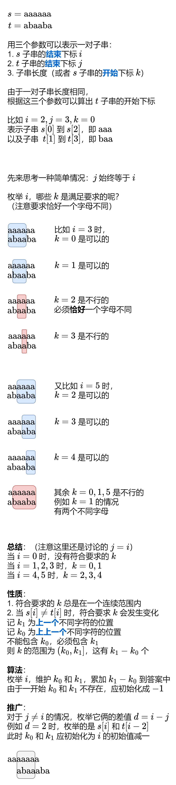

# 【图解】非暴力 O(nm) 算法（Python/Java/C++/Go）

> **[1638. 统计只差一个字符的子串数目](https://leetcode.cn/problems/count-substrings-that-differ-by-one-character/solutions/2192600/tu-jie-fei-bao-li-onm-suan-fa-pythonjava-k5og/) · Medium**

> **题目描述**
> 给你两个字符串 `s` 和 `t` ，请你找出 `s` 中的非空子串的数目，这些子串满足替换 **一个不同字符** 以后，是 `t` 串的子串。换言之，请你找到 `s` 和 `t` 串中 **恰好** 只有一个字符不同的子字符串对的数目。
>
> 比方说， `"computer"` and `"computation" `只有一个字符不同： `'e'`/`'a'` ，所以这一对子字符串会给答案加 1 。
>
> 请你返回满足上述条件的不同子字符串对数目。
>
> 一个 **子字符串** 是一个字符串中连续的字符。
>
> **示例 1：**
>
> ```
>
> 输入：s = "aba", t = "baba"
> 输出：6
> 解释：以下为只相差 1 个字符的 s 和 t 串的子字符串对：
> ("aba", "baba")
> ("aba", "baba")
> ("aba", "baba")
> ("aba", "baba")
> ("aba", "baba")
> ("aba", "baba")
> 加粗部分分别表示 s 和 t 串选出来的子字符串。
> ```
>
> **示例 2：**
>
> ```
>
> 输入：s = "ab", t = "bb"
> 输出：3
> 解释：以下为只相差 1 个字符的 s 和 t 串的子字符串对：
> ("ab", "bb")
> ("ab", "bb")
> ("ab", "bb")
> 加粗部分分别表示 s 和 t 串选出来的子字符串。
> ```
>
> **示例 3：**
>
> ```
>
> 输入：s = "a", t = "a"
> 输出：0
> ```
>
> **示例 4：**
>
> ```
>
> 输入：s = "abe", t = "bbc"
> 输出：10
> ```
>
> **提示：**
>
> - `1 <= s.length, t.length <= 100`
>
> - `s` 和 `t` 都只包含小写英文字母。

> **题解**
> 
>
> ### 思想总结
>
> 如果暴力枚举 $i,j,k$，这种 $\mathcal{O}(nm\cdot\min(n,m))$ 的立方复杂度做法也是可以通过本题的。
>
> 但注意到 $(i,j)$ 可以复用 $(i-1,j-1)$ 的计算结果（类比动态规划），就可以进一步减少计算量，从而降低时间复杂度。
>
> ```python
> class Solution:
>     def countSubstrings(self, s: str, t: str) -> int:
>         ans, n, m = 0, len(s), len(t)
>         for d in range(1 - m, n):  # d=i-j, j=i-d
>             i = max(d, 0)
>             k0 = k1 = i - 1
>             while i < n and i - d < m:
>                 if s[i] != t[i - d]:
>                     k0 = k1  # 上上一个不同
>                     k1 = i   # 上一个不同
>                 ans += k1 - k0
>                 i += 1
>         return ans
> ```
>
>
> ### 复杂度分析
>
> - 时间复杂度：$\mathcal{O}(nm)$，其中 $n$ 为 $s$ 的长度，$m$ 为 $t$ 的长度。$d$ 有 $\mathcal{O}(n+m)$ 个，每个 $d$ 需要花费 $\mathcal{O}(\min(n,m))$ 的时间枚举，所以总的时间复杂度为 $\mathcal{O}((n+m)\cdot\min(n,m))$。如果 $n>m$，则 $\mathcal{O}(n+m)=\mathcal{O}(n)$，$\mathcal{O}(\min(n,m))=\mathcal{O}(m)$，所以 $\mathcal{O}((n+m)\cdot\min(n,m))=\mathcal{O}(nm)$；对于 $n<m$ 同理。所以时间复杂度可以简化为 $\mathcal{O}(nm)$。
> - 空间复杂度：$\mathcal{O}(1)$。
>
> ### 相似题目
>
> - [795. 区间子数组个数](https://leetcode.cn/problems/number-of-subarrays-with-bounded-maximum/)，[题解](../../0700-0799/0795%20区间子数组个数/灵茶山艾府.md)
> - [2444. 统计定界子数组的数目](https://leetcode.cn/problems/count-subarrays-with-fixed-bounds/)，[题解](../../2400-2499/2444%20统计定界子数组的数目/灵茶山艾府.md)
>
> ## 分类题单
>
> [如何科学刷题？](https://leetcode.cn/circle/discuss/RvFUtj/)
>
> 1. [滑动窗口与双指针（定长/不定长/单序列/双序列/三指针/分组循环）](https://leetcode.cn/circle/discuss/0viNMK/)
> 2. [二分算法（二分答案/最小化最大值/最大化最小值/第K小）](https://leetcode.cn/circle/discuss/SqopEo/)
> 3. [单调栈（基础/矩形面积/贡献法/最小字典序）](https://leetcode.cn/circle/discuss/9oZFK9/)
> 4. [网格图（DFS/BFS/综合应用）](https://leetcode.cn/circle/discuss/YiXPXW/)
> 5. [位运算（基础/性质/拆位/试填/恒等式/思维）](https://leetcode.cn/circle/discuss/dHn9Vk/)
> 6. [图论算法（DFS/BFS/拓扑排序/基环树/最短路/最小生成树/网络流）](https://leetcode.cn/circle/discuss/01LUak/)
> 7. [动态规划（入门/背包/划分/状态机/区间/状压/数位/数据结构优化/树形/博弈/概率期望）](https://leetcode.cn/circle/discuss/tXLS3i/)
> 8. [常用数据结构（前缀和/差分/栈/队列/堆/字典树/并查集/树状数组/线段树）](https://leetcode.cn/circle/discuss/mOr1u6/)
> 9. [数学算法（数论/组合/概率期望/博弈/计算几何/随机算法）](https://leetcode.cn/circle/discuss/IYT3ss/)
> 10. [贪心与思维（基本贪心策略/反悔/区间/字典序/数学/思维/脑筋急转弯/构造）](https://leetcode.cn/circle/discuss/g6KTKL/)
> 11. [链表、二叉树与回溯（前后指针/快慢指针/DFS/BFS/直径/LCA/一般树）](https://leetcode.cn/circle/discuss/K0n2gO/)
> 12. [字符串（KMP/Z函数/Manacher/字符串哈希/AC自动机/后缀数组/子序列自动机）](https://leetcode.cn/circle/discuss/SJFwQI/)
>
> [我的题解精选（已分类）](https://github.com/EndlessCheng/codeforces-go/blob/master/leetcode/SOLUTIONS.md)
>
> 欢迎关注 [B站@灵茶山艾府](https://space.bilibili.com/206214)
