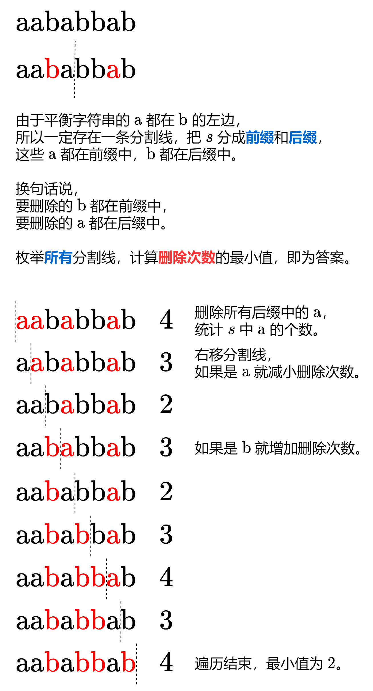

# 前后缀分解，一张图秒懂！（附动态规划）Python/Java/C++/Go

> **[1653. 使字符串平衡的最少删除次数](https://leetcode.cn/problems/minimum-deletions-to-make-string-balanced/solutions/2149746/qian-hou-zhui-fen-jie-yi-zhang-tu-miao-d-dor2/) · Medium · 难度分 1794**

> **所属题单**
> - [动态规划 · 专题：前后缀分解](../../../刷题路径/灵神原版题单/动态规划/专题：前后缀分解.md)

> **题目描述**
> 给你一个字符串 `s` ，它仅包含字符 `'a'` 和 `'b'`​​​​ 。
>
> 你可以删除 `s` 中任意数目的字符，使得 `s` **平衡** 。当不存在下标对 `(i,j)` 满足 `i < j` ，且 `s[i] = 'b'` 的同时 `s[j]= 'a'` ，此时认为 `s` 是 **平衡** 的。
>
> 请你返回使 `s` **平衡** 的 **最少** 删除次数。
>
> **示例 1：**
>
> ```
>
> 输入：s = "aababbab"
> 输出：2
> 解释：你可以选择以下任意一种方案：
> 下标从 0 开始，删除第 2 和第 6 个字符（"aababbab" -> "aaabbb"），
> 下标从 0 开始，删除第 3 和第 6 个字符（"aababbab" -> "aabbbb"）。
> ```
>
> **示例 2：**
>
> ```
>
> 输入：s = "bbaaaaabb"
> 输出：2
> 解释：唯一的最优解是删除最前面两个字符。
> ```
>
> **提示：**
>
> - `1 <= s.length <= 10⁵`
>
> - `s[i]` 要么是 `'a'` 要么是 `'b'`​ 。​

> **题解**
> ## 方法一：前后缀分解（两次遍历）
>
> 
>
> #### 答疑
>
> **问**：为什么把 `if-else` 写成 `(c - 'a') * 2 - 1` 会快很多？
>
> **答**：CPU 在遇到分支（条件跳转指令）时会预测代码要执行哪个分支，如果预测正确，CPU 就会继续按照预测的路径执行程序。但如果预测失败，CPU 就需要回滚之前的指令并加载正确的指令，以确保程序执行的正确性。
>
> 对于本题的数据，字符 $\text{`a'}$ 和 $\text{`b'}$ 可以认为是随机出现的，在这种情况下分支预测就会有 $50\%$ 的概率失败。失败导致的回滚和加载操作需要消耗额外的 CPU 周期，如果能用较小的代价去掉分支，对于本题的情况必然可以带来效率上的提升。
>
> > 注：这种优化方法会降低可读性，不建议在业务代码中使用。
>
> ```python
> class Solution:
>     def minimumDeletions(self, s: str) -> int:
>         ans = delete = s.count('a')
>         for c in s:
>             delete -= 1 if c == 'a' else -1
>             if delete < ans:  # 手动计算 min 会快很多
>                 ans = delete
>         return ans
> ```
>
>
> #### 复杂度分析
>
> - 时间复杂度：$\mathcal{O}(n)$，其中 $n$ 是 $s$ 的长度。
> - 空间复杂度：$\mathcal{O}(1)$。
>
> ## 方法二：动态规划（一次遍历）
>
> 如果你还不熟悉动态规划（包括空间优化），可以先看看 [动态规划入门](https://www.bilibili.com/video/BV1Xj411K7oF/)。
>
> 考虑 $s$ 的最后一个字母：
>
> - 如果它是 $\text{`b'}$，则无需删除，问题规模缩小，变成「使 $s$ 的前 $n-1$ 个字母平衡的最少删除次数」。
> - 如果它是 $\text{`a'}$：
>   - 删除它，则答案为「使 $s$ 的前 $n-1$ 个字母平衡的最少删除次数」加上 $1$。
>   - 保留它，那么前面的所有 $\text{`b'}$ 都要删除；
>
> 设 $\textit{cntB}$ 为前 $i$ 个字母中 $\text{`b'}$ 的个数。定义 $f[i]$ 表示使 $s$ 的前 $i$ 个字母平衡的最少删除次数：
>
> - 如果第 $i$ 个字母是 $\text{`b'}$，则 $f[i] = f[i-1]$；
> - 如果第 $i$ 个字母是 $\text{`a'}$，则 $f[i] = \min(f[i-1]+1,\textit{cntB})$。
>
> ```python
> class Solution:
>     def minimumDeletions(self, s: str) -> int:
>         f = cnt_b = 0
>         for c in s:
>             if c == 'b':
>                 cnt_b += 1  # f 值不变
>             else:
>                 f = min(f + 1, cnt_b)
>         return f
> ```
>
>
> 这份代码也可以像方法一那样去掉分支：
>
> - 如果第 $i$ 个字母是 $\text{`b'}$，则 $\textit{cntB}$ 增加 $1$，$f[i] = \min(f[i-1],\textit{cntB})$，这里也考虑全部删除 $\text{`b'}$；
> - 如果第 $i$ 个字母是 $\text{`a'}$，则 $\textit{cntB}$ 增加 $0$，$f[i] = \min(f[i-1]+1,\textit{cntB})$。
>
> 这两种情况可以合并成：
>
> 设当前字母为 $c$，$x=c-\text{`a'}$，则 $\textit{cntB}$ 增加 $x$，$f[i] = \min(f[i-1]+(x\oplus 1),\textit{cntB})$。其中 $\oplus$ 表示异或。
>
> ```python
> class Solution:
>     def minimumDeletions(self, s: str) -> int:
>         f = cnt_b = 0
>         for c in s:
>             x = ord(c) - ord('a')  # ord 很慢
>             cnt_b += x
>             f = min(f + (x ^ 1), cnt_b)
>         return f
> ```
>
>
> #### 复杂度分析
>
> - 时间复杂度：$\mathcal{O}(n)$，其中 $n$ 是 $s$ 的长度。
> - 空间复杂度：$\mathcal{O}(1)$。
>
> ## 专题训练
>
> 见下面动态规划题单的「**专题：前后缀分解**」。
>
> ## 分类题单
>
> [如何科学刷题？](https://leetcode.cn/circle/discuss/RvFUtj/)
>
> 1. [滑动窗口与双指针（定长/不定长/单序列/双序列/三指针/分组循环）](https://leetcode.cn/circle/discuss/0viNMK/)
> 2. [二分算法（二分答案/最小化最大值/最大化最小值/第K小）](https://leetcode.cn/circle/discuss/SqopEo/)
> 3. [单调栈（基础/矩形面积/贡献法/最小字典序）](https://leetcode.cn/circle/discuss/9oZFK9/)
> 4. [网格图（DFS/BFS/综合应用）](https://leetcode.cn/circle/discuss/YiXPXW/)
> 5. [位运算（基础/性质/拆位/试填/恒等式/思维）](https://leetcode.cn/circle/discuss/dHn9Vk/)
> 6. [图论算法（DFS/BFS/拓扑排序/基环树/最短路/最小生成树/网络流）](https://leetcode.cn/circle/discuss/01LUak/)
> 7. [动态规划（入门/背包/划分/状态机/区间/状压/数位/数据结构优化/树形/博弈/概率期望）](https://leetcode.cn/circle/discuss/tXLS3i/)
> 8. [常用数据结构（前缀和/差分/栈/队列/堆/字典树/并查集/树状数组/线段树）](https://leetcode.cn/circle/discuss/mOr1u6/)
> 9. [数学算法（数论/组合/概率期望/博弈/计算几何/随机算法）](https://leetcode.cn/circle/discuss/IYT3ss/)
> 10. [贪心与思维（基本贪心策略/反悔/区间/字典序/数学/思维/脑筋急转弯/构造）](https://leetcode.cn/circle/discuss/g6KTKL/)
> 11. [链表、树与回溯（前后指针/快慢指针/DFS/BFS/直径/LCA）](https://leetcode.cn/circle/discuss/K0n2gO/)
> 12. [字符串（KMP/Z函数/Manacher/字符串哈希/AC自动机/后缀数组/子序列自动机）](https://leetcode.cn/circle/discuss/SJFwQI/)
>
> [我的题解精选（已分类）](https://github.com/EndlessCheng/codeforces-go/blob/master/leetcode/SOLUTIONS.md)
>
> 欢迎关注 [B站@灵茶山艾府](https://space.bilibili.com/206214)
