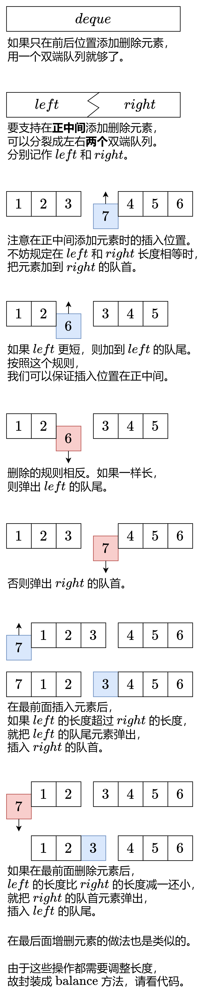

# 【图解】两个双端队列+简洁写法（Python/Java/C++/Go/Rust）

> **[1670. 设计前中后队列](https://leetcode.cn/problems/design-front-middle-back-queue/solutions/2544784/tu-jie-liang-ge-shuang-duan-dui-lie-jian-43pr/) · Medium · 难度分 1610**

> **所属题单**
> - [常用数据结构 · 四、队列](../../../刷题路径/灵神原版题单/常用数据结构/四、队列.md) · §4.2 设计

> **题目描述**
> 请你设计一个队列，支持在前，中，后三个位置的 `push` 和 `pop` 操作。
>
> 请你完成 `FrontMiddleBack` 类：
>
> - `FrontMiddleBack()` 初始化队列。
>
> - `void pushFront(int val)` 将 `val` 添加到队列的 **最前面** 。
>
> - `void pushMiddle(int val)` 将 `val` 添加到队列的 **正中间** 。
>
> - `void pushBack(int val)` 将 `val` 添加到队里的 **最后面** 。
>
> - `int popFront()` 将 **最前面** 的元素从队列中删除并返回值，如果删除之前队列为空，那么返回 `-1` 。
>
> - `int popMiddle()` 将 **正中间** 的元素从队列中删除并返回值，如果删除之前队列为空，那么返回 `-1` 。
>
> - `int popBack()` 将 **最后面** 的元素从队列中删除并返回值，如果删除之前队列为空，那么返回 `-1` 。
>
> 请注意当有 **两个** 中间位置的时候，选择靠前面的位置进行操作。比方说：
>
> - 将 `6` 添加到 `[1, 2, 3, 4, 5]` 的中间位置，结果数组为 `[1, 2, 6, 3, 4, 5]` 。
>
> - 从 `[1, 2, 3, 4, 5, 6]` 的中间位置弹出元素，返回 `3` ，数组变为 `[1, 2, 4, 5, 6]` 。
>
> **示例 1：**
>
> ```
>
> 输入：
> ["FrontMiddleBackQueue", "pushFront", "pushBack", "pushMiddle", "pushMiddle", "popFront", "popMiddle", "popMiddle", "popBack", "popFront"]
> [[], [1], [2], [3], [4], [], [], [], [], []]
> 输出：
> [null, null, null, null, null, 1, 3, 4, 2, -1]
>
> 解释：
> FrontMiddleBackQueue q = new FrontMiddleBackQueue();
> q.pushFront(1);   // [1]
> q.pushBack(2);    // [1, 2]
> q.pushMiddle(3);  // [1, 3, 2]
> q.pushMiddle(4);  // [1, 4, 3, 2]
> q.popFront();     // 返回 1 -> [4, 3, 2]
> q.popMiddle();    // 返回 3 -> [4, 2]
> q.popMiddle();    // 返回 4 -> [2]
> q.popBack();      // 返回 2 -> []
> q.popFront();     // 返回 -1 -> [] （队列为空）
> ```
>
> **提示：**
>
> - `1 <= val <= 10⁹`
>
> - 最多调用 `1000` 次 `pushFront`， `pushMiddle`， `pushBack`， `popFront`， `popMiddle` 和 `popBack` 。

> **题解**
> {:width=500}
>
> ```python
> class FrontMiddleBackQueue:
>     __slots__ = 'left', 'right'
>
>     def __init__(self):
>         self.left = deque()
>         self.right = deque()
>
>     # 调整长度，保证 0 <= len(right) - len(left) <= 1
>     # 从而保证可以在正中间插入删除元素
>     def balance(self):
>         if len(self.left) > len(self.right):
>             self.right.appendleft(self.left.pop())
>         elif len(self.right) > len(self.left) + 1:
>             self.left.append(self.right.popleft())
>
>     def pushFront(self, val: int) -> None:
>         self.left.appendleft(val)
>         self.balance()
>
>     def pushMiddle(self, val: int) -> None:
>         if len(self.left) < len(self.right):
>             self.left.append(val)
>         else:
>             self.right.appendleft(val)
>
>     def pushBack(self, val: int) -> None:
>         self.right.append(val)
>         self.balance()
>
>     def popFront(self) -> int:
>         if not self.right:  # 整个队列为空
>             return -1
>         val = self.left.popleft() if self.left else self.right.popleft()
>         self.balance()
>         return val
>
>     def popMiddle(self) -> int:
>         if not self.right:  # 整个队列为空
>             return -1
>         if len(self.left) == len(self.right):
>             return self.left.pop()
>         return self.right.popleft()
>
>     def popBack(self) -> int:
>         if not self.right:  # 整个队列为空
>             return -1
>         val = self.right.pop()
>         self.balance()
>         return val
> ```
>
>
> #### 复杂度分析
>
> - 时间复杂度：所有操作均为 $\mathcal{O}(1)$。
> - 空间复杂度：$\mathcal{O}(q)$，其中 $q$ 为操作次数。
>
> ## 分类题单
>
> [如何科学刷题？](https://leetcode.cn/circle/discuss/RvFUtj/)
>
> 1. [滑动窗口与双指针（定长/不定长/单序列/双序列/三指针）](https://leetcode.cn/circle/discuss/0viNMK/)
> 2. [二分算法（二分答案/最小化最大值/最大化最小值/第K小）](https://leetcode.cn/circle/discuss/SqopEo/)
> 3. [单调栈（基础/矩形面积/贡献法/最小字典序）](https://leetcode.cn/circle/discuss/9oZFK9/)
> 4. [网格图（DFS/BFS/综合应用）](https://leetcode.cn/circle/discuss/YiXPXW/)
> 5. [位运算（基础/性质/拆位/试填/恒等式/思维）](https://leetcode.cn/circle/discuss/dHn9Vk/)
> 6. [图论算法（DFS/BFS/拓扑排序/最短路/最小生成树/二分图/基环树/欧拉路径）](https://leetcode.cn/circle/discuss/01LUak/)
> 7. [动态规划（入门/背包/状态机/划分/区间/状压/数位/数据结构优化/树形/博弈/概率期望）](https://leetcode.cn/circle/discuss/tXLS3i/)
> 8. [常用数据结构（前缀和/差分/栈/队列/堆/字典树/并查集/树状数组/线段树）](https://leetcode.cn/circle/discuss/mOr1u6/)
> 9. [数学算法（数论/组合/概率期望/博弈/计算几何/随机算法）](https://leetcode.cn/circle/discuss/IYT3ss/)
> 10. [贪心与思维（基本贪心策略/反悔/区间/字典序/数学/思维/脑筋急转弯/构造）](https://leetcode.cn/circle/discuss/g6KTKL/)
> 11. [链表、二叉树与一般树（前后指针/快慢指针/DFS/BFS/直径/LCA）](https://leetcode.cn/circle/discuss/K0n2gO/)
> 12. [字符串（KMP/Z函数/Manacher/字符串哈希/AC自动机/后缀数组/子序列自动机）](https://leetcode.cn/circle/discuss/SJFwQI/)
>
> [我的题解精选（已分类）](https://github.com/EndlessCheng/codeforces-go/blob/master/leetcode/SOLUTIONS.md)
>
> 欢迎关注 [B站@灵茶山艾府](https://space.bilibili.com/206214)
