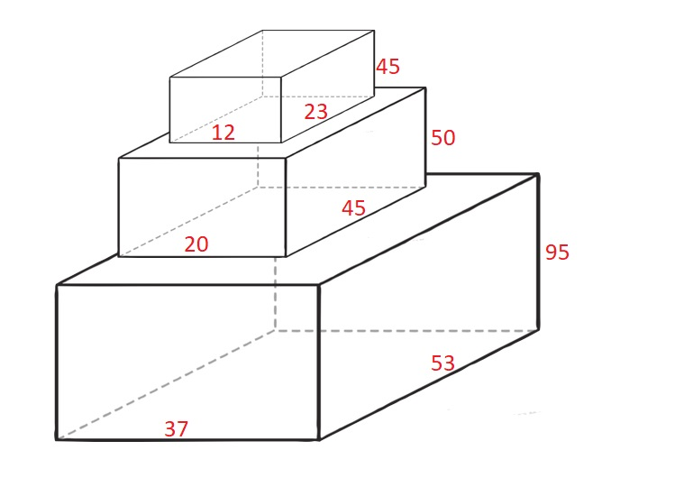
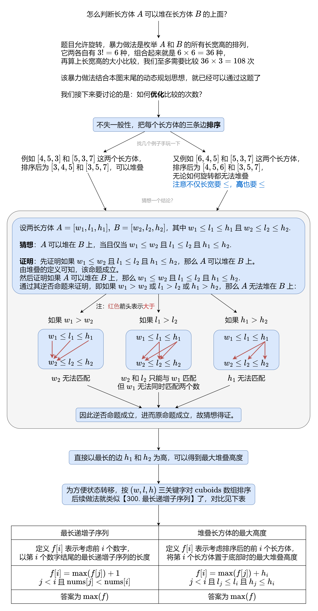

# 【图解】算法优化+详细证明（Python/Java/C++/Go）

> **[1691. 堆叠长方体的最大高度](https://leetcode.cn/problems/maximum-height-by-stacking-cuboids/solutions/2014514/tu-jie-suan-fa-you-hua-xiang-xi-zheng-mi-b6fq/) · Hard · 难度分 2172**

> **所属题单**
> - [动态规划 · 四、经典线性 DP](../../../刷题路径/灵神原版题单/动态规划/四、经典线性%20DP.md) · §4.2 最长递增子序列（LIS） · §4.2.2 进阶

> **题目描述**
> 给你 `n` 个长方体 `cuboids` ，其中第 `i` 个长方体的长宽高表示为 `cuboids[i] = [width_i, length_i, height_i]`（**下标从 0 开始**）。请你从 `cuboids` 选出一个 **子集** ，并将它们堆叠起来。
>
> 如果 `width_i <= width_j` 且 `length_i <= length_j` 且 `height_i <= height_j` ，你就可以将长方体 `i` 堆叠在长方体 `j` 上。你可以通过旋转把长方体的长宽高重新排列，以将它放在另一个长方体上。
>
> 返回 **堆叠长方体** `cuboids` 可以得到的 **最大高度** 。
>
> **示例 1：**
>
> 
>
> ```
>
> 输入：cuboids = [[50,45,20],[95,37,53],[45,23,12]]
> 输出：190
> 解释：
> 第 1 个长方体放在底部，53x37 的一面朝下，高度为 95 。
> 第 0 个长方体放在中间，45x20 的一面朝下，高度为 50 。
> 第 2 个长方体放在上面，23x12 的一面朝下，高度为 45 。
> 总高度是 95 + 50 + 45 = 190 。
> ```
>
> **示例 2：**
>
> ```
>
> 输入：cuboids = [[38,25,45],[76,35,3]]
> 输出：76
> 解释：
> 无法将任何长方体放在另一个上面。
> 选择第 1 个长方体然后旋转它，使 35x3 的一面朝下，其高度为 76 。
> ```
>
> **示例 3：**
>
> ```
>
> 输入：cuboids = [[7,11,17],[7,17,11],[11,7,17],[11,17,7],[17,7,11],[17,11,7]]
> 输出：102
> 解释：
> 重新排列长方体后，可以看到所有长方体的尺寸都相同。
> 你可以把 11x7 的一面朝下，这样它们的高度就是 17 。
> 堆叠长方体的最大高度为 6 * 17 = 102 。
> ```
>
> **提示：**
>
> - `n == cuboids.length`
>
> - `1 <= n <= 100`
>
> - `1 <= width_i, length_i, height_i <= 100`

> **题解**
> 
>
> #### 答疑
>
> **问**：为什么要对 $\textit{cuboids}$ 排序？
>
> **答**：排序后，答案对应的长方体子序列可直接按照从左到右的顺序堆叠，从而保证了状态转移的正确性，即计算 $f[i]$ 时，可按照 $i$ 从小到大的顺序计算，且只用考虑 $j<i$ 的状态转移来源 $f[j]$。如果不排序，则无法保证这些。
>
> **问**：为什么当 $A$ 可以堆在 $B$ 上时，可以直接把最长的边作为高？
>
> **答**：我可以换一个角度来解释。把长方体看成盒子，把 $A$ **装进** $B$ 中（三条边短对短，中对中，长对长）。由于无论 $B$ 怎么旋转，$A$ 始终在 $B$ 中，那么直接把 $B$ 按照最长的边竖着放置，$A$ 也会按照最长的边竖着放置。
>
> **问**：是否有时间复杂度比 $O(n^2)$ 更低的做法？
>
> **答**：可以用动态开点二维线段树做到 $O(n\log^2 n)$。
>
> ```python
> class Solution:
>     def maxHeight(self, cuboids: List[List[int]]) -> int:
>         for c in cuboids:
>             c.sort()
>         cuboids.sort()
>         f = [0] * len(cuboids)
>         for i, (_, l2, h2) in enumerate(cuboids):
>             for j, (_, l1, h1) in enumerate(cuboids[:i]):
>                 if l1 <= l2 and h1 <= h2:  # 排序后，w1 <= w2 恒成立
>                     f[i] = max(f[i], f[j])  # cuboids[j] 可以堆在 cuboids[i] 上
>             f[i] += h2
>         return max(f)
> ```
>
>
> #### 复杂度分析
>
> - 时间复杂度：$O(n^2)$，其中 $n$ 为 $\textit{cuboids}$ 的长度。
> - 空间复杂度：$O(n)$。
>
> #### 相似题目
>
> - [300. 最长递增子序列](https://leetcode.cn/problems/longest-increasing-subsequence/)
> - [354. 俄罗斯套娃信封问题](https://leetcode.cn/problems/russian-doll-envelopes/)
>
> 如果想加深对 LIS 的理解，还可以做做 [2407. 最长递增子序列 II](https://leetcode.cn/problems/longest-increasing-subsequence-ii/)。
>
> ---
>
> 欢迎关注 [B站@灵茶山艾府](https://space.bilibili.com/206214)，最近正在连载 [【基础算法精讲】](https://www.bilibili.com/video/BV1AP41137w7/)，欢迎点赞~
