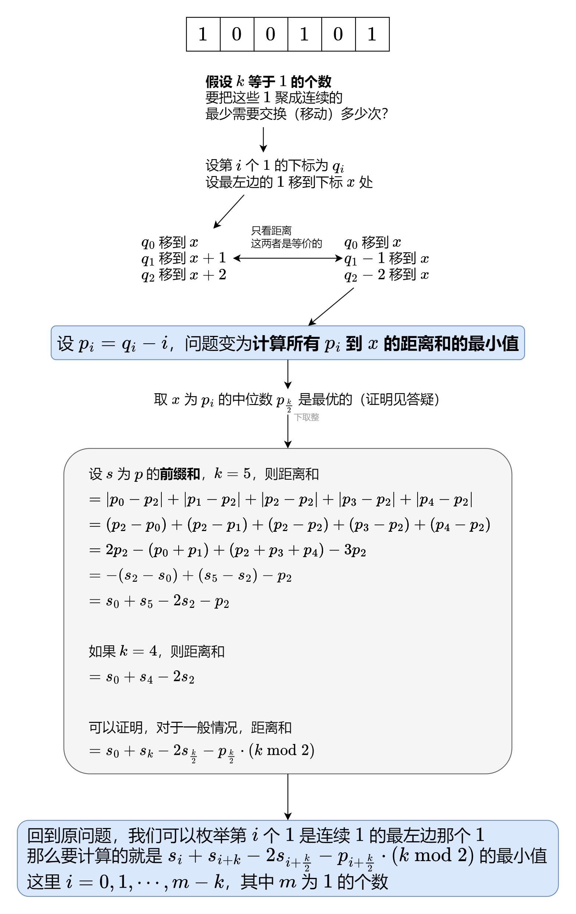

# 【图解】转换成中位数贪心+空间优化（Python/Java/C++/Go）

> **[1703. 得到连续 K 个 1 的最少相邻交换次数](https://leetcode.cn/problems/minimum-adjacent-swaps-for-k-consecutive-ones/solutions/2024387/tu-jie-zhuan-huan-cheng-zhong-wei-shu-ta-iz4v/) · Hard · 难度分 2467**

> **所属题单**
> - [常用数据结构 · 一、前缀和](../../../刷题路径/灵神原版题单/常用数据结构/一、前缀和.md) · §1.3 距离和
> - [贪心算法 · 四、数学贪心](../../../刷题路径/灵神原版题单/贪心算法/四、数学贪心.md) · §4.5 中位数贪心

> **题目描述**
> 给你一个整数数组 `nums` 和一个整数 `k` 。 `nums` 仅包含 `0` 和 `1` 。每一次移动，你可以选择 **相邻** 两个数字并将它们交换。
>
> 请你返回使 `nums` 中包含 `k` 个 **连续** `1` 的 **最少** 交换次数。
>
> **示例 1：**
>
> ```
> 输入：nums = [1,0,0,1,0,1], k = 2
> 输出：1
> 解释：在第一次操作时，nums 可以变成 [1,0,0,0,1,1] 得到连续两个 1 。
> ```
>
> **示例 2：**
>
> ```
> 输入：nums = [1,0,0,0,0,0,1,1], k = 3
> 输出：5
> 解释：通过 5 次操作，最左边的 1 可以移到右边直到 nums 变为 [0,0,0,0,0,1,1,1] 。
> ```
>
> **示例 3：**
>
> ```
> 输入：nums = [1,1,0,1], k = 2
> 输出：0
> 解释：nums 已经有连续 2 个 1 了。
> ```
>
> **提示：**
>
> - `1 <= nums.length <= 10⁵`
>
> - `nums[i]` 要么是 `0` ，要么是 `1` 。
>
> - `1 <= k <= sum(nums)`

> **题解**
> 
>
> #### 算法小课堂：前缀和
>
> 定义前缀和 $s[0]=0$，$s[i+1] = \sum\limits_{j=0}^{i}p[j]$。
>
> 例如 $p=[2,3,3,5]$，对应的前缀和数组为 $s=[0, 2, 5, 8, 13]$。
>
> 通过前缀和，我们可以把**子数组的和转换成两个前缀和的差**，即
>
> $$
> \sum_{j=\textit{left}}^{\textit{right}}p[j] = \sum\limits_{j=0}^{\textit{right}}p[j] - \sum\limits_{j=0}^{\textit{left}-1}p[j] = s[\textit{right}+1] - s[\textit{left}]
> $$
>
> 例如 $p$ 的子数组 $[3,3,5]$ 的和就可以用 $s[4]-s[1]=13-2=11$ 算出来。
>
> > 注：为方便计算，常用左闭右开区间 $[\textit{left},\textit{right})$ 来表示子数组，此时子数组的和为 $s[\textit{right}]-s[\textit{left}]$。
>
> #### 答疑
>
> **问**：为什么图中的 $x$ 取在中位数上是最优的？
>
> **答**：首先，如果 $x$ 取在区间 $[p[0],p[k-1]]$ 之外，那么 $x$ 向区间方向移动可以使距离和变小；同时，如果 $x$ 取在区间 $[p[0],p[k-1]]$ 之内，无论如何移动 $x$，它到 $p[0]$ 和 $p[k-1]$ 的距离和都是一个定值 $p[k-1]-p[0]$，那么去掉 $p[0]$ 和 $p[k-1]$ 这两个最左最右的数，问题规模缩小。不断缩小问题规模，如果最后剩下 $1$ 个数，那么 $x$ 就取它；如果最后剩下 $2$ 个数，那么 $x$ 取这两个数之间的任意值都可以（包括这两个数）。因此中位数可以取 $p[k/2]$。
>
> ```python
> class Solution:
>     def minMoves(self, nums: List[int], k: int) -> int:
>         p = [q - i for i, q in enumerate(i for i, x in enumerate(nums) if x)]
>         s = list(accumulate(p, initial=0))  # p 的前缀和
>         return min(s[i] + s[i + k] - s[i + k // 2] * 2 - p[i + k // 2] * (k % 2)
>                    for i in range(len(p) - k + 1))  # p[i:i+k] 中所有数到 p[i+k//2] 的距离之和，取最小值
> ```
>
>
> #### 优化
>
> 在遍历 $\textit{nums}$ 的同时，把 $p$ 直接存到 $\textit{nums}$ 中，并累加计算 $s[i],s[i+k/2],s[i+k]$，这样可以做到 $O(1)$ 额外空间。
>
> > 注：还可以用三指针在不修改 $\textit{nums}$ 的情况下做到 $O(1)$ 额外空间，感兴趣的读者可以试试。
>
> ```python
> class Solution:
>     def minMoves(self, nums: List[int], k: int) -> int:
>         m = 0
>         for i, p in enumerate(i for i, x in enumerate(nums) if x):
>             nums[i] = p - i
>             m += 1
>         if m == len(nums): return 0  # 全部都是 1
>         ans, p = inf, nums
>         sl, sm, sr = 0, sum(p[:k // 2]), sum(p[:k])  # s[i] s[i+k//2] s[i+k] 忽略切片开销
>         for i in range(m - k + 1):
>             ans = min(ans, sl + sr - sm * 2 - p[i + k // 2] * (k % 2))
>             sl += p[i]
>             sm += p[i + k // 2]
>             sr += p[i + k]
>         return ans
> ```
>
>
> #### 复杂度分析
>
> - 时间复杂度：$O(n)$，其中 $n$ 为 $\textit{nums}$ 的长度。
> - 空间复杂度：$O(1)$，仅用到若干额外变量。
>
> #### 相似题目（中位数贪心）
>
> - [462. 最小操作次数使数组元素相等 II](https://leetcode.cn/problems/minimum-moves-to-equal-array-elements-ii/)
> - [2033. 获取单值网格的最小操作数](https://leetcode.cn/problems/minimum-operations-to-make-a-uni-value-grid/)
> - [2448. 使数组相等的最小开销](https://leetcode.cn/problems/minimum-cost-to-make-array-equal/)
>
> ---
>
> 欢迎关注 [B站@灵茶山艾府](https://space.bilibili.com/206214)，最近正在连载 [【基础算法精讲】](https://www.bilibili.com/video/BV1AP41137w7/)，欢迎点赞~
