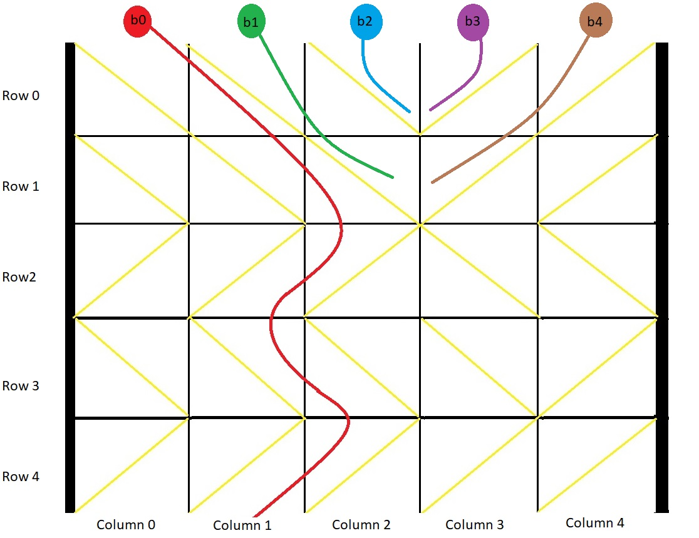

# 模拟每列球的移动（Python/Java/C++/C/Go/JS/Rust）

> **[1706. 球会落何处](https://leetcode.cn/problems/where-will-the-ball-fall/solutions/3075235/mo-ni-mei-lie-qiu-de-yi-dong-pythonjavac-qhbo/) · Medium**

> **题目描述**
> 用一个大小为 `m x n` 的二维网格 `grid` 表示一个箱子。你有 `n` 颗球。箱子的顶部和底部都是开着的。
>
> 箱子中的每个单元格都有一个对角线挡板，跨过单元格的两个角，可以将球导向左侧或者右侧。
>
> - 将球导向右侧的挡板跨过左上角和右下角，在网格中用 `1` 表示。
>
> - 将球导向左侧的挡板跨过右上角和左下角，在网格中用 `-1` 表示。
>
> 在箱子每一列的顶端各放一颗球。每颗球都可能卡在箱子里或从底部掉出来。如果球恰好卡在两块挡板之间的 "V" 形图案，或者被一块挡导向到箱子的任意一侧边上，就会卡住。
>
> 返回一个大小为 `n` 的数组 `answer` ，其中 `answer[i]` 是球放在顶部的第 `i` 列后从底部掉出来的那一列对应的下标，如果球卡在盒子里，则返回 `-1` 。
>
> **示例 1：**
>
> 
>
> ```
>
> 输入：grid = [[1,1,1,-1,-1],[1,1,1,-1,-1],[-1,-1,-1,1,1],[1,1,1,1,-1],[-1,-1,-1,-1,-1]]
> 输出：[1,-1,-1,-1,-1]
> 解释：示例如图：
> b0 球开始放在第 0 列上，最终从箱子底部第 1 列掉出。
> b1 球开始放在第 1 列上，会卡在第 2、3 列和第 1 行之间的 "V" 形里。
> b2 球开始放在第 2 列上，会卡在第 2、3 列和第 0 行之间的 "V" 形里。
> b3 球开始放在第 3 列上，会卡在第 2、3 列和第 0 行之间的 "V" 形里。
> b4 球开始放在第 4 列上，会卡在第 2、3 列和第 1 行之间的 "V" 形里。
> ```
>
> **示例 2：**
>
> ```
>
> 输入：grid = [[-1]]
> 输出：[-1]
> 解释：球被卡在箱子左侧边上。
> ```
>
> **示例 3：**
>
> ```
>
> 输入：grid = [[1,1,1,1,1,1],[-1,-1,-1,-1,-1,-1],[1,1,1,1,1,1],[-1,-1,-1,-1,-1,-1]]
> 输出：[0,1,2,3,4,-1]
> ```
>
> **提示：**
>
> - `m == grid.length`
>
> - `n == grid[i].length`
>
> - `1 <= m, n <= 100`
>
> - `grid[i][j]` 为 `1` 或 `-1`

> **题解**
> 
>
> 在示例图中，球是斜着移动的，不好分析。为了方便分析，我们把球的斜向移动，拆分成水平和垂直的移动。
>
> 假设球在第 $r$ 行第 $c$ 列：
>
> - 如果 $\textit{grid}[r][c] = -1$，球会先向左移动一步。
> - 如果 $\textit{grid}[r][c] = 1$，球会先向右移动一步。
> - 如果移动一步后，球没有卡住，那么球会垂直落入下一排。否则退出循环。
>
> 什么情况下会卡住？
>
> - 水平移动一步后，球出界了。
> - 卡在 $\text{V}$ 形，即 $-1$ 的左边是 $1$，$1$ 的右边是 $-1$。这意味着球水平移动一步后，遇到的 $\textit{grid}[r][c]$ 值与移动前不同。
>
> 如果球在移动过程中没有卡住（没有中途退出循环），那么记录循环结束后球的列号。否则记录 $-1$。
>
> ```python
> class Solution:
>     def findBall(self, grid: List[List[int]]) -> List[int]:
>         n = len(grid[0])
>         ans = [-1] * n
>         for j in range(n):
>             # 模拟第 j 列球的移动
>             cur_col = j  # 当前列号
>             for row in grid:
>                 d = row[cur_col]  # -1 或 1，表示左/右
>                 cur_col += d  # 左/右走一步
>                 # 如果球出界或者卡在 V 形，退出循环，否则继续循环（垂直落入下一排）
>                 # V 形就是 -1 的左边是 1，1 的右边是 -1，即 row[cur_col] != d
>                 if cur_col < 0 or cur_col == n or row[cur_col] != d:
>                     break
>             else:  # 没有中途 break，说明球成功到达底部
>                 ans[j] = cur_col
>         return ans
> ```
>
>
> #### 复杂度分析
>
> - 时间复杂度：$\mathcal{O}(mn)$，其中 $m$ 和 $n$ 分别为 $\textit{grid}$ 的行数和列数。有 $n$ 个球，每个球需要 $\mathcal{O}(m)$ 的时间模拟。
> - 空间复杂度：$\mathcal{O}(1)$。返回值不计入。
>
> ## 分类题单
>
> [如何科学刷题？](https://leetcode.cn/circle/discuss/RvFUtj/)
>
> 1. [滑动窗口与双指针（定长/不定长/单序列/双序列/三指针/分组循环）](https://leetcode.cn/circle/discuss/0viNMK/)
> 2. [二分算法（二分答案/最小化最大值/最大化最小值/第K小）](https://leetcode.cn/circle/discuss/SqopEo/)
> 3. [单调栈（基础/矩形面积/贡献法/最小字典序）](https://leetcode.cn/circle/discuss/9oZFK9/)
> 4. [网格图（DFS/BFS/综合应用）](https://leetcode.cn/circle/discuss/YiXPXW/)
> 5. [位运算（基础/性质/拆位/试填/恒等式/思维）](https://leetcode.cn/circle/discuss/dHn9Vk/)
> 6. [图论算法（DFS/BFS/拓扑排序/最短路/最小生成树/二分图/基环树/欧拉路径）](https://leetcode.cn/circle/discuss/01LUak/)
> 7. [动态规划（入门/背包/状态机/划分/区间/状压/数位/数据结构优化/树形/博弈/概率期望）](https://leetcode.cn/circle/discuss/tXLS3i/)
> 8. [常用数据结构（前缀和/差分/栈/队列/堆/字典树/并查集/树状数组/线段树）](https://leetcode.cn/circle/discuss/mOr1u6/)
> 9. [数学算法（数论/组合/概率期望/博弈/计算几何/随机算法）](https://leetcode.cn/circle/discuss/IYT3ss/)
> 10. [贪心与思维（基本贪心策略/反悔/区间/字典序/数学/思维/脑筋急转弯/构造）](https://leetcode.cn/circle/discuss/g6KTKL/)
> 11. [链表、二叉树与回溯（前后指针/快慢指针/DFS/BFS/直径/LCA/一般树）](https://leetcode.cn/circle/discuss/K0n2gO/)
> 12. [字符串（KMP/Z函数/Manacher/字符串哈希/AC自动机/后缀数组/子序列自动机）](https://leetcode.cn/circle/discuss/SJFwQI/)
>
> [我的题解精选（已分类）](https://github.com/EndlessCheng/codeforces-go/blob/master/leetcode/SOLUTIONS.md)
>
> 欢迎关注 [B站@灵茶山艾府](https://space.bilibili.com/206214)
