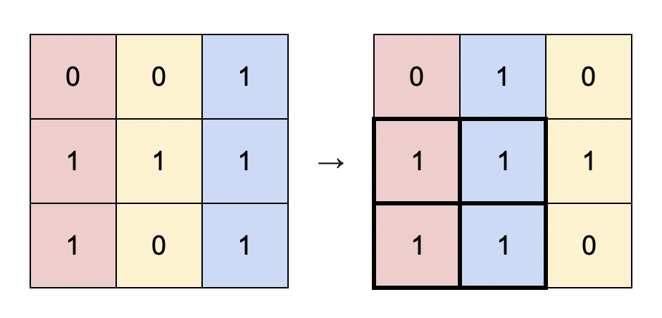
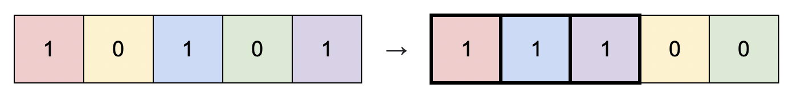

# 1727. 重新排列后的最大子矩阵

Medium · 难度分 1927 · [力扣原题](https://leetcode.cn/problems/largest-submatrix-with-rearrangements/)

所在刷题路径：灵神题单·单调栈、灵神题单·贪心与思维

| 作者 | 题解 | 动画讲解 |
|---|---|---|
| 灵茶山艾府 | [📄 题解](灵茶山艾府.md) | [▶︎ 动画（GIF）](1727%20重新排列后的最大子矩阵%20·%20灵茶山艾府.gif) · [mp4 文件](1727%20重新排列后的最大子矩阵%20·%20灵茶山艾府.mp4) |
| yiduobo | [📄 题解](yiduobo.md) | [▶︎ 动画（GIF）](1727%20重新排列后的最大子矩阵%20·%20yiduobo.gif) · [mp4 文件](1727%20重新排列后的最大子矩阵%20·%20yiduobo.mp4) |

## 动画讲解

> 动图会循环播放；想暂停、拖进度条请下载上面表格里的 mp4 文件。

### 灵茶山艾府


### yiduobo


## 题目描述

给你一个二进制矩阵 `matrix` ，它的大小为 `m x n` ，你可以将 `matrix` 中的 **列** 按任意顺序重新排列。

请你返回最优方案下将 `matrix` 重新排列后，全是 `1` 的最大子矩阵面积。

**示例 1：**



```

输入：matrix = [[0,0,1],[1,1,1],[1,0,1]]
输出：4
解释：你可以按照上图方式重新排列矩阵的每一列。
最大的全 1 子矩阵是上图中加粗的部分，面积为 4 。
```

**示例 2：**



```

输入：matrix = [[1,0,1,0,1]]
输出：3
解释：你可以按照上图方式重新排列矩阵的每一列。
最大的全 1 子矩阵是上图中加粗的部分，面积为 3 。
```

**示例 3：**

```

输入：matrix = [[1,1,0],[1,0,1]]
输出：2
解释：由于你只能整列整列重新排布，所以没有比面积为 2 更大的全 1 子矩形。
```

**示例 4：**

```

输入：matrix = [[0,0],[0,0]]
输出：0
解释：由于矩阵中没有 1 ，没有任何全 1 的子矩阵，所以面积为 0 。
```

**提示：**

- `m == matrix.length`

- `n == matrix[i].length`

- `1 <= m * n <= 10⁵`

- `matrix[i][j]` 要么是 `0` ，要么是 `1` 。

---
[↑ 返回 1700-1799](../README.md) · [总索引](../../../索引.md) · [仓库首页](../../../README.md)
