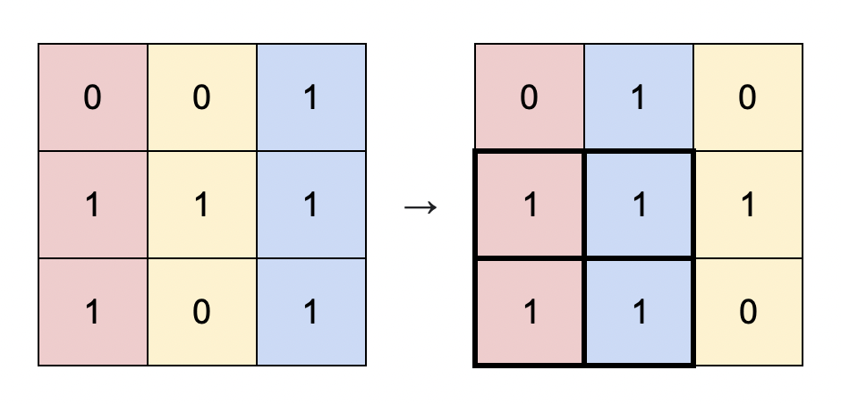

# 枚举子矩形的底边 + O(mn) 优化（Python/Java/C++/Go）

> **[1727. 重新排列后的最大子矩阵](https://leetcode.cn/problems/largest-submatrix-with-rearrangements/solutions/3920921/mei-ju-zi-ju-xing-de-di-bian-omn-you-hua-dfy3/) · Medium · 难度分 1927**

> **所属题单**
> - [单调栈 · 二、矩形](../../../刷题路径/灵神原版题单/单调栈/二、矩形.md)
> - [贪心算法 · 一、贪心策略](../../../刷题路径/灵神原版题单/贪心算法/一、贪心策略.md) · §1.6 先枚举，再贪心

> **题目描述**
> 给你一个二进制矩阵 `matrix` ，它的大小为 `m x n` ，你可以将 `matrix` 中的 **列** 按任意顺序重新排列。
>
> 请你返回最优方案下将 `matrix` 重新排列后，全是 `1` 的最大子矩阵面积。
>
> **示例 1：**
>
> 
>
> ```
>
> 输入：matrix = [[0,0,1],[1,1,1],[1,0,1]]
> 输出：4
> 解释：你可以按照上图方式重新排列矩阵的每一列。
> 最大的全 1 子矩阵是上图中加粗的部分，面积为 4 。
> ```
>
> **示例 2：**
>
> 
>
> ```
>
> 输入：matrix = [[1,0,1,0,1]]
> 输出：3
> 解释：你可以按照上图方式重新排列矩阵的每一列。
> 最大的全 1 子矩阵是上图中加粗的部分，面积为 3 。
> ```
>
> **示例 3：**
>
> ```
>
> 输入：matrix = [[1,1,0],[1,0,1]]
> 输出：2
> 解释：由于你只能整列整列重新排布，所以没有比面积为 2 更大的全 1 子矩形。
> ```
>
> **示例 4：**
>
> ```
>
> 输入：matrix = [[0,0],[0,0]]
> 输出：0
> 解释：由于矩阵中没有 1 ，没有任何全 1 的子矩阵，所以面积为 0 。
> ```
>
> **提示：**
>
> - `m == matrix.length`
>
> - `n == matrix[i].length`
>
> - `1 <= m * n <= 10⁵`
>
> - `matrix[i][j]` 要么是 `0` ，要么是 `1` 。

> **题解**
> 做法类似 [85. 最大矩形](https://leetcode.cn/problems/maximal-rectangle/)，枚举子矩形的底边（最后一行），定义 $\textit{heights}[j]$ 表示从 $\textit{matrix}[i][j]$ 往上有多少个连续的 $1$（柱子的高度），问题变成：
>
> - 你可以重排 $\textit{heights}$。重排后，对于 $\textit{heights}$ 的连续子数组，子数组长度（矩形底边长）$\times$ 子数组最小值（矩形的高），即为全 $1$ 子矩形的面积。
>
> 对于示例 1，以第三行为底边算出来的 $\textit{heights} = [2,0,3]$，下图重排后是 $[2,3,0]$。其中子数组 $[2,3]$，长为 $2$，最小值为 $2$，所以对应的子矩形面积为 $2\times 2 = 4$。
>
> {:width=430px}
>
> 如何找到面积最大的子矩形？还是枚举。
>
> 枚举子数组的长度 $k = 1,2,\ldots,n$。由于我们可以重排 $\textit{heights}$，那么贪心地，把 $\textit{heights}$ 最大的 $k$ 个数排在一起，就可以让子数组的最小值（矩形的高）尽量大，从而得到最大的矩形面积。
>
> 对于 $\textit{heights}$ 的计算，如果 $\textit{matrix}[i][j]=0$，那么 $\textit{heights}[j] = 0$。否则，把高度增加 $1$。形象地说，就是在柱子下面垫一块石头，把柱子抬高。
>
> ## 优化前
>
> ```python
> class Solution:
>     def largestSubmatrix(self, matrix: List[List[int]]) -> int:
>         n = len(matrix[0])
>         heights = [0] * n
>         ans = 0
>
>         for row in matrix:  # 枚举子矩形的底边
>             for j, x in enumerate(row):
>                 if x == 0:
>                     heights[j] = 0
>                 else:
>                     heights[j] += 1
>
>             hs = sorted(heights)  # 复制一份 heights 再排序
>             for i, h in enumerate(hs):  # 把 hs[i:] 作为子数组
>                 # 子数组长为 n-i，最小值为 h，对应的子矩形面积为 (n-i)*h
>                 ans = max(ans, (n - i) * h)  
>
>         return ans
> ```
>
>
> #### 复杂度分析
>
> - 时间复杂度：$\mathcal{O}(mn\log n)$，其中 $m$ 和 $n$ 分别是 $\textit{matrix}$ 的行数和列数。瓶颈在排序上，有 $m$ 行，每行都要跑一个 $\mathcal{O}(n\log n)$ 的排序。
> - 空间复杂度：$\mathcal{O}(n)$。
>
> ## 优化
>
> 考察从 $i-1$ 行到 $i$ 行，$\textit{heights}$ 会如何变化：
>
> - 如果 $\textit{matrix}[i][j] = 0$，那么 $\textit{heights}[j] = 0$。在排序后，$0$ 会排在大于 $0$ 的高度前面。
> - 如果 $\textit{matrix}[i][j] = 1$，那么 $\textit{heights}[j]$ 增加一。对于那些增加一的高度，**相对大小是不变的，无需再次排序**。比如把 $1,2,3$ 都增加一，得到 $2,3,4$，这三个数的相对大小不变。
>
> 举个例子。假设 $i-1$ 行的 $\textit{heights}$ 排序后是 $[0,{\color{red}0},{\color{red}0},1,{\color{red}2},{\color{red}3}]$，把红色数字加一，其余数字变成 $0$，得到 $[0,{\color{red}1},{\color{red}1},0,{\color{red}3},{\color{red}4}]$。把 $0$ 排在红色数字前面，得到 $[0,0,{\color{red}1},{\color{red}1},{\color{red}3},{\color{red}4}]$。注意红色数字的相对大小是不变的，无需再次排序。
>
> 一般地，如果已知 $i-1$ 行的 $\textit{heights}$ 排序后的结果，那么对于 $i$ 行，我们只需把高度变成 $0$ 的数据排在前面，其余（增加一的）高度的相对大小不变，无需再次排序。这样就可以把排序的时间从 $\mathcal{O}(n\log n)$ 优化成 $\mathcal{O}(n)$。
>
> 但是，如果直接对 $\textit{heights}$ 排序，我们就不知道每个高度对应矩阵的哪一列了。如何解决？创建一个 $0$ 到 $n-1$ 的下标数组（列号数组）$\textit{idx}$，对下标数组排序。
>
> ```python
> class Solution:
>     def largestSubmatrix(self, matrix: List[List[int]]) -> int:
>         n = len(matrix[0])
>         heights = [0] * n
>         idx = list(range(n))  # 按照高度排序后的列号
>         ans = 0
>
>         for row in matrix:
>             zeros = []
>             non_zeros = []
>             for j in idx:
>                 if row[j] == 0:
>                     heights[j] = 0
>                     zeros.append(j)
>                 else:
>                     heights[j] += 1
>                     non_zeros.append(j)
>             idx = zeros + non_zeros  # 把高度为 0 的列号排在其他高度前面
>
>             # heights[idx[i]] 是递增的
>             for i in range(len(zeros), n):  # 高度 0 无需计算
>                 ans = max(ans, (n - i) * heights[idx[i]])
>
>         return ans
> ```
>
>
> #### 复杂度分析
>
> - 时间复杂度：$\mathcal{O}(mn)$，其中 $m$ 和 $n$ 分别是 $\textit{matrix}$ 的行数和列数。
> - 空间复杂度：$\mathcal{O}(n)$。
>
> ## 专题训练
>
> 见下面贪心题单的「**§1.6 先枚举，再贪心**」。
>
> ## 分类题单
>
> [如何科学刷题？](https://leetcode.cn/circle/discuss/RvFUtj/)
>
> 1. [滑动窗口与双指针（定长/不定长/单序列/双序列/三指针/分组循环）](https://leetcode.cn/circle/discuss/0viNMK/)
> 2. [二分算法（二分答案/最小化最大值/最大化最小值/第K小）](https://leetcode.cn/circle/discuss/SqopEo/)
> 3. [单调栈（基础/矩形面积/贡献法/最小字典序）](https://leetcode.cn/circle/discuss/9oZFK9/)
> 4. [网格图（DFS/BFS/综合应用）](https://leetcode.cn/circle/discuss/YiXPXW/)
> 5. [位运算（基础/性质/拆位/试填/恒等式/思维）](https://leetcode.cn/circle/discuss/dHn9Vk/)
> 6. [图论算法（DFS/BFS/拓扑排序/基环树/最短路/最小生成树/网络流）](https://leetcode.cn/circle/discuss/01LUak/)
> 7. [动态规划（入门/背包/划分/状态机/区间/状压/数位/数据结构优化/树形/博弈/概率期望）](https://leetcode.cn/circle/discuss/tXLS3i/)
> 8. [常用数据结构（前缀和/差分/栈/队列/堆/字典树/并查集/树状数组/线段树）](https://leetcode.cn/circle/discuss/mOr1u6/)
> 9. [数学算法（数论/组合/概率期望/博弈/计算几何/随机算法）](https://leetcode.cn/circle/discuss/IYT3ss/)
> 10. [贪心与思维（基本贪心策略/反悔/区间/字典序/数学/思维/脑筋急转弯/构造）](https://leetcode.cn/circle/discuss/g6KTKL/)
> 11. [链表、树与回溯（前后指针/快慢指针/DFS/BFS/直径/LCA）](https://leetcode.cn/circle/discuss/K0n2gO/)
> 12. [字符串（KMP/Z函数/Manacher/字符串哈希/AC自动机/后缀数组/子序列自动机）](https://leetcode.cn/circle/discuss/SJFwQI/)
>
> [我的题解精选（已分类）](https://github.com/EndlessCheng/codeforces-go/blob/master/leetcode/SOLUTIONS.md)
>
> 欢迎关注 [B站@灵茶山艾府](https://space.bilibili.com/206214)
