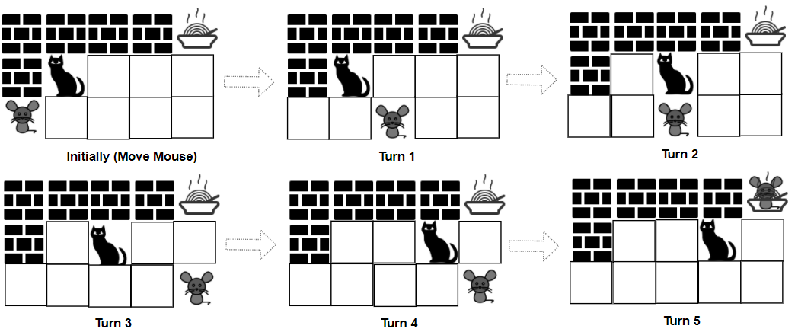

# 逆向思维 + 拓扑序 DP，复用 913 题代码（Python/Java/C++/Go）

> **[1728. 猫和老鼠 II](https://leetcode.cn/problems/cat-and-mouse-ii/solutions/3070697/ni-xiang-si-wei-tuo-bu-xu-dpfu-yong-913-t99rl/) · Hard · 难度分 2849**

> **所属题单**
> - [动态规划 · 十三、图 DP](../../../刷题路径/灵神原版题单/动态规划/十三、图%20DP.md)
> - [动态规划 · 十四、博弈 DP](../../../刷题路径/灵神原版题单/动态规划/十四、博弈%20DP.md)
> - [数学算法 · 四、博弈论](../../../刷题路径/灵神原版题单/数学算法/四、博弈论.md)

> **题目描述**
> 一只猫和一只老鼠在玩一个叫做猫和老鼠的游戏。
>
> 它们所处的环境设定是一个 `rows x cols` 的方格 `grid` ，其中每个格子可能是一堵墙、一块地板、一位玩家（猫或者老鼠）或者食物。
>
> - 玩家由字符 `'C'` （代表猫）和 `'M'` （代表老鼠）表示。
>
> - 地板由字符 `'.'` 表示，玩家可以通过这个格子。
>
> - 墙用字符 `'#'` 表示，玩家不能通过这个格子。
>
> - 食物用字符 `'F'` 表示，玩家可以通过这个格子。
>
> - 字符 `'C'` ， `'M'` 和 `'F'` 在 `grid` 中都只会出现一次。
>
> 猫和老鼠按照如下规则移动：
>
> - 老鼠 **先移动** ，然后两名玩家轮流移动。
>
> - 每一次操作时，猫和老鼠可以跳到上下左右四个方向之一的格子，他们不能跳过墙也不能跳出 `grid` 。
>
> - `catJump` 和 `mouseJump` 是猫和老鼠分别跳一次能到达的最远距离，它们也可以跳小于最大距离的长度。
>
> - 它们可以停留在原地。
>
> - 老鼠可以跳跃过猫的位置。
>
> 游戏有 4 种方式会结束：
>
> - 如果猫跟老鼠处在相同的位置，那么猫获胜。
>
> - 如果猫先到达食物，那么猫获胜。
>
> - 如果老鼠先到达食物，那么老鼠获胜。
>
> - 如果老鼠不能在 1000 次操作以内到达食物，那么猫获胜。
>
> 给你 `rows x cols` 的矩阵 `grid` 和两个整数 `catJump` 和 `mouseJump` ，双方都采取最优策略，如果老鼠获胜，那么请你返回 `true` ，否则返回 `false` 。
>
> **示例 1：**
>
> 
>
> ```
>
> 输入：grid = ["####F","#C...","M...."], catJump = 1, mouseJump = 2
> 输出：true
> 解释：猫无法抓到老鼠，也没法比老鼠先到达食物。
> ```
>
> **示例 2：**
>
> 
>
> ```
>
> 输入：grid = ["M.C...F"], catJump = 1, mouseJump = 4
> 输出：true
> ```
>
> **示例 3：**
>
> ```
>
> 输入：grid = ["M.C...F"], catJump = 1, mouseJump = 3
> 输出：false
> ```
>
> **示例 4：**
>
> ```
>
> 输入：grid = ["C...#","...#F","....#","M...."], catJump = 2, mouseJump = 5
> 输出：false
> ```
>
> **示例 5：**
>
> ```
>
> 输入：grid = [".M...","..#..","#..#.","C#.#.","...#F"], catJump = 3, mouseJump = 1
> 输出：true
> ```
>
> **提示：**
>
> - `rows == grid.length`
>
> - `cols = grid[i].length`
>
> - `1 <= rows, cols <= 8`
>
> - `grid[i][j]` 只包含字符 `'C'` ，`'M'` ，`'F'` ，`'.'` 和 `'#'` 。
>
> - `grid` 中只包含一个 `'C'` ，`'M'` 和 `'F'` 。
>
> - `1 <= catJump, mouseJump <= 8`

> **题解**
> 请先完成 [913. 猫和老鼠](https://leetcode.cn/problems/cat-and-mouse/)，[我的题解](../../0900-0999/0913%20猫和老鼠/灵茶山艾府.md)。
>
> 本题思路一样，为了复用 913 题的代码，需要做一些预处理和修改：
>
> 1. 把二维坐标 $(i,j)$ 映射为 $i\cdot n + j$（$n$ 为列数），这样可以把二维坐标转换成一维坐标。
> 2. 遍历 $\textit{grid}$，枚举位置和跳跃长度，鼠和猫分别建图 $\textit{gMouse}$ 和 $\textit{gCat}$。
> 3. $\textit{deg}[i][j][0]$ 初始化成 $\textit{gMouse}[i]$ 的长度，$\textit{deg}[i][j][1]$ 初始化成 $\textit{gCat}[j]$ 的长度。
> 4. 913 题猫不能进洞，但本题可以（把食物当作洞）。
>
> 注：本题虽然有「$1000$ 次操作内」的要求，但由于 $2mn\ll 1000$，如果 $1000$ 次操作内还没有从起点走到终点，那么一定是平局。所以 $1000$ 的要求等同于平局。
>
> 关于 $2mn$，可以考虑之字型的网格图，或者参考 [2258. 逃离火灾](../../2200-2299/2258%20逃离火灾/灵茶山艾府.md) 中的图。
>
> ```python
> class Solution:
>     # 913. 猫和老鼠
>     def catMouseGame(self, g_mouse: List[List[int]], g_cat: List[List[int]], mouse_start: int, cat_start: int, hole: int) -> int:
>         n = len(g_mouse)
>         deg = [[[0, 0] for _ in range(n)] for _ in range(n)]
>         for i in range(n):
>             for j in range(n):
>                 deg[i][j][0] = len(g_mouse[i])
>                 deg[i][j][1] = len(g_cat[j])
>
>         winner = [[[0, 0] for _ in range(n)] for _ in range(n)]
>         q = deque()
>         for i in range(n):
>             winner[hole][i][1] = 1  # 鼠到达洞中（此时轮到猫移动），鼠获胜
>             winner[i][hole][0] = 2  # 猫到达洞中（此时轮到鼠移动），猫获胜
>             winner[i][i][0] = winner[i][i][1] = 2  # 猫和鼠出现在同一个节点，无论轮到谁移动，都是猫获胜
>             q.append((hole, i, 1))  # 从终点开始倒推
>             q.append((i, hole, 0))
>             q.append((i, i, 0))
>             q.append((i, i, 1))
>
>         # 获取 (mouse, cat, turn) 的上个状态（值尚未确定）
>         def get_pre_states() -> List[Tuple[int, int]]:
>             if turn:  # 当前轮到猫移动，枚举上一轮鼠的位置
>                 return [(pre_mouse, cat) for pre_mouse in g_mouse[mouse] if winner[pre_mouse][cat][0] == 0]
>             # 当前轮到鼠移动，枚举上一轮猫的位置
>             return [(mouse, pre_cat) for pre_cat in g_cat[cat] if winner[mouse][pre_cat][1] == 0]
>
>         # 减少上个状态的度数
>         def dec_deg_to_zero() -> bool:
>             deg[pre_mouse][pre_cat][pre_turn] -= 1
>             return deg[pre_mouse][pre_cat][pre_turn] == 0
>
>         while q:
>             mouse, cat, turn = q.popleft()
>             win = winner[mouse][cat][turn]  # 最终谁赢了
>             pre_turn = turn ^ 1
>             for pre_mouse, pre_cat in get_pre_states():
>                 # 情况一：如果上一回合鼠从 pre 移动到 cur，最终鼠赢，那么标记 pre 状态的 winner = 鼠
>                 # 情况二：如果上一回合猫从 pre 移动到 cur，最终猫赢，那么标记 pre 状态的 winner = 猫
>                 # 情况三：如果上一回合鼠从 pre 移动到 cur，最终猫赢，那么待定，直到我们发现从 pre 出发能到达的状态都是猫赢，那么标记 pre 状态的 winner = 猫
>                 # 情况四：如果上一回合猫从 pre 移动到 cur，最终鼠赢，那么待定，直到我们发现从 pre 出发能到达的状态都是鼠赢，那么标记 pre 状态的 winner = 鼠
>                 if pre_turn == win - 1 or dec_deg_to_zero():
>                     winner[pre_mouse][pre_cat][pre_turn] = win
>                     q.append((pre_mouse, pre_cat, pre_turn))
>
>         # 鼠在节点 mouse_start，猫在节点 cat_start，当前轮到鼠移动
>         return winner[mouse_start][cat_start][0]  # 返回最终谁赢了（或者平局）
>
>     def canMouseWin(self, grid: List[str], catJump: int, mouseJump: int) -> bool:
>         DIRS = (0, -1), (0, 1), (-1, 0), (1, 0)  # 左右上下
>         m, n = len(grid), len(grid[0])
>         # 鼠和猫分别建图
>         g_mouse = [[] for _ in range(m * n)]
>         g_cat = [[] for _ in range(m * n)]
>         for i, row in enumerate(grid):
>             for j, c in enumerate(row):
>                 if c == '#':  # 墙
>                     continue
>                 if c == 'M':  # 鼠的位置
>                     mx, my = i, j
>                 elif c == 'C':  # 猫的位置
>                     cx, cy = i, j
>                 elif c == 'F':  # 食物（洞）的位置
>                     fx, fy = i, j
>                 v = i * n + j  # 二维坐标 (i,j) 映射为一维坐标 v
>                 for dx, dy in DIRS:  # 枚举左右上下四个方向
>                     for k in range(mouseJump + 1):  # 枚举跳跃长度
>                         x, y = i + k * dx, j + k * dy
>                         if not (0 <= x < m and 0 <= y < n and grid[x][y] != '#'):  # 出界或者遇到墙
>                             break
>                         g_mouse[v].append(x * n + y)  # 连边
>                     for k in range(catJump + 1):  # 枚举跳跃长度
>                         x, y = i + k * dx, j + k * dy
>                         if not (0 <= x < m and 0 <= y < n and grid[x][y] != '#'):  # 出界或者遇到墙
>                             break
>                         g_cat[v].append(x * n + y)  # 连边
>
>         # 判断是否鼠赢
>         return self.catMouseGame(g_mouse, g_cat, mx * n + my, cx * n + cy, fx * n + fy) == 1
> ```
>
>
> #### 复杂度分析
>
> - 时间复杂度：$\mathcal{O}(m^2n^2(m+n))$，其中 $m$ 和 $n$ 分别为 $\textit{grid}$ 的行数和列数。有 $\mathcal{O}(m^2n^2)$ 个状态，每个状态需要遍历 $\mathcal{O}(m+n)$ 个相邻的状态。
> - 空间复杂度：$\mathcal{O}(m^2n^2)$。
>
> 更多相似题目，见下面动态规划题单中的「**十四、博弈 DP**」。
>
> ## 分类题单
>
> [如何科学刷题？](https://leetcode.cn/circle/discuss/RvFUtj/)
>
> 1. [滑动窗口与双指针（定长/不定长/单序列/双序列/三指针/分组循环）](https://leetcode.cn/circle/discuss/0viNMK/)
> 2. [二分算法（二分答案/最小化最大值/最大化最小值/第K小）](https://leetcode.cn/circle/discuss/SqopEo/)
> 3. [单调栈（基础/矩形面积/贡献法/最小字典序）](https://leetcode.cn/circle/discuss/9oZFK9/)
> 4. [网格图（DFS/BFS/综合应用）](https://leetcode.cn/circle/discuss/YiXPXW/)
> 5. [位运算（基础/性质/拆位/试填/恒等式/思维）](https://leetcode.cn/circle/discuss/dHn9Vk/)
> 6. [图论算法（DFS/BFS/拓扑排序/最短路/最小生成树/二分图/基环树/欧拉路径）](https://leetcode.cn/circle/discuss/01LUak/)
> 7. 【本题相关】[动态规划（入门/背包/状态机/划分/区间/状压/数位/数据结构优化/树形/博弈/概率期望）](https://leetcode.cn/circle/discuss/tXLS3i/)
> 8. [常用数据结构（前缀和/差分/栈/队列/堆/字典树/并查集/树状数组/线段树）](https://leetcode.cn/circle/discuss/mOr1u6/)
> 9. [数学算法（数论/组合/概率期望/博弈/计算几何/随机算法）](https://leetcode.cn/circle/discuss/IYT3ss/)
> 10. [贪心与思维（基本贪心策略/反悔/区间/字典序/数学/思维/脑筋急转弯/构造）](https://leetcode.cn/circle/discuss/g6KTKL/)
> 11. [链表、二叉树与回溯（前后指针/快慢指针/DFS/BFS/直径/LCA/一般树）](https://leetcode.cn/circle/discuss/K0n2gO/)
> 12. [字符串（KMP/Z函数/Manacher/字符串哈希/AC自动机/后缀数组/子序列自动机）](https://leetcode.cn/circle/discuss/SJFwQI/)
>
> [我的题解精选（已分类）](https://github.com/EndlessCheng/codeforces-go/blob/master/leetcode/SOLUTIONS.md)
>
> 欢迎关注 [B站@灵茶山艾府](https://space.bilibili.com/206214)
