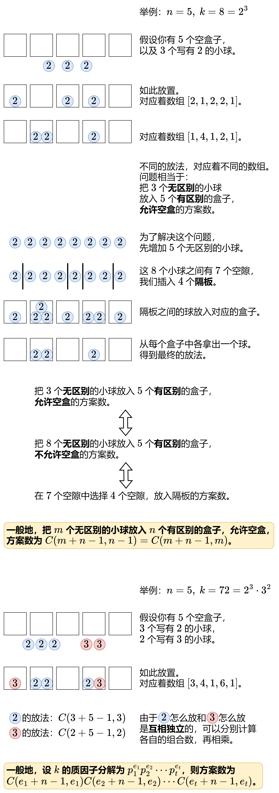

# 【图解】质因数分解+放球问题（Python/Java/C++/Go/JS/Rust）

> **[1735. 生成乘积数组的方案数](https://leetcode.cn/problems/count-ways-to-make-array-with-product/solutions/2713481/tu-jie-zhi-yin-zi-fen-jie-fang-qiu-wen-t-fboo/) · Hard · 难度分 2500**

> **所属题单**
> - [数学算法 · 一、数论](../../../刷题路径/灵神原版题单/数学算法/一、数论.md) · §1.3 质因数分解
> - [数学算法 · 二、组合数学](../../../刷题路径/灵神原版题单/数学算法/二、组合数学.md) · §2.2 组合计数

> **题目描述**
> 给你一个二维整数数组 `queries` ，其中 `queries[i] = [n_i, k_i]` 。第 `i` 个查询 `queries[i]` 要求构造长度为 `n_i` 、每个元素都是正整数的数组，且满足所有元素的乘积为 `k_i`<sub> </sub>，请你找出有多少种可行的方案。由于答案可能会很大，方案数需要对 `10⁹ + 7` **取余** 。
>
> 请你返回一个整数数组 `answer`，满足 `answer.length == queries.length` ，其中 `answer[i]`是第 `i` 个查询的结果。
>
> **示例 1：**
>
> ```
>
> 输入：queries = [[2,6],[5,1],[73,660]]
> 输出：[4,1,50734910]
> 解释：每个查询之间彼此独立。
> [2,6]：总共有 4 种方案得到长度为 2 且乘积为 6 的数组：[1,6]，[2,3]，[3,2]，[6,1]。
> [5,1]：总共有 1 种方案得到长度为 5 且乘积为 1 的数组：[1,1,1,1,1]。
> [73,660]：总共有 1050734917 种方案得到长度为 73 且乘积为 660 的数组。1050734917 对 10⁹ + 7 取余得到 50734910 。
> ```
>
> **示例 2 ：**
>
> ```
>
> 输入：queries = [[1,1],[2,2],[3,3],[4,4],[5,5]]
> 输出：[1,2,3,10,5]
> ```
>
> **提示：**
>
> - `1 <= queries.length <= 10⁴ `
>
> - `1 <= n_i, k_i <= 10⁴`

> **题解**
> 
>
> 如何编程实现？首先讲讲简单的做法，更高效的做法见后面的「写法二」。
>
> ## 如何分解质因子
>
> 从 $i=2$ 开始枚举，如果 $k$ 能被 $i$ 整除就不断除 $i$，直到 $k$ 不能被 $i$ 整除为止，统计除 $i$ 的次数，作为公式中的 $e$。
>
> 什么时候停止枚举呢？如果 $i^2 > k$，继续向后枚举是不会出现 $k$ 被 $i$ 整除的情况的。这可以用反证法证明：假设存在 $i$，满足 $i^2>k$ 且 $k$ 能被 $i$ 整除，那么 $k$ 也能被 $\dfrac{k}{i}$ 整除，注意到 $\dfrac{k}{i}<i$，但我们已经处理完小于 $i$ 的因子了，不会出现 $k$ 仍可以被一个小于 $i$ 的数整除的情况，矛盾。所以当 $i^2 > k$ 时可以停止枚举。
>
> 循环结束后，如果 $k>1$，说明还有一个质因子为 $k$。
>
> ## 如何计算组合数
>
> 对于从 $n$ 个物品中选择 $m$ 个物品的方案数 $C(n,m)$，可以用「选或不选」来思考，对于第 $n$ 个物品：
>
> - 不选：问题变成从 $n-1$ 个物品中选择 $m$ 个物品的方案数 $C(n-1,m)$。
> - 选：问题变成从 $n-1$ 个物品中选择 $m-1$ 个物品的方案数 $C(n-1,m-1)$。
>
> 所以 $C(n,m) = C(n-1,m) + C(n-1,m-1)$。
>
> 初始值：$C(n,0) = 1$。
>
> 对于本题，由于 $2^{13} < 10^4 < 2^{14}$，我们可以预处理 $n\le 10^4 + 13-1$ 和 $m \le 13$ 的组合数。
>
> ```python
> MOD = 1_000_000_007
>
> # 预处理组合数
> c = [[0] * 14 for _ in range(10013)]
> c[0][0] = 1
> for i in range(1, 10013):
>     c[i][0] = 1
>     for j in range(1, 14):
>         c[i][j] = (c[i - 1][j] + c[i - 1][j - 1]) % MOD
>
> class Solution:
>     def waysToFillArray(self, queries: List[List[int]]) -> List[int]:
>         ans = []
>         for n, k in queries:
>             res = 1
>             i = 2
>             while i * i <= k:
>                 if k % i == 0:  # i 是 k 的质因子
>                     e = 0
>                     while k % i == 0:
>                         e += 1  # 统计有多少个质因子 i
>                         k //= i
>                     res = res * c[e + n - 1][e] % MOD
>                 i += 1
>             if k > 1:  # 还剩下一个质因子
>                 res = res * n % MOD
>             ans.append(res)
>         return ans
> ```
>
>
> #### 复杂度分析
>
> - 时间复杂度：预处理的时间为 $\mathcal{O}((N+\log K)\log K)$，其中 $N=10^4, K=10^4$。回答单个询问的时间为 $\mathcal{O}(\sqrt k)$。
> - 空间复杂度：$\mathcal{O}((N+\log K)\log K)$。返回值不计入。
>
> ## 写法二
>
> 竞赛算法，供学有余力的同学参考。
>
> 优化 1：预处理阶乘及其逆元后，利用公式 $C(n,m) = \dfrac{n!}{m!(n-m)!}$ 计算组合数。关于除法取模的计算方法，见 [模运算的世界：当加减乘除遇上取模](https://leetcode.cn/circle/discuss/mDfnkW/)。
>
> 优化 2：预处理每个数的最小质因子（LPF，least prime factor），从而快速分解质因数。这可以用埃氏筛或者欧拉筛来做，见 [筛法](https://oi-wiki.org/math/number-theory/sieve/)。下面代码用的埃氏筛。
>
> ```python
> MOD = 1_000_000_007
> MX = 10013
> MX_K = 10001
>
> f = [0] * MX  # f[i] = i!
> f[0] = 1
> for i in range(1, MX):
>     f[i] = f[i - 1] * i % MOD
>
> inv_f = [0] * MX  # inv_f[i] = i!^-1
> inv_f[-1] = pow(f[-1], -1, MOD)
> for i in range(MX - 1, 0, -1):
>     inv_f[i - 1] = inv_f[i] * i % MOD
>
> lpf = [0] * MX_K  # i 的最小质因子是 lpf[i]
> for i in range(2, MX_K):
>     if lpf[i] == 0:  # i 是质数
>         for j in range(i, MX_K, i):
>             if lpf[j] == 0:
>                 lpf[j] = i  # j 的最小质因子是 i
>
> def comb(n: int, m: int) -> int:
>     return f[n] * inv_f[m] * inv_f[n - m] % MOD
>
> class Solution:
>     def waysToFillArray(self, queries: List[List[int]]) -> List[int]:
>         ans = []
>         for n, k in queries:
>             res = 1
>             while k > 1:
>                 p = lpf[k]
>                 e = 0
>                 while k % p == 0:
>                     e += 1
>                     k //= p
>                 res = res * comb(e + n - 1, e) % MOD
>             ans.append(res)
>         return ans
> ```
>
>
> #### 复杂度分析
>
> - 时间复杂度：预处理的时间为 $\mathcal{O}(N+K\log \log K)$，其中 $N=10^4, K=10^4$。回答单个询问的时间为 $\mathcal{O}(\log k)$，因为 $k$ 有 $\mathcal{O}(\log k)$ 个质因子。
> - 空间复杂度：$\mathcal{O}(N+K)$。返回值不计入。
>
> 注：如果用欧拉筛计算 LPF，则预处理的时间复杂度为 $\mathcal{O}(N+K)$。
>
> ## 放球问题
>
> - [1641. 统计字典序元音字符串的数目](https://leetcode.cn/problems/count-sorted-vowel-strings/) 1519
> - [1621. 大小为 K 的不重叠线段的数目](https://leetcode.cn/problems/number-of-sets-of-k-non-overlapping-line-segments/) 2198
> - [2338. 统计理想数组的数目](https://leetcode.cn/problems/count-the-number-of-ideal-arrays/) 2615
> - [CF1931G](https://codeforces.com/contest/1931/problem/G) & [视频讲解](https://www.bilibili.com/video/BV1p6421g736/)
>
> ## 预处理最小质因子 LPF
>
> - [2709. 最大公约数遍历](https://leetcode.cn/problems/greatest-common-divisor-traversal/) 2172
> - [1998. 数组的最大公因数排序](https://leetcode.cn/problems/gcd-sort-of-an-array/) 2429
>
> ## 分类题单
>
> [如何科学刷题？](https://leetcode.cn/circle/discuss/RvFUtj/)
>
> 1. [滑动窗口与双指针（定长/不定长/单序列/双序列/三指针/分组循环）](https://leetcode.cn/circle/discuss/0viNMK/)
> 2. [二分算法（二分答案/最小化最大值/最大化最小值/第K小）](https://leetcode.cn/circle/discuss/SqopEo/)
> 3. [单调栈（基础/矩形面积/贡献法/最小字典序）](https://leetcode.cn/circle/discuss/9oZFK9/)
> 4. [网格图（DFS/BFS/综合应用）](https://leetcode.cn/circle/discuss/YiXPXW/)
> 5. [位运算（基础/性质/拆位/试填/恒等式/思维）](https://leetcode.cn/circle/discuss/dHn9Vk/)
> 6. [图论算法（DFS/BFS/拓扑排序/最短路/最小生成树/二分图/基环树/欧拉路径）](https://leetcode.cn/circle/discuss/01LUak/)
> 7. [动态规划（入门/背包/状态机/划分/区间/状压/数位/数据结构优化/树形/博弈/概率期望）](https://leetcode.cn/circle/discuss/tXLS3i/)
> 8. [常用数据结构（前缀和/差分/栈/队列/堆/字典树/并查集/树状数组/线段树）](https://leetcode.cn/circle/discuss/mOr1u6/)
> 9. [数学算法（数论/组合/概率期望/博弈/计算几何/随机算法）](https://leetcode.cn/circle/discuss/IYT3ss/)
> 10. [贪心与思维（基本贪心策略/反悔/区间/字典序/数学/思维/脑筋急转弯/构造）](https://leetcode.cn/circle/discuss/g6KTKL/)
> 11. [链表、二叉树与回溯（前后指针/快慢指针/DFS/BFS/直径/LCA/一般树）](https://leetcode.cn/circle/discuss/K0n2gO/)
> 12. [字符串（KMP/Z函数/Manacher/字符串哈希/AC自动机/后缀数组/子序列自动机）](https://leetcode.cn/circle/discuss/SJFwQI/)
>
> [我的题解精选（已分类）](https://github.com/EndlessCheng/codeforces-go/blob/master/leetcode/SOLUTIONS.md)
>
> 欢迎关注 [B站@灵茶山艾府](https://space.bilibili.com/206214)
