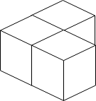
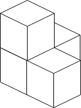

# 1739. 放置盒子

Hard · 难度分 2198 · [力扣原题](https://leetcode.cn/problems/building-boxes/)

所在刷题路径：灵神题单·数学算法

| 作者 | 题解 | 动画讲解 |
|---|---|---|
| 灵茶山艾府 | [📄 题解](灵茶山艾府.md) | [▶︎ 1739 放置盒子 · 灵茶山艾府.mp4](1739%20放置盒子%20·%20灵茶山艾府.mp4) |
| yiduobo | [📄 题解](yiduobo.md) | [▶︎ 1739 放置盒子 · yiduobo.mp4](1739%20放置盒子%20·%20yiduobo.mp4) |

## 题目描述

有一个立方体房间，其长度、宽度和高度都等于 `n` 个单位。请你在房间里放置 `n` 个盒子，每个盒子都是一个单位边长的立方体。放置规则如下：

- 你可以把盒子放在地板上的任何地方。

- 如果盒子 `x` 需要放置在盒子 `y` 的顶部，那么盒子 `y` 竖直的四个侧面都 **必须** 与另一个盒子或墙相邻。

给你一个整数 `n` ，返回接触地面的盒子的 **最少** 可能数量<em>。</em>

**示例 1：**



```

输入：n = 3
输出：3
解释：上图是 3 个盒子的摆放位置。
这些盒子放在房间的一角，对应左侧位置。
```

**示例 2：**



```

输入：n = 4
输出：3
解释：上图是 3 个盒子的摆放位置。
这些盒子放在房间的一角，对应左侧位置。
```

**示例 3：**


```

输入：n = 10
输出：6
解释：上图是 10 个盒子的摆放位置。
这些盒子放在房间的一角，对应后方位置。
```

**提示：**

- `1 <= n <= 10⁹`

---
[↑ 返回 1700-1799](../README.md) · [总索引](../../../索引.md) · [仓库首页](../../../README.md)
