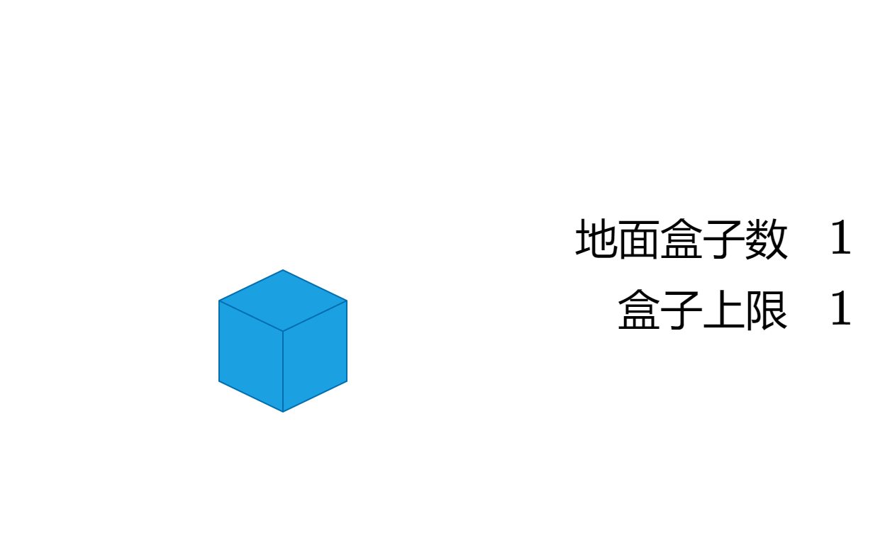
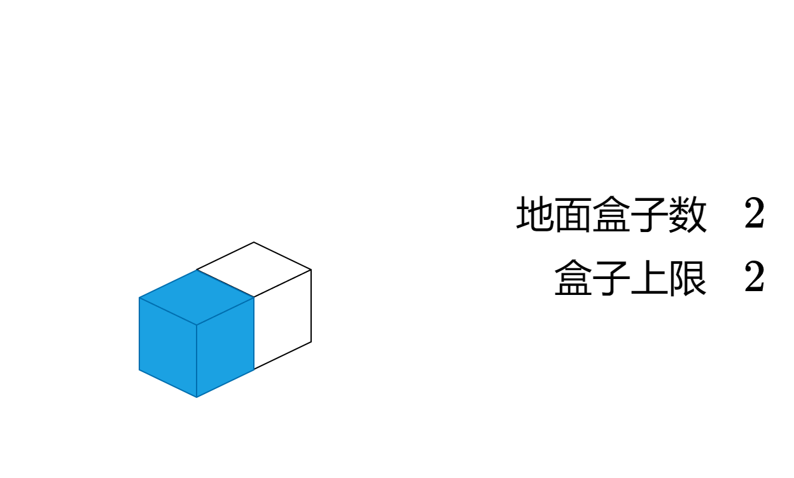
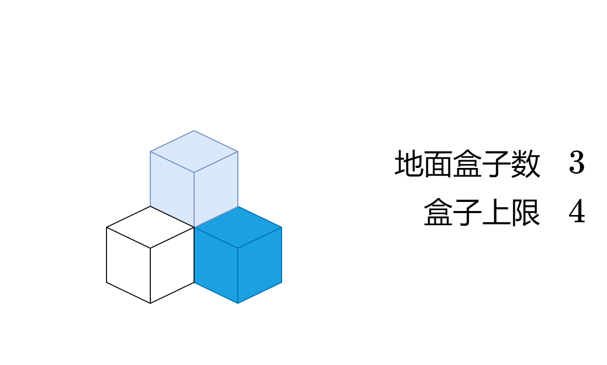
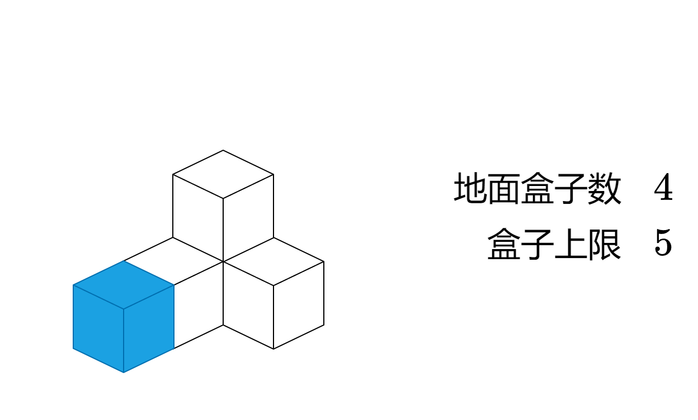
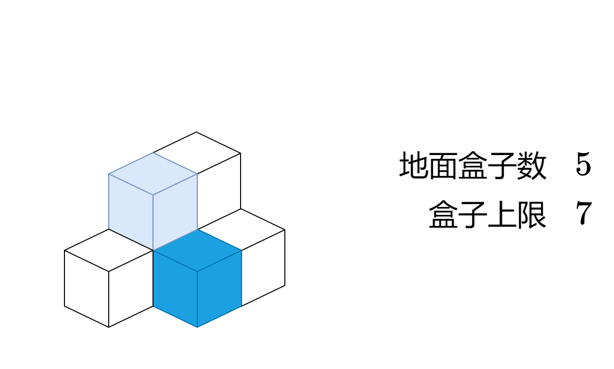
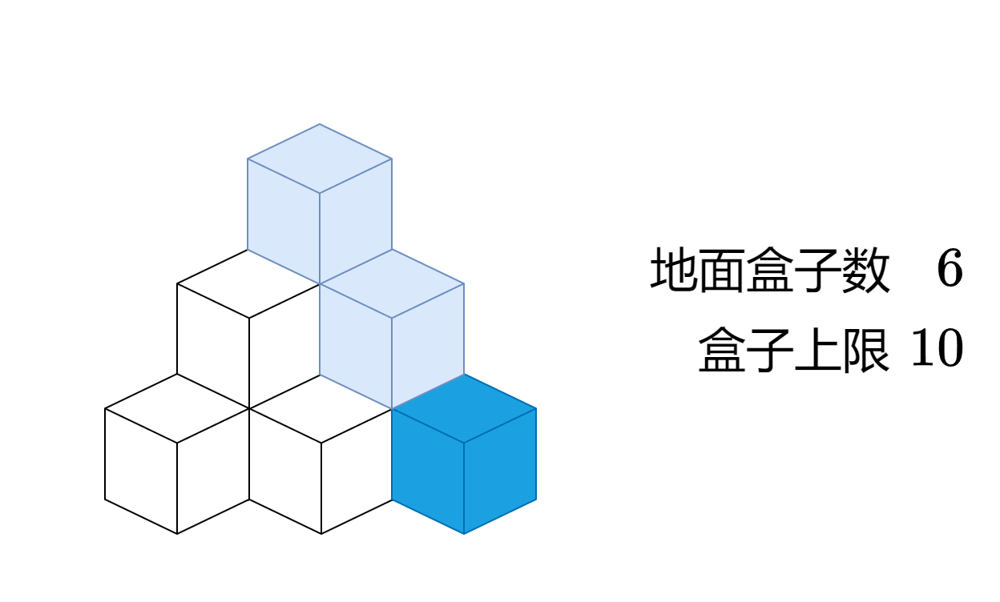
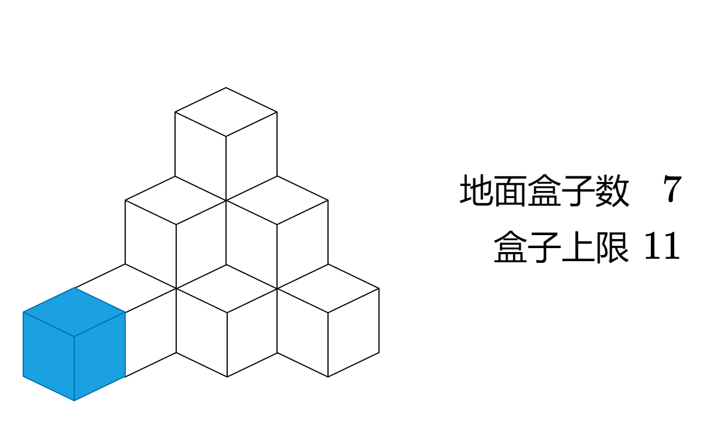
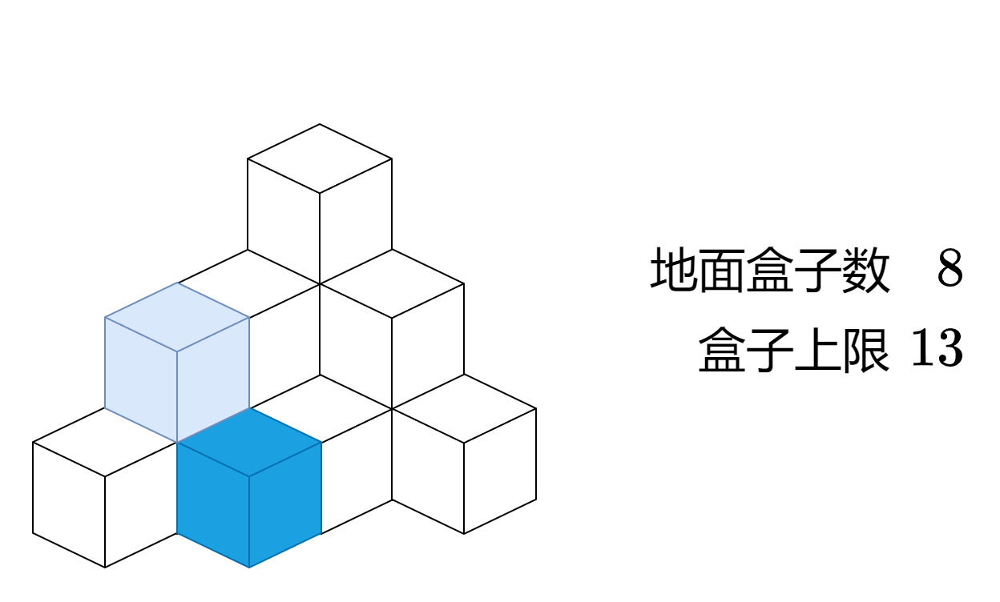
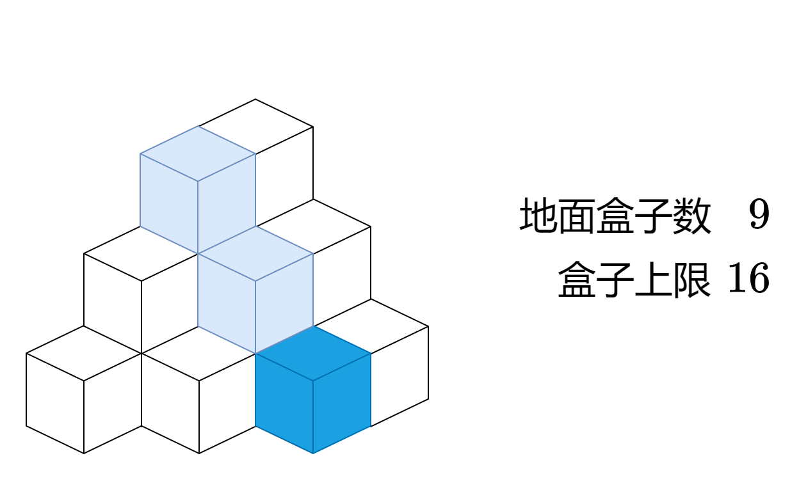
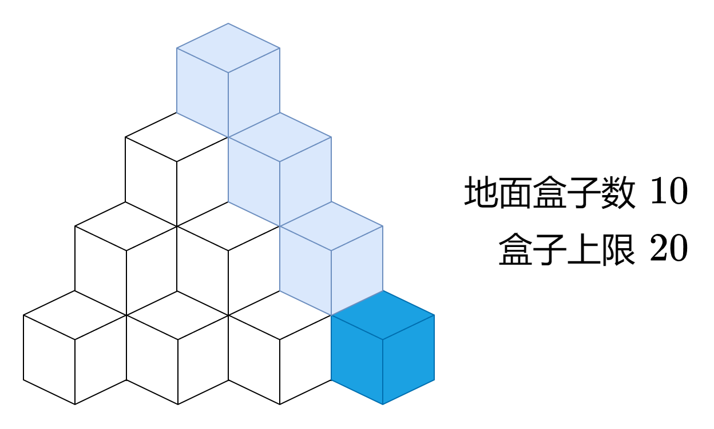

# 没想明白？一个动画秒懂！附 O(1) 做法（Python/Java/C++/Go）

> **[1739. 放置盒子](https://leetcode.cn/problems/building-boxes/solutions/2031813/mei-xiang-ming-bai-yi-ge-dong-hua-miao-d-8vbe/) · Hard · 难度分 2198**

> **所属题单**
> - [数学算法 · 七、杂项](../../../刷题路径/灵神原版题单/数学算法/七、杂项.md) · §7.10 其他

> **题目描述**
> 有一个立方体房间，其长度、宽度和高度都等于 `n` 个单位。请你在房间里放置 `n` 个盒子，每个盒子都是一个单位边长的立方体。放置规则如下：
>
> - 你可以把盒子放在地板上的任何地方。
>
> - 如果盒子 `x` 需要放置在盒子 `y` 的顶部，那么盒子 `y` 竖直的四个侧面都 **必须** 与另一个盒子或墙相邻。
>
> 给你一个整数 `n` ，返回接触地面的盒子的 **最少** 可能数量<em>。</em>
>
> **示例 1：**
>
> 
>
> ```
>
> 输入：n = 3
> 输出：3
> 解释：上图是 3 个盒子的摆放位置。
> 这些盒子放在房间的一角，对应左侧位置。
> ```
>
> **示例 2：**
>
> 
>
> ```
>
> 输入：n = 4
> 输出：3
> 解释：上图是 3 个盒子的摆放位置。
> 这些盒子放在房间的一角，对应左侧位置。
> ```
>
> **示例 3：**
>
> 
>
> ```
>
> 输入：n = 10
> 输出：6
> 解释：上图是 10 个盒子的摆放位置。
> 这些盒子放在房间的一角，对应后方位置。
> ```
>
> **提示：**
>
> - `1 <= n <= 10⁹`

> **题解**
> <,,,,,,,,,>
>
> 根据上图，当接触地面的盒子 $\textit{ans}$ 等于
>
> $$
> 1+2+3+\cdots+i=\dfrac{i(i+1)}{2}
> $$
>
> 时，对应的盒子上限 $\textit{maxN}$ 为 
>
> $$
> 1+(1+2)+(1+2+3)+\cdots+\dfrac{i(i+1)}{2}=\dfrac{i(i+1)(i+2)}{6}
> $$
>
> 在 $\dfrac{i(i+1)(i+2)}{6}$ 的基础上，接触地面的盒子再增加 $j$ 个 $(j\le i+1)$，盒子上限就会再增加 $1+2+\cdots+j=\dfrac{j(j+1)}{2}$ 个。
>
> 因此，设 $x$ 为最大的满足 $\dfrac{i(i+1)(i+2)}{6} \le n$ 的 $i$，$y$ 为最小的满足 $\dfrac{x(x+1)(x+2)}{6} + \dfrac{j(j+1)}{2} \ge n$ 的 $j$，则答案为 $\dfrac{x(x+1)}{2}+y$。
>
> 实现时可以把 $x$ 和 $y$ 直接加到 $\textit{ans}$ 中。
>
> ```python
> class Solution:
>     def minimumBoxes(self, n: int) -> int:
>         ans = max_n = 0
>         i = j = 1
>         while max_n + ans + i <= n:
>             ans += i
>             max_n += ans
>             i += 1
>         while max_n < n:
>             ans += 1
>             max_n += j
>             j += 1
>         return ans
> ```
>
>
> #### 复杂度分析
>
> - 时间复杂度：$\mathcal{O}(\sqrt[3]n)$。根据上面推导的公式，$i$ 和 $j$ 至多为 $\mathcal{O}(\sqrt[3]n)$。
> - 空间复杂度：$\mathcal{O}(1)$，仅用到若干变量。
>
> #### 优化
>
> 直接计算 $x$ 和 $y$。
>
> 对于 $x$，哪个整数是满足 $\dfrac{x(x+1)(x+2)}{6} \le n$ 的最大整数呢？
>
> 如果 $x=\lfloor\sqrt[3]{6n}\rfloor$：
>
> - 由于 $(x+1)(x+2)(x+3)>(x+1)^3>6n$，所以 $x+1$ 必不满足要求。
> - 由于 $(x-1)x(x+1)=x(x^2-1)=x^3-x<x^3\le 6n$，所以 $x-1$ 必满足要求。
> - $x$ 是否满足要求？计算一下就知道了。
>
> 因此，取 $x=\lfloor\sqrt[3]{6n}\rfloor$，如果 $\dfrac{x(x+1)(x+2)}{6} > n$ 则将 $x$ 减一。
>
> 对于 $y$，设 $N=n-\dfrac{x(x+1)(x+2)}{6}$，则
>
> $$
> \dfrac{y(y+1)}{2}\ge N
> $$
>
> 解得
>
> $$
> y\ge \dfrac{-1+\sqrt{1+8N}}{2}
> $$
>
> 由于 $y$ 是整数，所以
>
> $$
> y=\left\lceil\dfrac{-1+\sqrt{1+8N}}{2}\right\rceil = \left\lceil\dfrac{-1+\lceil\sqrt{1+8N}\rceil}{2}\right\rceil = \left\lfloor\dfrac{\lceil\sqrt{1+8N}\rceil}{2}\right\rfloor
> $$
>
> ```python
> class Solution:
>     def minimumBoxes(self, n: int) -> int:
>         x = floor(cbrt(6 * n))
>         ans = x * (x + 1) // 2
>         max_n = x * (x + 1) * (x + 2) // 6
>         if max_n > n:
>             max_n -= ans
>             ans -= x
>         return ans + ceil(sqrt(1 + 8 * (n - max_n))) // 2
> ```
>
>
> #### 复杂度分析
>
> - 时间复杂度：$\mathcal{O}(1)$。计算开立方和开平方均视作 $\mathcal{O}(1)$。
> - 空间复杂度：$\mathcal{O}(1)$，仅用到若干变量。
>
> ## 分类题单
>
> [如何科学刷题？](https://leetcode.cn/circle/discuss/RvFUtj/)
>
> 1. [滑动窗口与双指针（定长/不定长/单序列/双序列/三指针/分组循环）](https://leetcode.cn/circle/discuss/0viNMK/)
> 2. [二分算法（二分答案/最小化最大值/最大化最小值/第K小）](https://leetcode.cn/circle/discuss/SqopEo/)
> 3. [单调栈（基础/矩形面积/贡献法/最小字典序）](https://leetcode.cn/circle/discuss/9oZFK9/)
> 4. [网格图（DFS/BFS/综合应用）](https://leetcode.cn/circle/discuss/YiXPXW/)
> 5. [位运算（基础/性质/拆位/试填/恒等式/思维）](https://leetcode.cn/circle/discuss/dHn9Vk/)
> 6. [图论算法（DFS/BFS/拓扑排序/最短路/最小生成树/二分图/基环树/欧拉路径）](https://leetcode.cn/circle/discuss/01LUak/)
> 7. [动态规划（入门/背包/状态机/划分/区间/状压/数位/数据结构优化/树形/博弈/概率期望）](https://leetcode.cn/circle/discuss/tXLS3i/)
> 8. [常用数据结构（前缀和/差分/栈/队列/堆/字典树/并查集/树状数组/线段树）](https://leetcode.cn/circle/discuss/mOr1u6/)
> 9. [数学算法（数论/组合/概率期望/博弈/计算几何/随机算法）](https://leetcode.cn/circle/discuss/IYT3ss/)
> 10. [贪心与思维（基本贪心策略/反悔/区间/字典序/数学/思维/脑筋急转弯/构造）](https://leetcode.cn/circle/discuss/g6KTKL/)
> 11. [链表、二叉树与回溯（前后指针/快慢指针/DFS/BFS/直径/LCA/一般树）](https://leetcode.cn/circle/discuss/K0n2gO/)
> 12. [字符串（KMP/Z函数/Manacher/字符串哈希/AC自动机/后缀数组/子序列自动机）](https://leetcode.cn/circle/discuss/SJFwQI/)
>
> [我的题解精选（已分类）](https://github.com/EndlessCheng/codeforces-go/blob/master/leetcode/SOLUTIONS.md)
>
> 欢迎关注 [B站@灵茶山艾府](https://space.bilibili.com/206214)
