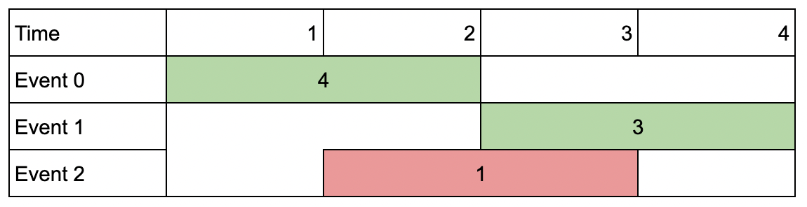

# 动态规划 + 二分查找优化（Python/Java/C++/Go/JS/Rust）

> **[1751. 最多可以参加的会议数目 II](https://leetcode.cn/problems/maximum-number-of-events-that-can-be-attended-ii/solutions/1913087/dong-tai-gui-hua-er-fen-cha-zhao-you-hua-fuip/) · Hard · 难度分 2041**

> **所属题单**
> - [动态规划 · 七、其他线性 DP](../../../刷题路径/灵神原版题单/动态规划/七、其他线性%20DP.md) · §7.2 不相交区间

> **题目描述**
> 给你一个 `events` 数组，其中 `events[i] = [startDay_i, endDay_i, value_i]` ，表示第 `i` 个会议在 `startDay_i`<sub> </sub>天开始，第 `endDay_i` 天结束，如果你参加这个会议，你能得到价值 `value_i` 。同时给你一个整数 `k` 表示你能参加的最多会议数目。
>
> 你同一时间只能参加一个会议。如果你选择参加某个会议，那么你必须 **完整** 地参加完这个会议。会议结束日期是包含在会议内的，也就是说你不能同时参加一个开始日期与另一个结束日期相同的两个会议。
>
> 请你返回能得到的会议价值 **最大和** 。
>
> **示例 1：**
>
> 
>
> ```
>
> 输入：events = [[1,2,4],[3,4,3],[2,3,1]], k = 2
> 输出：7
> 解释：选择绿色的活动会议 0 和 1，得到总价值和为 4 + 3 = 7 。
> ```
>
> **示例 2：**
>
> 
>
> ```
>
> 输入：events = [[1,2,4],[3,4,3],[2,3,10]], k = 2
> 输出：10
> 解释：参加会议 2 ，得到价值和为 10 。
> 你没法再参加别的会议了，因为跟会议 2 有重叠。你 不 需要参加满 k 个会议。
> ```
>
> **示例 3：**
>
> 
>
> ```
>
> 输入：events = [[1,1,1],[2,2,2],[3,3,3],[4,4,4]], k = 3
> 输出：9
> 解释：尽管会议互不重叠，你只能参加 3 个会议，所以选择价值最大的 3 个会议。
> ```
>
> **提示：**
>
> - `1 <= k <= events.length`
>
> - `1 <= k * events.length <= 10⁶`
>
> - `1 <= startDay_i <= endDay_i <= 10⁹`
>
> - `1 <= value_i <= 10⁶`

> **题解**
> 请先完成本题的简单版本：[1235. 规划兼职工作](https://leetcode.cn/problems/maximum-profit-in-job-scheduling/)，[我的题解](../../1200-1299/1235%20规划兼职工作/灵茶山艾府.md)。
>
> > 注意 1235 题两个相邻区间的端点可以相同，本题不能相同。
>
> 本题在 1235 的基础上，约束参加的会议个数至多为 $k$。相应地，DP 要增加一个参数 $j$，表示至多参加 $j$ 个会议。
>
> 和 1235 一样，按照结束时间排序。定义 $f[i+1][j]$ 表示参加 $\textit{events}[0]$ 到 $\textit{events}[i]$ 中的**至多** $j$ 个会议，能得到的最大价值和。其中 $+1$ 是为了方便用 $f[0]$ 表示初始值，即没有会议的情况。
>
> 分类讨论：
>
> - 不参加 $\textit{events}[i]$，问题变成参加 $\textit{events}[0]$ 到 $\textit{events}[i-1]$ 中的至多 $j$ 个会议，能得到的最大价值和，即 $f[i][j]$；
> - 参加 $\textit{events}[i]$，设 $p$ 是最大的满足 $\textit{endDay}_p<\textit{startDay}_i$ 的 $p$（若不存在则 $p=-1$），问题变成参加 $\textit{events}[0]$ 到 $\textit{events}[p]$ 中的至多 $j-1$ 个会议，能得到的会议价值的最大和，即 $f[p+1][j-1] + \textit{value}_i$。 
>
> 两种情况取最大值，得到**状态转移方程**：
>
> $$
> f[i+1][j] = \max(f[i][j], f[p+1][j-1] + \textit{value}_i)
> $$
>
> 由于结束时间是有序的（我们排过序了），$p$ 可以用**二分查找**快速计算，原理见 [二分查找 红蓝染色法【基础算法精讲 04】](https://www.bilibili.com/video/BV1AP41137w7/)。
>
> **初始值**：$f[0][j] = 0$。没有会议，价值和为 $0$。
>
> **答案**：$f[n][k]$。
>
> **优化**：如果 $k=1$，只能参加一个会议，直接返回最大的价值。
>
> ```python
> # 手写 max 更快
> fmax = lambda a, b: b if b > a else a
>
> class Solution:
>     def maxValue(self, events: List[List[int]], k: int) -> int:
>         # 特判 k=1 的情况可以更快
>         if k == 1:
>             return max(e[2] for e in events)
>
>         events.sort(key=lambda e: e[1])  # 按照结束时间排序
>         n = len(events)
>         f = [[0] * (k + 1) for _ in range(n + 1)]
>         for i, (start_day, _, value) in enumerate(events):
>             p = bisect_left(events, start_day, hi=i, key=lambda e: e[1])  # hi=i 表示二分上界为 i（默认为 n）
>             for j in range(1, k + 1):
>                 # 为什么是 p 不是 p+1：上面算的是 >= start_day，-1 后得到 < start_day，但由于还要 +1，抵消了
>                 f[i + 1][j] = fmax(f[i][j], f[p][j - 1] + value)
>         return f[n][k]
> ```
>
>
> #### 复杂度分析
>
> - 时间复杂度：$\mathcal{O}(nk+n\log n)$，其中 $n$ 为 $\textit{events}$ 的长度。
> - 空间复杂度：$\mathcal{O}(nk)$。
>
> **注**：也可以交换 DP 的两个维度，外层循环枚举 $j$，内层循环枚举 $i$。预处理二分结果后，可以用滚动数组优化，做到 $\mathcal{O}(n)$ 的空间复杂度（时间复杂度不变）。留给感兴趣的读者实现。
>
> ## 专题训练
>
> 见下面动态规划题单的「**§7.2 不相交区间**」。
>
> ## 分类题单
>
> [如何科学刷题？](https://leetcode.cn/circle/discuss/RvFUtj/)
>
> 1. [滑动窗口与双指针（定长/不定长/单序列/双序列/三指针/分组循环）](https://leetcode.cn/circle/discuss/0viNMK/)
> 2. [二分算法（二分答案/最小化最大值/最大化最小值/第K小）](https://leetcode.cn/circle/discuss/SqopEo/)
> 3. [单调栈（基础/矩形面积/贡献法/最小字典序）](https://leetcode.cn/circle/discuss/9oZFK9/)
> 4. [网格图（DFS/BFS/综合应用）](https://leetcode.cn/circle/discuss/YiXPXW/)
> 5. [位运算（基础/性质/拆位/试填/恒等式/思维）](https://leetcode.cn/circle/discuss/dHn9Vk/)
> 6. [图论算法（DFS/BFS/拓扑排序/基环树/最短路/最小生成树/网络流）](https://leetcode.cn/circle/discuss/01LUak/)
> 7. [动态规划（入门/背包/划分/状态机/区间/状压/数位/数据结构优化/树形/博弈/概率期望）](https://leetcode.cn/circle/discuss/tXLS3i/)
> 8. [常用数据结构（前缀和/差分/栈/队列/堆/字典树/并查集/树状数组/线段树）](https://leetcode.cn/circle/discuss/mOr1u6/)
> 9. [数学算法（数论/组合/概率期望/博弈/计算几何/随机算法）](https://leetcode.cn/circle/discuss/IYT3ss/)
> 10. [贪心与思维（基本贪心策略/反悔/区间/字典序/数学/思维/脑筋急转弯/构造）](https://leetcode.cn/circle/discuss/g6KTKL/)
> 11. [链表、二叉树与回溯（前后指针/快慢指针/DFS/BFS/直径/LCA/一般树）](https://leetcode.cn/circle/discuss/K0n2gO/)
> 12. [字符串（KMP/Z函数/Manacher/字符串哈希/AC自动机/后缀数组/子序列自动机）](https://leetcode.cn/circle/discuss/SJFwQI/)
>
> [我的题解精选（已分类）](https://github.com/EndlessCheng/codeforces-go/blob/master/leetcode/SOLUTIONS.md)
>
> 欢迎关注 [B站@灵茶山艾府](https://space.bilibili.com/206214)
