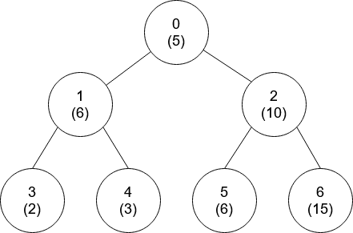
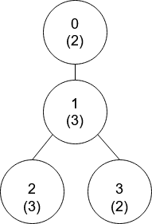

# DFS 中记录节点值的深度和编号，回溯写法（Python/Java/C++/Go/JS/Rust）

> **[1766. 互质树](https://leetcode.cn/problems/tree-of-coprimes/solutions/2733992/dfs-zhong-ji-lu-jie-dian-zhi-de-shen-du-4v5d2/) · Hard · 难度分 2232**

> **所属题单**
> - [链表、二叉树与回溯 · 三、一般树](../../../刷题路径/灵神原版题单/链表、二叉树与回溯/三、一般树.md) · §3.2 自顶向下 DFS
> - [数学算法 · 一、数论](../../../刷题路径/灵神原版题单/数学算法/一、数论.md) · §1.8 互质

> **题目描述**
> 给你一个 `n` 个节点的树（也就是一个无环连通无向图），节点编号从 `0` 到 `n - 1` ，且恰好有 `n - 1` 条边，每个节点有一个值。树的 **根节点** 为 0 号点。
>
> 给你一个整数数组 `nums` 和一个二维数组 `edges` 来表示这棵树。`nums[i]` 表示第 `i` 个点的值，`edges[j] = [u_j, v_j]` 表示节点 `u_j` 和节点 `v_j` 在树中有一条边。
>
> 当 `gcd(x, y) == 1` ，我们称两个数 `x` 和 `y` 是 **互质的** ，其中 `gcd(x, y)` 是 `x` 和 `y` 的 **最大公约数** 。
>
> 从节点 `i` 到 **根** 最短路径上的点都是节点 `i` 的祖先节点。一个节点 **不是** 它自己的祖先节点。
>
> 请你返回一个大小为 `n` 的数组 `ans` ，其中 `ans[i]`是离节点 `i` 最近的祖先节点且满足 `nums[i]` 和 `nums[ans[i]]` 是 **互质的** ，如果不存在这样的祖先节点，`ans[i]` 为 `-1` 。
>
> **示例 1：**
>
> 
>
> ```
>
> 输入：nums = [2,3,3,2], edges = [[0,1],[1,2],[1,3]]
> 输出：[-1,0,0,1]
> 解释：上图中，每个节点的值在括号中表示。
> - 节点 0 没有互质祖先。
> - 节点 1 只有一个祖先节点 0 。它们的值是互质的（gcd(2,3) == 1）。
> - 节点 2 有两个祖先节点，分别是节点 1 和节点 0 。节点 1 的值与它的值不是互质的（gcd(3,3) == 3）但节点 0 的值是互质的(gcd(2,3) == 1)，所以节点 0 是最近的符合要求的祖先节点。
> - 节点 3 有两个祖先节点，分别是节点 1 和节点 0 。它与节点 1 互质（gcd(3,2) == 1），所以节点 1 是离它最近的符合要求的祖先节点。
> ```
>
> **示例 2：**
>
> 
>
> ```
>
> 输入：nums = [5,6,10,2,3,6,15], edges = [[0,1],[0,2],[1,3],[1,4],[2,5],[2,6]]
> 输出：[-1,0,-1,0,0,0,-1]
> ```
>
> **提示：**
>
> - `nums.length == n`
>
> - `1 <= nums[i] <= 50`
>
> - `1 <= n <= 10⁵`
>
> - `edges.length == n - 1`
>
> - `edges[j].length == 2`
>
> - `0 <= u_j, v_j < n`
>
> - `u_j != v_j`

> **题解**
> 对于节点 $x$，我们需要计算节点值与 $\textit{nums}[x]$ 互质的最近祖先节点是哪个。
>
> 最暴力的做法是，枚举 $x$ 的所有祖先节点。但如果这棵树是一条链，枚举 $x$ 的所有祖先节点需要 $\mathcal{O}(n)$ 的时间，每个点都这样枚举的话，总共需要 $\mathcal{O}(n^2)$ 的时间，太慢了。
>
> 注意到，所有节点的节点值都不超过 $50$，我们可以枚举 $[1,50]$ 中与 $\textit{nums}[x]$ 互质的数。由于要计算的是「最近」祖先，**对于节点值相同的祖先，只需枚举深度最大的**。因此，对于节点 $x$，我们至多枚举它的 $50$ 个祖先。这样总共只需要 $\mathcal{O}(nU)$ 的时间，其中 $U=50$。
>
> 具体来说，我们需要在递归这棵树的同时，维护两组信息：
>
> - $\textit{valDepth}$ 数组。其中 $\textit{valDepth}[j]$ 保存节点值等于 $j$ 的最近祖先的**深度**。
> - $\textit{valNodeId}$ 数组。其中 $\textit{valNodeId}[j]$ 保存节点值等于 $j$ 的最近祖先的**节点编号**。
>
> 设当前节点值为 $\textit{val}=\textit{nums}[x]$，我们枚举 $[1,50]$ 中与 $\textit{val}$ 互质的数字 $j$，计算出 $\textit{valDepth}[j]$ 的最大值，及其对应的节点编号，即为答案 $\textit{ans}[x]$。
>
> 代码实现时，可以**预处理** $[1,50]$ 中有哪些数对是互质的。
>
> ### 答疑
>
> **问**：代码中的「恢复现场」是什么意思？
>
> **答**：这是**回溯**中的一个概念（例如 [78. 子集](https://leetcode.cn/problems/subsets/)）。请看示例 1，节点 $1$ 有两个儿子 $2$ 和 $3$。我们先递归节点 $2$，此时会「覆盖」$\textit{valDepth}[3]$ 和 $\textit{valNodeId}[3]$ 的数据。递归完节点 $2$，要在递归节点 $3$ 之前，把 $\textit{valDepth}[3]$ 和 $\textit{valNodeId}[3]$ **恢复**成递归节点 $2$ 之前的数据（即节点 $1$ 的深度和编号），这样在递归节点 $3$ 的时候，节点值为 $3$ 的祖先节点是 $1$。如果不恢复，$\textit{valDepth}[3]$ 和 $\textit{valNodeId}[3]$ 中记录的是节点 $2$ 的信息，这就搞错了，因为节点 $2$ 不是节点 $3$ 的祖先节点。
>
> 
>
> ```python
> # 预处理：coprime[i] 保存 [1, MX) 中与 i 互质的所有元素
> MX = 51
> coprime = [[j for j in range(1, MX) if gcd(i, j) == 1]
>            for i in range(MX)]
>
> class Solution:
>     def getCoprimes(self, nums: List[int], edges: List[List[int]]) -> List[int]:
>         n = len(nums)
>         g = [[] for _ in range(n)]
>         for x, y in edges:
>             g[x].append(y)
>             g[y].append(x)
>
>         ans = [0] * n
>         val_depth_id = [(-1, -1)] * MX  # 包含深度和节点编号
>         def dfs(x: int, fa: int, depth: int) -> None:
>             val = nums[x]  # x 的节点值
>             # 计算与 val 互质的祖先节点值中，节点深度最大的节点编号
>             ans[x] = max(val_depth_id[j] for j in coprime[val])[1]
>             tmp = val_depth_id[val]  # 用于恢复现场
>             val_depth_id[val] = (depth, x)  # 保存 val 对应的节点深度和节点编号
>             for y in g[x]:
>                 if y != fa:
>                     dfs(y, x, depth + 1)
>             val_depth_id[val] = tmp  # 恢复现场
>         dfs(0, -1, 0)
>         return ans
> ```
>
>
> #### 复杂度分析
>
> - 时间复杂度：$\mathcal{O}(nU)$，其中 $n$ 为 $\textit{nums}$ 的长度，$U=\max(\textit{nums})=50$。
> - 空间复杂度：$\mathcal{O}(n+U)$。忽略预处理的时间和空间。
>
> ## 分类题单
>
> 1. [滑动窗口（定长/不定长/多指针）](https://leetcode.cn/circle/discuss/0viNMK/)
> 2. [二分算法（二分答案/最小化最大值/最大化最小值/第K小）](https://leetcode.cn/circle/discuss/SqopEo/)
> 3. [单调栈（矩形系列/字典序最小/贡献法）](https://leetcode.cn/circle/discuss/9oZFK9/)
> 4. [网格图（DFS/BFS/综合应用）](https://leetcode.cn/circle/discuss/YiXPXW/)
> 5. [位运算（基础/性质/拆位/试填/恒等式/贪心/脑筋急转弯）](https://leetcode.cn/circle/discuss/dHn9Vk/)
> 6. [图论算法（DFS/BFS/拓扑排序/最短路/最小生成树/二分图/基环树/欧拉路径）](https://leetcode.cn/circle/discuss/01LUak/)
> 7. [动态规划（入门/背包/状态机/划分/区间/状压/数位/数据结构优化/树形/博弈/概率期望）](https://leetcode.cn/circle/discuss/tXLS3i/)
>
> 更多题单，点我个人主页 - 讨论发布。
>
> 欢迎关注 [B站@灵茶山艾府](https://space.bilibili.com/206214)
>
> [我的题解精选（已分类）](https://github.com/EndlessCheng/codeforces-go/blob/master/leetcode/SOLUTIONS.md)
