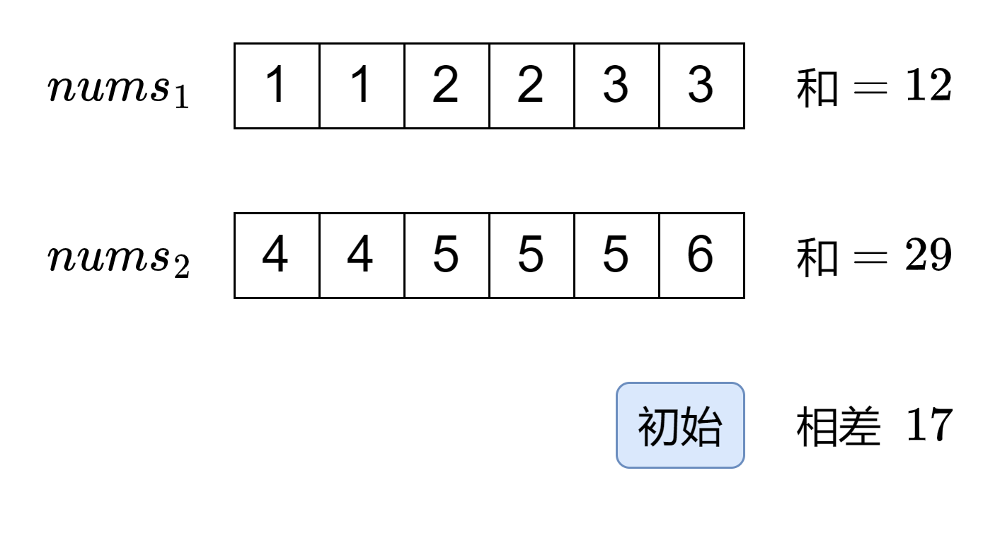
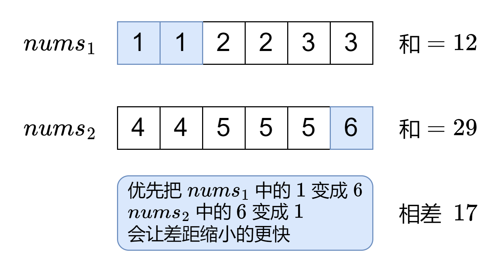
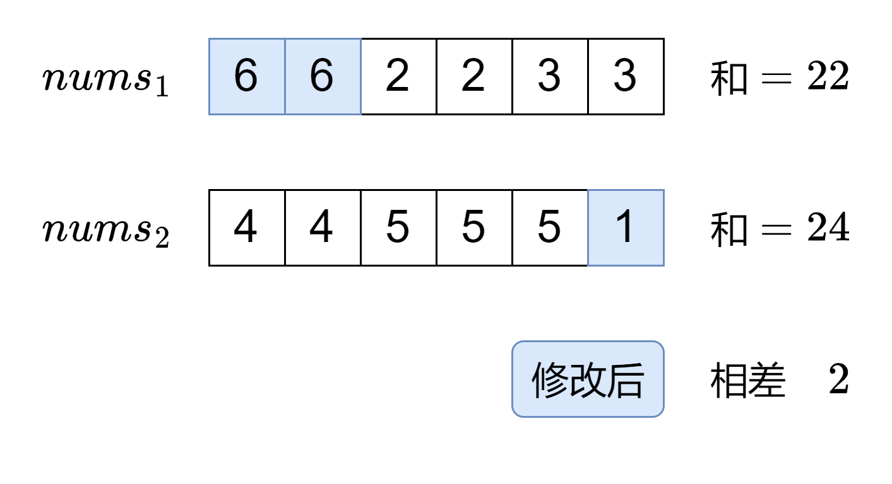
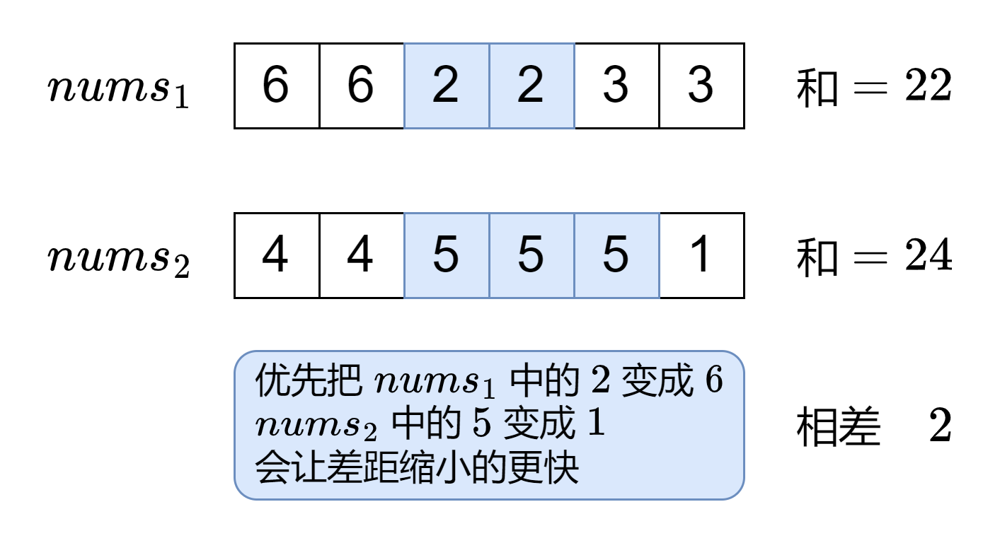
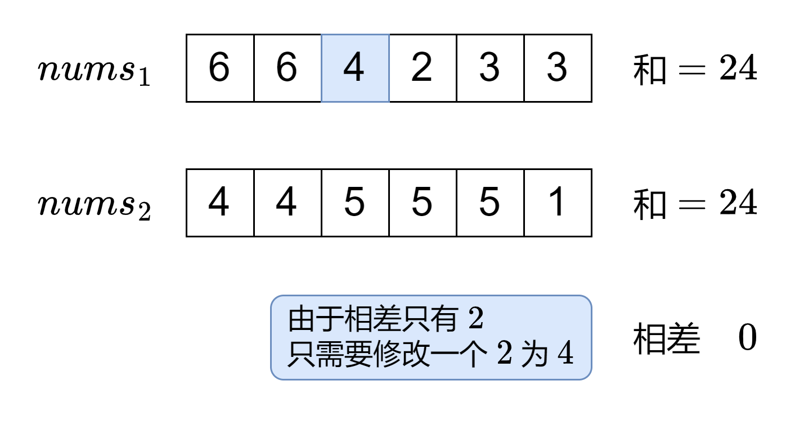

# 没想明白？一个动画秒懂！（Python/Java/C++/Go）

> **[1775. 通过最少操作次数使数组的和相等](https://leetcode.cn/problems/equal-sum-arrays-with-minimum-number-of-operations/solutions/2009786/mei-xiang-ming-bai-yi-ge-dong-hua-miao-d-ocuu/) · Medium · 难度分 1850**

> **所属题单**
> - [贪心算法 · 一、贪心策略](../../../刷题路径/灵神原版题单/贪心算法/一、贪心策略.md) · §1.1 从最小/最大开始贪心

> **题目描述**
> 给你两个长度可能不等的整数数组 `nums1` 和 `nums2` 。两个数组中的所有值都在 `1` 到 `6` 之间（包含 `1` 和 `6`）。
>
> 每次操作中，你可以选择 **任意** 数组中的任意一个整数，将它变成 `1` 到 `6` 之间 **任意** 的值（包含 `1` 和 `6`）。
>
> 请你返回使 `nums1` 中所有数的和与 `nums2` 中所有数的和相等的最少操作次数。如果无法使两个数组的和相等，请返回 `-1` 。
>
> **示例 1：**
>
> ```
> 输入：nums1 = [1,2,3,4,5,6], nums2 = [1,1,2,2,2,2]
> 输出：3
> 解释：你可以通过 3 次操作使 nums1 中所有数的和与 nums2 中所有数的和相等。以下数组下标都从 0 开始。
> - 将 nums2[0] 变为 6 。 nums1 = [1,2,3,4,5,6], nums2 = [6,1,2,2,2,2] 。
> - 将 nums1[5] 变为 1 。 nums1 = [1,2,3,4,5,1], nums2 = [6,1,2,2,2,2] 。
> - 将 nums1[2] 变为 2 。 nums1 = [1,2,2,4,5,1], nums2 = [6,1,2,2,2,2] 。
> ```
>
> **示例 2：**
>
> ```
> 输入：nums1 = [1,1,1,1,1,1,1], nums2 = [6]
> 输出：-1
> 解释：没有办法减少 nums1 的和或者增加 nums2 的和使二者相等。
> ```
>
> **示例 3：**
>
> ```
> 输入：nums1 = [6,6], nums2 = [1]
> 输出：3
> 解释：你可以通过 3 次操作使 nums1 中所有数的和与 nums2 中所有数的和相等。以下数组下标都从 0 开始。
> - 将 nums1[0] 变为 2 。 nums1 = [2,6], nums2 = [1] 。
> - 将 nums1[1] 变为 2 。 nums1 = [2,2], nums2 = [1] 。
> - 将 nums2[0] 变为 4 。 nums1 = [2,2], nums2 = [4] 。
> ```
>
> **提示：**
>
> - `1 <= nums1.length, nums2.length <= 10⁵`
>
> - `1 <= nums1[i], nums2[i] <= 6`

> **题解**
> <,,,,>
>
> #### 详细算法流程
>
> 不妨设 $\textit{nums}_1$ 的元素和小于 $\textit{nums}_2$ 的元素和（如果不是则交换这两数组），元素和的差为 $d$。
>
> 那么 $\textit{nums}_1$ 的元素需要变大，$\textit{nums}_2$ 的元素需要变小。
>
> 计算每个元素的**最大变化量**：
>
> - $\textit{nums}_1[i]$ 最大能变成 $6$，最大变化量为 $6-\textit{nums}_1[i]$；
> - $\textit{nums}_2[i]$ 最小能变成 $1$，最大变化量为 $\textit{nums}_2[i]-1$。
>
> 统计这些变化量的个数，记到一个哈希表或长为 $6$ 的数组 $\textit{cnt}$ 中，也就是有 $\textit{cnt}[i]$ 个数可以使 $d$ 减少 $i$。
>
> 那么从大到小枚举 $i=5,4,3,2,1$：
>
> - 如果 $d > i\cdot\textit{cnt}[i]$，那么应该把这 $\textit{cnt}[i]$ 个数的变化量拉满，并更新 $d$ 为 $d-i\cdot\textit{cnt}[i]$；
> - 否则，可以通过修改其中的 $\left\lceil\dfrac{d}{i}\right\rceil$ 个数，使 $d$ 恰好为 $0$，退出循环。
>
> 累加需要修改的数的个数，即为答案。如果无法使 $d=0$，返回 $-1$。
>
> #### 优化
>
> 假设 $\textit{nums}_1$ 的元素和小于 $\textit{nums}_2$ 的元素和。
>
> 把 $\textit{nums}_1$ 的所有数都改成 $6$，$\textit{nums}_2$ 的所有数都改成 $1$，如果 $\textit{nums}_1$ 的元素和仍然小于 $\textit{nums}_2$ 的元素和，则说明无论怎么操作，都无法使这两个数组的元素和相等。
>
> 对于 $\textit{nums}_1$ 的元素和大于 $\textit{nums}_2$ 的元素和的情况，也同理。
>
> 因此，设 $n$ 为 $\textit{nums}_1$ 的长度，$m$ 为 $\textit{nums}_2$ 的长度，我们可以在一开始就判断下：如果 $6n<m$ 或 $6m<n$，则直接返回 $-1$。否则，一定可以使两个数组的和相等，这是因为从「$\textit{nums}_1$ 的元素和小于 $\textit{nums}_2$ 的元素和」变到「$\textit{nums}_1$ 的元素和大于等于 $\textit{nums}_2$ 的元素和」，由于元素值可以变成 $[1,6]$ 中的任意值，我们可以每次操作只把一个元素增大 $1$ 或减小 $1$，这样必然会遇到元素和相差为 $0$ 的情况。
>
> ```python
> class Solution:
>     def minOperations(self, nums1: List[int], nums2: List[int]) -> int:
>         if 6 * len(nums1) < len(nums2) or 6 * len(nums2) < len(nums1):
>             return -1  # 优化
>         d = sum(nums2) - sum(nums1)  # 数组元素和的差，我们要让这个差变为 0
>         if d < 0:
>             d = -d
>             nums1, nums2 = nums2, nums1  # 统一让 nums1 的数变大，nums2 的数变小
>         ans = 0
>         # 统计每个数的最大变化量（nums1 的变成 6，nums2 的变成 1）
>         cnt = Counter(6 - x for x in nums1) + Counter(x - 1 for x in nums2)
>         for i in range(5, 0, -1):  # 从大到小枚举最大变化量 5 4 3 2 1
>             if i * cnt[i] >= d:  # 可以让 d 变为 0
>                 return ans + (d + i - 1) // i
>             ans += cnt[i]  # 需要所有最大变化量为 i 的数
>             d -= i * cnt[i]
> ```
>
>
> #### 复杂度分析
>
> - 时间复杂度：$O(n+m)$，其中 $n$ 为 $\textit{nums}_1$ 的长度，$m$ 为 $\textit{nums}_2$ 的长度。
> - 空间复杂度：$O(C)$。本题 $C=6$。
>
> ---
>
> 欢迎关注 [B站@灵茶山艾府](https://space.bilibili.com/206214)，最近正在连载 [【基础算法精讲】](https://www.bilibili.com/video/BV1AP41137w7/)，欢迎收看~
