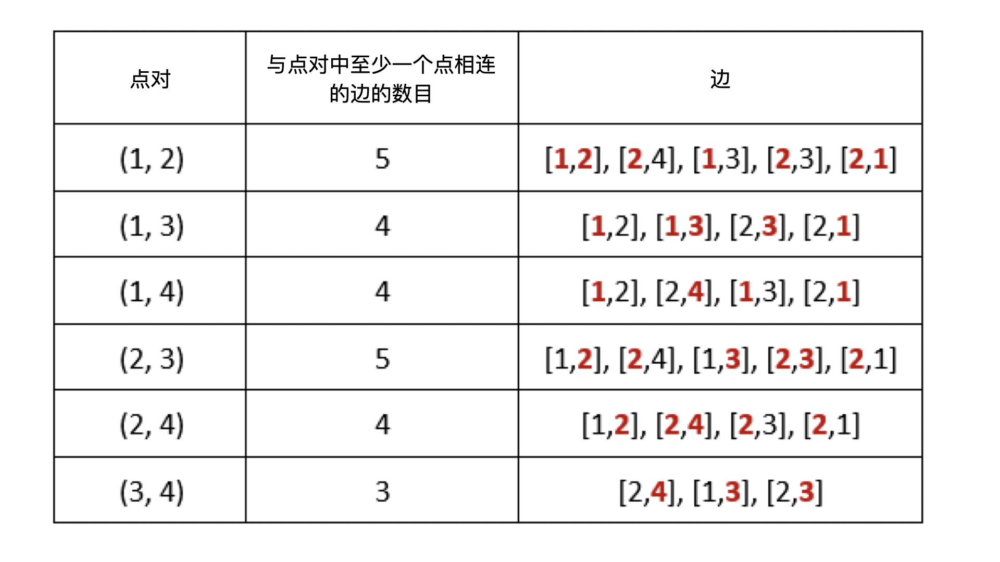

# 1782. 统计点对的数目

Hard · 难度分 2457 · [力扣原题](https://leetcode.cn/problems/count-pairs-of-nodes/)

所在刷题路径：灵神题单·滑动窗口与双指针、灵神题单·图论算法

| 作者 | 题解 | 动画讲解 |
|---|---|---|
| 灵茶山艾府 | [📄 题解](灵茶山艾府.md) | [▶︎ 动画（GIF）](1782%20统计点对的数目%20·%20灵茶山艾府.gif) · [mp4 文件](1782%20统计点对的数目%20·%20灵茶山艾府.mp4) |
| yiduobo | [📄 题解](yiduobo.md) | [▶︎ 动画（GIF）](1782%20统计点对的数目%20·%20yiduobo.gif) · [mp4 文件](1782%20统计点对的数目%20·%20yiduobo.mp4) |

## 动画讲解

> 动图会循环播放；想暂停、拖进度条请下载上面表格里的 mp4 文件。

### 灵茶山艾府


### yiduobo


## 题目描述

给你一个无向图，无向图由整数 `n`  ，表示图中节点的数目，和 `edges` 组成，其中 `edges[i] = [u_i, v_i]` 表示 `u_i` 和 `v_i`<sub> </sub>之间有一条无向边。同时给你一个代表查询的整数数组 `queries` 。

第 `j` 个查询的答案是满足如下条件的点对 `(a, b)` 的数目：

- `a < b`

- `cnt` 是与 `a` **或者** `b` 相连的边的数目，且 `cnt` **严格大于** `queries[j]` 。

请你返回一个数组 `answers` ，其中 `answers.length == queries.length` 且 `answers[j]` 是第 `j` 个查询的答案。

请注意，图中可能会有 **多重边** 。

**示例 1：**



```

输入：n = 4, edges = [[1,2],[2,4],[1,3],[2,3],[2,1]], queries = [2,3]
输出：[6,5]
解释：每个点对中，与至少一个点相连的边的数目如上图所示。
answers[0] = 6。所有的点对(a, b)中边数和都大于2，故有6个；
answers[1] = 5。所有的点对(a, b)中除了(3,4)边数等于3，其它点对边数和都大于3，故有5个。
```

**示例 2：**

```

输入：n = 5, edges = [[1,5],[1,5],[3,4],[2,5],[1,3],[5,1],[2,3],[2,5]], queries = [1,2,3,4,5]
输出：[10,10,9,8,6]
```

**提示：**

- `2 <= n <= 2 * 10⁴`

- `1 <= edges.length <= 10⁵`

- `1 <= u_i, v_i <= n`

- `u_i != v_i`

- `1 <= queries.length <= 20`

- `0 <= queries[j] < edges.length`

---
[↑ 返回 1700-1799](../README.md) · [总索引](../../../索引.md) · [仓库首页](../../../README.md)
