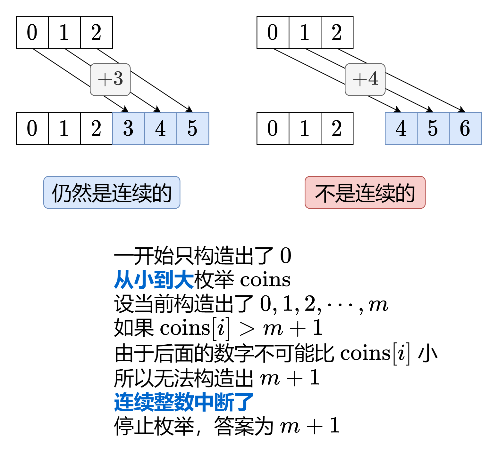

# 没想明白？一张图秒懂！（Python/Java/C++/Go）

> **[1798. 你能构造出连续值的最大数目](https://leetcode.cn/problems/maximum-number-of-consecutive-values-you-can-make/solutions/2091580/mei-xiang-ming-bai-yi-zhang-tu-miao-dong-7xlx/) · Medium · 难度分 1931**

> **所属题单**
> - [贪心算法 · 四、数学贪心](../../../刷题路径/灵神原版题单/贪心算法/四、数学贪心.md) · §4.6 归纳法

> **题目描述**
> 给你一个长度为 `n` 的整数数组 `coins` ，它代表你拥有的 `n` 个硬币。第 `i` 个硬币的值为 `coins[i]` 。如果你从这些硬币中选出一部分硬币，它们的和为 `x` ，那么称，你可以 **构造** 出 `x` 。
>
> 请返回从 `0` 开始（**包括** `0` ），你最多能 **构造** 出多少个连续整数。
>
> 你可能有多个相同值的硬币。
>
> **示例 1：**
>
> ```
>
> 输入：coins = [1,3]
> 输出：2
> 解释：你可以得到以下这些值：
> - 0：什么都不取 []
> - 1：取 [1]
> 从 0 开始，你可以构造出 2 个连续整数。
> ```
>
> **示例 2：**
>
> ```
>
> 输入：coins = [1,1,1,4]
> 输出：8
> 解释：你可以得到以下这些值：
> - 0：什么都不取 []
> - 1：取 [1]
> - 2：取 [1,1]
> - 3：取 [1,1,1]
> - 4：取 [4]
> - 5：取 [4,1]
> - 6：取 [4,1,1]
> - 7：取 [4,1,1,1]
> 从 0 开始，你可以构造出 8 个连续整数。
> ```
>
> **示例 3：**
>
> ```
>
> 输入：nums = [1,4,10,3,1]
> 输出：20
> ```
>
> **提示：**
>
> - `coins.length == n`
>
> - `1 <= n <= 4 * 10⁴`
>
> - `1 <= coins[i] <= 4 * 10⁴`

> **题解**
> ### 提示
>
> **有序**是一个强大的性质，如果对数组排序不影响答案的话，可以尝试将数组排序后，再重新思考，看看能否发现新的思路。
>
> 
>
> ```python
> class Solution:
>     def getMaximumConsecutive(self, coins: List[int]) -> int:
>         m = 0  # 一开始只能构造出 0
>         coins.sort()
>         for c in coins:
>             if c > m + 1:  # coins 已排序，后面没有比 c 更小的数了
>                 break  # 无法构造出 m+1，继续循环没有意义
>             m += c  # 可以构造出区间 [0,m+c] 中的所有整数
>         return m + 1  # [0,m] 中一共有 m+1 个整数
> ```
>
>
> ### 复杂度分析
>
> - 时间复杂度：$O(n\log n)$，其中 $n$ 为 $\textit{coins}$ 的长度。瓶颈在排序上。
> - 空间复杂度：$O(1)$。忽略排序时的栈空间，仅用到若干额外变量。
>
> ---
>
> 如果你觉得自己的思维能力有些薄弱，可以做做 [从周赛中学算法 - 2022 年周赛题目总结（下篇）](https://leetcode.cn/circle/discuss/WR1MJP/) 中的「思维题」这节，所有题目我都写了题解。
>
> 最后，欢迎关注【bilibili@灵茶山艾府】，每周更新算法教学视频~
