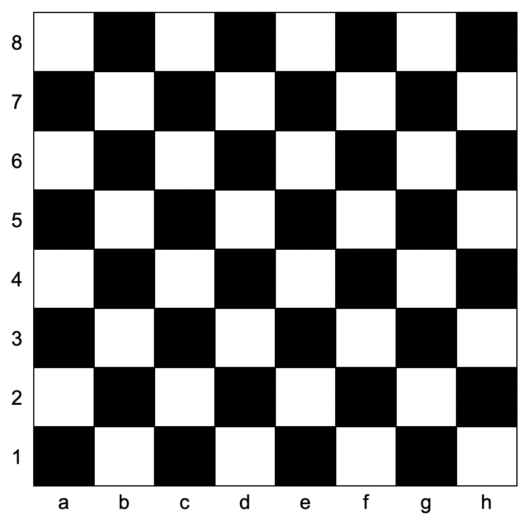

# 1812. 判断国际象棋棋盘中一个格子的颜色

Easy · [力扣原题](https://leetcode.cn/problems/determine-color-of-a-chessboard-square/)

| 作者 | 题解 | 动画讲解 |
|---|---|---|
| 灵茶山艾府 | [📄 题解](灵茶山艾府.md) | [▶︎ 1812 判断国际象棋棋盘中一个格子的颜色 · 灵茶山艾府.mp4](1812%20判断国际象棋棋盘中一个格子的颜色%20·%20灵茶山艾府.mp4) |
| yiduobo | [📄 题解](yiduobo.md) | [▶︎ 1812 判断国际象棋棋盘中一个格子的颜色 · yiduobo.mp4](1812%20判断国际象棋棋盘中一个格子的颜色%20·%20yiduobo.mp4) |

## 题目描述

给你一个坐标 `coordinates` ，它是一个字符串，表示国际象棋棋盘中一个格子的坐标。下图是国际象棋棋盘示意图。



如果所给格子的颜色是白色，请你返回 `true`，如果是黑色，请返回 `false` 。

给定坐标一定代表国际象棋棋盘上一个存在的格子。坐标第一个字符是字母，第二个字符是数字。

**示例 1：**

```

输入：coordinates = "a1"
输出：false
解释：如上图棋盘所示，"a1" 坐标的格子是黑色的，所以返回 false 。
```

**示例 2：**

```

输入：coordinates = "h3"
输出：true
解释：如上图棋盘所示，"h3" 坐标的格子是白色的，所以返回 true 。
```

**示例 3：**

```

输入：coordinates = "c7"
输出：false
```

**提示：**

- `coordinates.length == 2`

- `'a' <= coordinates[0] <= 'h'`

- `'1' <= coordinates[1] <= '8'`

---
[↑ 返回 1800-1899](../README.md) · [总索引](../../../索引.md) · [仓库首页](../../../README.md)
