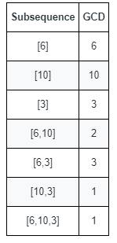

# 击败100%！枚举GCD+循环优化（Python/Java/C++/Go）

> **[1819. 序列中不同最大公约数的数目](https://leetcode.cn/problems/number-of-different-subsequences-gcds/solutions/2061079/ji-bai-100mei-ju-gcdxun-huan-you-hua-pyt-get7/) · Hard · 难度分 2540**

> **所属题单**
> - [数学算法 · 一、数论](../../../刷题路径/灵神原版题单/数学算法/一、数论.md) · §1.6 最大公约数（GCD）

> **题目描述**
> 给你一个由正整数组成的数组 `nums` 。
>
> 数字序列的 **最大公约数** 定义为序列中所有整数的共有约数中的最大整数。
>
> - 例如，序列 `[4,6,16]` 的最大公约数是 `2` 。
>
> 数组的一个 **子序列** 本质是一个序列，可以通过删除数组中的某些元素（或者不删除）得到。
>
> - 例如，`[2,5,10]` 是 `[1,2,1,2,4,1,5,10]` 的一个子序列。
>
> 计算并返回 `nums` 的所有 **非空** 子序列中 **不同** 最大公约数的 **数目** 。
>
> **示例 1：**
>
> 
>
> ```
>
> 输入：nums = [6,10,3]
> 输出：5
> 解释：上图显示了所有的非空子序列与各自的最大公约数。
> 不同的最大公约数为 6 、10 、3 、2 和 1 。
> ```
>
> **示例 2：**
>
> ```
>
> 输入：nums = [5,15,40,5,6]
> 输出：7
> ```
>
> **提示：**
>
> - `1 <= nums.length <= 10⁵`
>
> - `1 <= nums[i] <= 2 * 10⁵`

> **题解**
> ### 横看成岭侧成峰。
>
> 由于非空子序列的数量高达 $2^n-1$，直接回溯枚举是会超时的。不妨换一个视角，考虑**值域**。
>
> 多个数的最大公约数等于 $g$，也反过来说明这些数都是 $g$ 的倍数。例如 $[8,12,6]$ 的最大公约数是 $2$，这些数都是 $2$ 的倍数。
>
> ### 【值域】【倍数】
>
> 那么，能不能反过来，枚举 $g$ 的倍数呢？（找在 $\textit{nums}$ 中的倍数）
>
> - $1,2,3,\cdots$
> - $2,4,6,\cdots$
> - $3,6,9,\cdots$
>
> 看上去运行时间是平方级别，会超时。
>
> ### 先别急着否定，这里得来点数学。
>
> 设 $U=\max(\textit{nums})$，那么 $1$ 的倍数需要枚举 $\left\lfloor\dfrac{U}{1}\right\rfloor$ 个，$2$ 的倍数需要枚举 $\left\lfloor\dfrac{U}{2}\right\rfloor$ 个，……，把这些加起来，去掉下取整，有
>
> $$
> \left\lfloor\dfrac{U}{1}\right\rfloor + \left\lfloor\dfrac{U}{2}\right\rfloor +\cdots + \left\lfloor\dfrac{U}{U}\right\rfloor \le U\cdot\left(\dfrac{1}{1} + \dfrac{1}{2} + \cdots + \dfrac{1}{U}\right)
> $$
>
> 右边括号中的叫做 [调和级数部分和](https://baike.baidu.com/item/%E8%B0%83%E5%92%8C%E7%BA%A7%E6%95%B0/8019971?fr=aladdin#3)，可以看成是 $\mathcal{O}(\log U)$ 的，因此枚举倍数的时间复杂度为 $\mathcal{O}(U\log U)$，不会超时。
>
> 那么就枚举 $i=1,2,\cdots,U$ 及其倍数，当作子序列中的数。
>
> ### 子序列中的数越多，$g$ 就可能越小，就越可能等于 $i$。
>
> 例如，如果枚举 $i=2$ 的倍数，其中 $8$ 和 $12$ 是在 $\textit{nums}$ 中的，但由于 $8$ 和 $12$ 的最大公约数等于 $4$，所以无法找到一个子序列，其最大公约数为 $i$。但如果还有 $6$ 也在 $\textit{nums}$ 中，那么最大公约数等于 $2$，这样 $i$ 就可以是一个子序列的最大公约数了。
>
> 代码实现时，需要用哈希表或者数组，记录每个数是否在 $\textit{nums}$ 中，从而加快判断。数组的效率会更高一些。
>
> ### 优化前
>
> ```python
> class Solution:
>     def countDifferentSubsequenceGCDs(self, nums: List[int]) -> int:
>         mx = max(nums)
>         has = [False] * (mx + 1)
>         for x in nums:
>             has[x] = True
>
>         ans = 0
>         for i in range(1, mx + 1):
>             g = 0  # 0 和任何数 x 的最大公约数都是 x
>             for j in range(i, mx + 1, i):  # 枚举 i 的倍数 j
>                 if has[j]:  # 如果 j 在 nums 中
>                     g = gcd(g, j)  # 更新最大公约数
>                     if g == i:  # 找到一个答案（g 无法继续减小）
>                         ans += 1
>                         break  # 提前退出循环
>         return ans
> ```
>
>
> ### 优化
>
> 答案可以由两部分组成：
>
> - 子序列的长度为 $1$，此时最大公约数等于 $\textit{nums}[i]$，这部分可以给答案贡献 $m$ 个，这里 $m$ 为 $\textit{nums}$ 中不同元素的个数。
> - 子序列的长度至少为 $2$，为了避免重复统计，此时最大公约数 $i$ 必须不在 $\textit{nums}$ 中。此外，要想使最大公约数为 $i$，$\textit{nums}$ 中**最小**要有 $2i$ 和 $3i$ 这两个数，这样最大公约数才能是 $i$。因此，**$i$ 只需要枚举到 $\left\lfloor\dfrac{U}{3}\right\rfloor$**。
>
> 凭借这个优化，下面的代码可以在时间上击败 $100\%$（截至本文发布时）。
>
> ```python
> class Solution:
>     def countDifferentSubsequenceGCDs(self, nums: List[int]) -> int:
>         ans = 0
>         mx = max(nums)
>         has = [False] * (mx + 1)
>         for x in nums:
>             if not has[x]:
>                 has[x] = True
>                 ans += 1  # 单独一个数也算
>
>         for i in range(1, mx // 3 + 1):  # 优化循环上界
>             if has[i]:
>                 continue
>             g = 0  # 0 和任何数 x 的最大公约数都是 x
>             for j in range(i * 2, mx + 1, i):  # 枚举 i 的倍数 j
>                 if has[j]:  # 如果 j 在 nums 中
>                     g = gcd(g, j)  # 更新最大公约数
>                     if g == i:  # 找到一个答案（g 无法继续减小）
>                         ans += 1
>                         break  # 提前退出循环
>         return ans
> ```
>
>
> #### 复杂度分析
>
> - 时间复杂度：$\mathcal{O}(n+U\log U)$，其中 $n$ 为 $\textit{nums}$ 的长度，$U=\max(\textit{nums})$。二重循环的时间复杂度分两部分，第一部分是**二重循环的次数**，根据 [调和级数部分和](https://baike.baidu.com/item/%E8%B0%83%E5%92%8C%E7%BA%A7%E6%95%B0/8019971?fr=aladdin#3)，循环次数为 $\mathcal{O}(U\log U)$；第二部分是**计算 $g$ 的总时间**，由于 $g$ 每次计算要么不变，要么至少减半，所以实际上 $g$ 在内层循环中至多减半 $\mathcal{O}(\log U)$ 次，计算 $g$ 的时间对于每个 $i$ 都是 $\mathcal{O}(\log U)$ 的，因此这部分的时间复杂度也为 $\mathcal{O}(U\log U)$。最后，加上遍历 $\textit{nums}$ 的 $\mathcal{O}(n)$ 时间，总的时间复杂度为 $\mathcal{O}(n+U\log U)$。
> - 空间复杂度：$\mathcal{O}(U)$。
>
> 更多题目，见下面数学题单中的 GCD 小节。
>
> ## 分类题单
>
> [如何科学刷题？](https://leetcode.cn/circle/discuss/RvFUtj/)
>
> 1. [滑动窗口与双指针（定长/不定长/单序列/双序列/三指针/分组循环）](https://leetcode.cn/circle/discuss/0viNMK/)
> 2. [二分算法（二分答案/最小化最大值/最大化最小值/第K小）](https://leetcode.cn/circle/discuss/SqopEo/)
> 3. [单调栈（基础/矩形面积/贡献法/最小字典序）](https://leetcode.cn/circle/discuss/9oZFK9/)
> 4. [网格图（DFS/BFS/综合应用）](https://leetcode.cn/circle/discuss/YiXPXW/)
> 5. [位运算（基础/性质/拆位/试填/恒等式/思维）](https://leetcode.cn/circle/discuss/dHn9Vk/)
> 6. [图论算法（DFS/BFS/拓扑排序/最短路/最小生成树/二分图/基环树/欧拉路径）](https://leetcode.cn/circle/discuss/01LUak/)
> 7. [动态规划（入门/背包/状态机/划分/区间/状压/数位/数据结构优化/树形/博弈/概率期望）](https://leetcode.cn/circle/discuss/tXLS3i/)
> 8. [常用数据结构（前缀和/差分/栈/队列/堆/字典树/并查集/树状数组/线段树）](https://leetcode.cn/circle/discuss/mOr1u6/)
> 9. [数学算法（数论/组合/概率期望/博弈/计算几何/随机算法）](https://leetcode.cn/circle/discuss/IYT3ss/)
> 10. [贪心与思维（基本贪心策略/反悔/区间/字典序/数学/思维/脑筋急转弯/构造）](https://leetcode.cn/circle/discuss/g6KTKL/)
> 11. [链表、二叉树与回溯（前后指针/快慢指针/DFS/BFS/直径/LCA/一般树）](https://leetcode.cn/circle/discuss/K0n2gO/)
> 12. [字符串（KMP/Z函数/Manacher/字符串哈希/AC自动机/后缀数组/子序列自动机）](https://leetcode.cn/circle/discuss/SJFwQI/)
>
> [我的题解精选（已分类）](https://github.com/EndlessCheng/codeforces-go/blob/master/leetcode/SOLUTIONS.md)
>
> 欢迎关注 [B站@灵茶山艾府](https://space.bilibili.com/206214)
