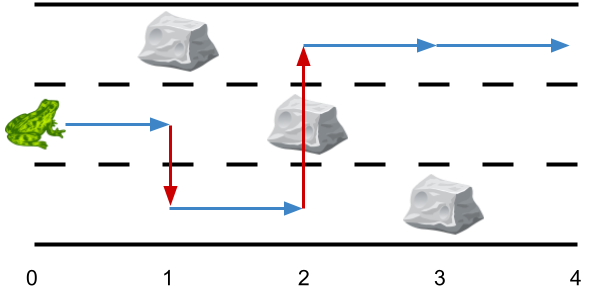
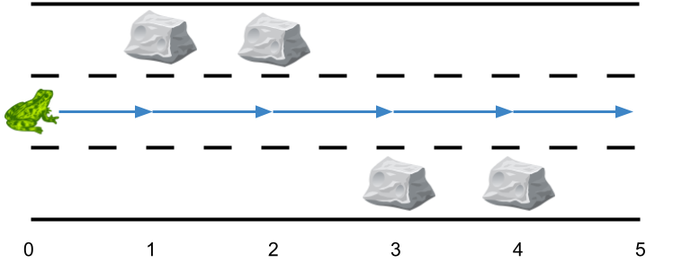
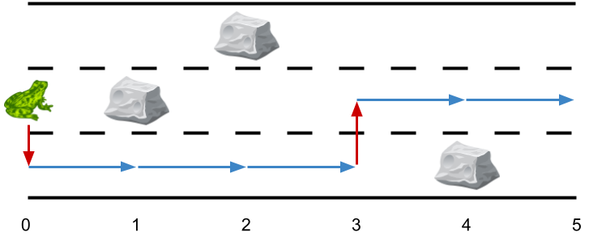
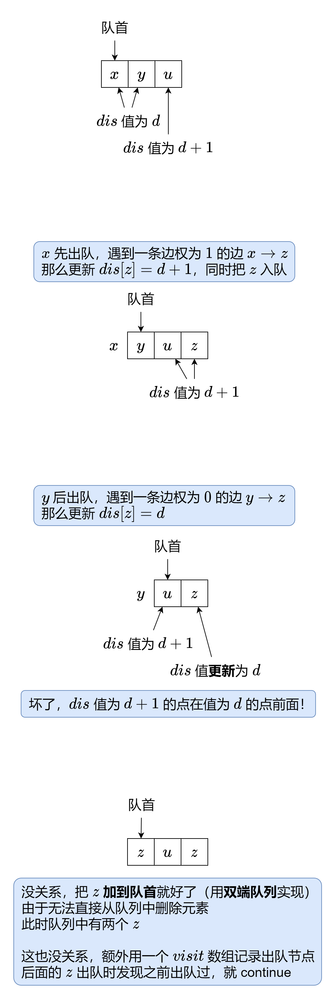

# 从 0 到 1 的 0-1 BFS（Python/Java/C++/Go）

> **[1824. 最少侧跳次数](https://leetcode.cn/problems/minimum-sideway-jumps/solutions/2071617/cong-0-dao-1-de-0-1-bfspythonjavacgo-by-1m8z4/) · Medium · 难度分 1778**

> **所属题单**
> - [网格图 · 三、网格图 0-1 BFS](../../../刷题路径/灵神原版题单/网格图/三、网格图%200-1%20BFS.md)
> - [动态规划 · 二、网格图 DP](../../../刷题路径/灵神原版题单/动态规划/二、网格图%20DP.md) · §2.1 基础

> **题目描述**
> 给你一个长度为 `n` 的 **3 跑道道路** ，它总共包含 `n + 1` 个 **点** ，编号为 `0` 到 `n` 。一只青蛙从 `0` 号点第二条跑道 **出发** ，它想要跳到点 `n` 处。然而道路上可能有一些障碍。
>
> 给你一个长度为 `n + 1` 的数组 `obstacles` ，其中 `obstacles[i]` （**取值范围从 0 到 3**）表示在点 `i` 处的 `obstacles[i]` 跑道上有一个障碍。如果 `obstacles[i] == 0` ，那么点 `i` 处没有障碍。任何一个点的三条跑道中 **最多有一个** 障碍。
>
> - 比方说，如果 `obstacles[2] == 1` ，那么说明在点 2 处跑道 1 有障碍。
>
> 这只青蛙从点 `i` 跳到点 `i + 1` 且跑道不变的前提是点 `i + 1` 的同一跑道上没有障碍。为了躲避障碍，这只青蛙也可以在 **同一个** 点处 **侧跳** 到 **另外一条** 跑道（这两条跑道可以不相邻），但前提是跳过去的跑道该点处没有障碍。
>
> - 比方说，这只青蛙可以从点 3 处的跑道 3 跳到点 3 处的跑道 1 。
>
> 这只青蛙从点 0 处跑道 `2` 出发，并想到达点 `n` 处的 **任一跑道** ，请你返回 **最少侧跳次数** 。
>
> **注意**：点 `0` 处和点 `n` 处的任一跑道都不会有障碍。
>
> **示例 1：**
>
> 
>
> ```
>
> 输入：obstacles = [0,1,2,3,0]
> 输出：2
> 解释：最优方案如上图箭头所示。总共有 2 次侧跳（红色箭头）。
> 注意，这只青蛙只有当侧跳时才可以跳过障碍（如上图点 2 处所示）。
> ```
>
> **示例 2：**
>
> 
>
> ```
>
> 输入：obstacles = [0,1,1,3,3,0]
> 输出：0
> 解释：跑道 2 没有任何障碍，所以不需要任何侧跳。
> ```
>
> **示例 3：**
>
> 
>
> ```
>
> 输入：obstacles = [0,2,1,0,3,0]
> 输出：2
> 解释：最优方案如上图所示。总共有 2 次侧跳。
> ```
>
> **提示：**
>
> - `obstacles.length == n + 1`
>
> - `1 <= n <= 5 * 10⁵`
>
> - `0 <= obstacles[i] <= 3`
>
> - `obstacles[0] == obstacles[n] == 0`

> **题解**
> ## 转化
>
> 把 $3$ 条跑道看成是一个 $n+1$ 列 $3$ 行的网格图。设列号为 $i\in [0,n]$，行号为 $j\in [0,2]$：
>
> - 如果 $(i,j)$ 和 $(i+1,j)$ 都没有障碍，则连一条边权为 $0$ 的边，表示跑道不变；
> - 如果 $(i,j)$ 和 $(i,k)\ (k\ne j)$ 都没有障碍，则连一条边权为 $1$ 的边，表示侧跳。
>
> 原问题可以转换成在该网格图上，求 $(0,1)$ 到 $(n,j)$ 的最短路长度。
>
> 这个问题你可以直接用 Dijkstra 算法解决，但还有更快的做法。
>
> ## 线性！我要线性时间复杂度！
>
> 我在[【基础算法精讲 13】](https://www.bilibili.com/video/BV1hG4y1277i/)中讲解了树上的 BFS，简单解释了 BFS 为什么要用队列，以及为什么用队列能得到正确结果。这里额外补充两点：
>
> 1. 对于一棵边权均为 $1$ 的**树**来说，BFS 算法可以求出起点到其余点的最短路的长度，我们把它记录到一个 $\textit{dis}$ 数组中，$\textit{dis}[x]$ 表示起点到 $x$ 的最短路的长度。$x$ 出队时，对于一条 $x\rightarrow y$ 的边，更新 $\textit{dis}[y]=\textit{dis}[x]+1$，然后把 $y$ 入队。
> 2. 在任何情况下，队列中只会含有 $\textit{dis}$ 值为 $d$ 和 $d+1$ 的点，且 $\textit{dis}$ **值为 $d$ 的点一定排在值为 $d+1$ 的点前面**（这个叫 **BFS 的两段性**）。
>
> 如果你只会树上的 BFS（边权均为 $1$），那么还需要解决两个问题：
>
> 1. 怎么处理图上的 BFS（边权均为 $1$）。
> 2. 怎么处理图上还有边权为 $0$ 的情况。
>
> 对于一条 $x\rightarrow y$ 的边，如果 $\textit{dis}[y]\le\textit{dis}[x]+1$，那么无需更新 $\textit{dis}[y]$，也无需把 $y$ 入队了，这样就解决了上面的问题 1。
>
> 如果图上还有边权为 $0$ 的边，问题就变得复杂了，可能会出现下面的情况：
>
> {:width=500}
>
> ## 总结
>
> 1. 对于边权为 $0$ 的边 $x\rightarrow y$，如果 $\textit{dis}[x]<dis[y]$，更新 $\textit{dis}[y]=\textit{dis}[x]$，把 $y$ 加到队首。
> 2. 对于边权为 $1$ 的边 $x\rightarrow y$，如果 $\textit{dis}[x]+1<dis[y]$，更新 $\textit{dis}[y]=\textit{dis}[x]+1$，把 $y$ 加到队尾。
>
> 这个算法叫 0-1 BFS。
>
> > 注：如果边权不止 $0$ 和 $1$，把双端队列换成最小堆，就得到了 Dijkstra 算法。
>
> 代码实现时，只要我们到达了第 $n$ 列中的某一行，就可以直接返回答案，因为到第 $n$ 列另外两行的最短路不会比当前的小。
>
> ## 答疑
>
> **问**：为什么青蛙一定能到达终点？
>
> **答**：你想把青蛙堵住是吧？由于有 $3$ 条跑道，且每列至多有一个障碍，那么唯一的**堵住**方式就是示例 $1$ 所展示的，$3$ 个障碍斜着摆放。青蛙不屑地看了看你，侧着跳走了。
>
> **问**：为什么代码中没有使用 $\textit{vis}$ 数组？
>
> **答**：对于节点 $x$，它第一次出队后，会去更新 $x$ 的邻居的 $\textit{dis}$ 值。它第二次出队时，由于 $x$ 的邻居的 $\textit{dis}$ 值已经被更新过，所以此时 $x$ 必不能更新邻居的 $\textit{dis}$ 值，无法产生任何影响，所以 $\textit{vis}$ 数组是多余的。
>
> > Dijkstra 算法也可以不要 $\textit{vis}$ 数组，在出堆时判断下，如果堆中存的 $\textit{dis}$ 超过了实际的 $\textit{dis}$ 值，可以直接 continue。
>
> ```python
> class Solution:
>     def minSideJumps(self, obstacles: List[int]) -> int:
>         n = len(obstacles)
>         dis = [[n] * 3 for _ in range(n)]
>         dis[0][1] = 0
>         q = deque([(0, 1)])  # 起点
>         while True:
>             i, j = q.popleft()
>             d = dis[i][j]
>             if i == n - 1: return d  # 到达终点
>             if obstacles[i + 1] != j + 1 and d < dis[i + 1][j]:  # 向右
>                 dis[i + 1][j] = d
>                 q.appendleft((i + 1, j))  # 加到队首
>             for k in (j + 1) % 3, (j + 2) % 3:  # 枚举另外两条跑道（向上/向下）
>                 if obstacles[i] != k + 1 and d + 1 < dis[i][k]:
>                     dis[i][k] = d + 1
>                     q.append((i, k))  # 加到队尾
> ```
>
>
> #### 复杂度分析
>
> - 时间复杂度：$\mathcal{O}(n)$，其中 $n$ 为 $\textit{obstacles}$ 的长度。根据 BFS 的两段性，每个点至多入队两次，一次在队尾，另一次在队首。
> - 空间复杂度：$\mathcal{O}(n)$。
>
> ## 相似题目
>
> - [1368. 使网格图至少有一条有效路径的最小代价](https://leetcode.cn/problems/minimum-cost-to-make-at-least-one-valid-path-in-a-grid/) 2069
> - [2290. 到达角落需要移除障碍物的最小数目](https://leetcode.cn/problems/minimum-obstacle-removal-to-reach-corner/) 2138
>
> ## 分类题单
>
> [如何科学刷题？](https://leetcode.cn/circle/discuss/RvFUtj/)
>
> 1. [滑动窗口与双指针（定长/不定长/单序列/双序列/三指针/分组循环）](https://leetcode.cn/circle/discuss/0viNMK/)
> 2. [二分算法（二分答案/最小化最大值/最大化最小值/第K小）](https://leetcode.cn/circle/discuss/SqopEo/)
> 3. [单调栈（基础/矩形面积/贡献法/最小字典序）](https://leetcode.cn/circle/discuss/9oZFK9/)
> 4. [网格图（DFS/BFS/综合应用）](https://leetcode.cn/circle/discuss/YiXPXW/)
> 5. [位运算（基础/性质/拆位/试填/恒等式/思维）](https://leetcode.cn/circle/discuss/dHn9Vk/)
> 6. [图论算法（DFS/BFS/拓扑排序/基环树/最短路/最小生成树/网络流）](https://leetcode.cn/circle/discuss/01LUak/)
> 7. [动态规划（入门/背包/划分/状态机/区间/状压/数位/数据结构优化/树形/博弈/概率期望）](https://leetcode.cn/circle/discuss/tXLS3i/)
> 8. [常用数据结构（前缀和/差分/栈/队列/堆/字典树/并查集/树状数组/线段树）](https://leetcode.cn/circle/discuss/mOr1u6/)
> 9. [数学算法（数论/组合/概率期望/博弈/计算几何/随机算法）](https://leetcode.cn/circle/discuss/IYT3ss/)
> 10. [贪心与思维（基本贪心策略/反悔/区间/字典序/数学/思维/脑筋急转弯/构造）](https://leetcode.cn/circle/discuss/g6KTKL/)
> 11. [链表、二叉树与回溯（前后指针/快慢指针/DFS/BFS/直径/LCA/一般树）](https://leetcode.cn/circle/discuss/K0n2gO/)
> 12. [字符串（KMP/Z函数/Manacher/字符串哈希/AC自动机/后缀数组/子序列自动机）](https://leetcode.cn/circle/discuss/SJFwQI/)
>
> [我的题解精选（已分类）](https://github.com/EndlessCheng/codeforces-go/blob/master/leetcode/SOLUTIONS.md)
>
> 欢迎关注 [B站@灵茶山艾府](https://space.bilibili.com/206214)
