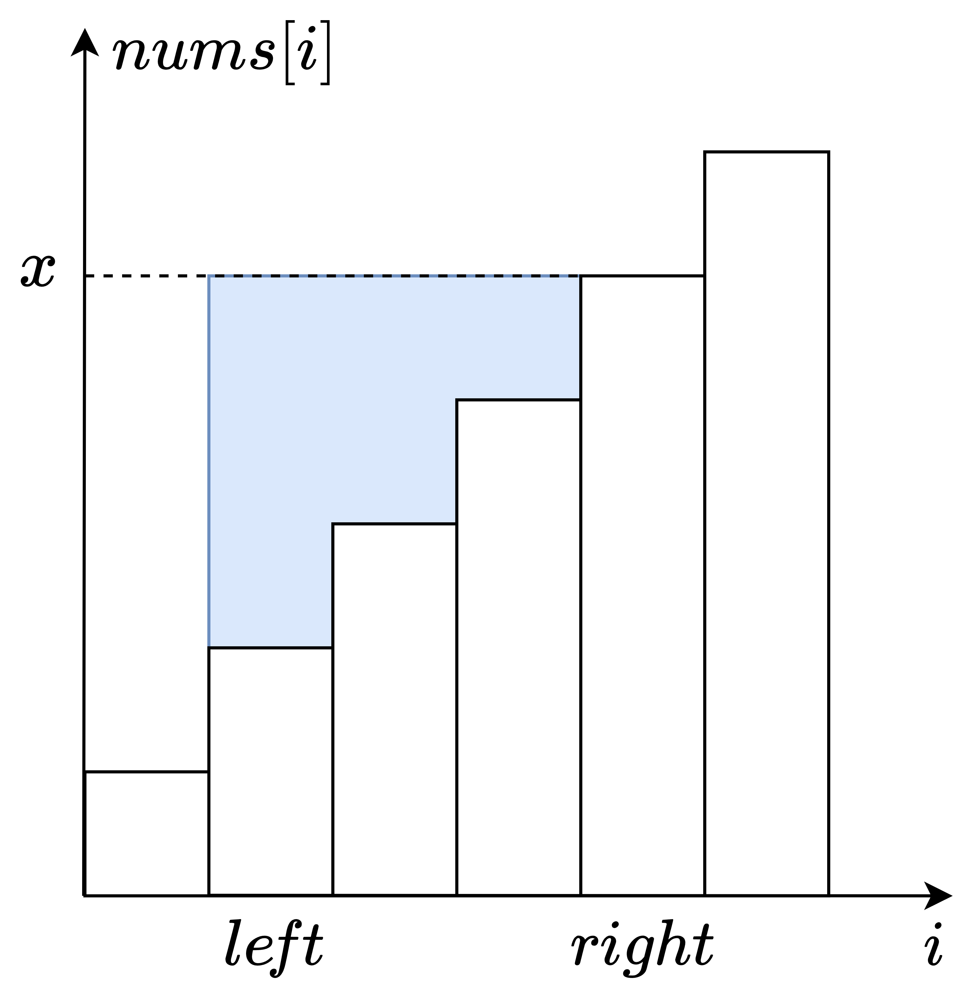

# 排序+滑动窗口（Python/Java/C++/C/Go/JS/Rust）

> **[1838. 最高频元素的频数](https://leetcode.cn/problems/frequency-of-the-most-frequent-element/solutions/742562/pai-xu-qian-zhui-he-er-fen-zuo-duan-dian-xegv/) · Medium · 难度分 1876**

> **所属题单**
> - [滑动窗口与双指针 · 二、不定长滑动窗口](../../../刷题路径/灵神原版题单/滑动窗口与双指针/二、不定长滑动窗口.md) · §2.1 越短越合法/求最长/最大 · §2.1.2 进阶（选做）

> **题目描述**
> 元素的 **频数** 是该元素在一个数组中出现的次数。
>
> 给你一个整数数组 `nums` 和一个整数 `k` 。在一步操作中，你可以选择 `nums` 的一个下标，并将该下标对应元素的值增加 `1` 。
>
> 执行最多 `k` 次操作后，返回数组中最高频元素的 **最大可能频数** <em>。</em>
>
> **示例 1：**
>
> ```
>
> 输入：nums = [1,2,4], k = 5
> 输出：3
> 解释：对第一个元素执行 3 次递增操作，对第二个元素执 2 次递增操作，此时 nums = [4,4,4] 。
> 4 是数组中最高频元素，频数是 3 。
> ```
>
> **示例 2：**
>
> ```
>
> 输入：nums = [1,4,8,13], k = 5
> 输出：2
> 解释：存在多种最优解决方案：
> - 对第一个元素执行 3 次递增操作，此时 nums = [4,4,8,13] 。4 是数组中最高频元素，频数是 2 。
> - 对第二个元素执行 4 次递增操作，此时 nums = [1,8,8,13] 。8 是数组中最高频元素，频数是 2 。
> - 对第三个元素执行 5 次递增操作，此时 nums = [1,4,13,13] 。13 是数组中最高频元素，频数是 2 。
> ```
>
> **示例 3：**
>
> ```
>
> 输入：nums = [3,9,6], k = 2
> 输出：1
> ```
>
> **提示：**
>
> - `1 <= nums.length <= 10⁵`
>
> - `1 <= nums[i] <= 10⁵`
>
> - `1 <= k <= 10⁵`

> **题解**
> 比如 $\textit{nums}=[1,4,1,2]$，把其中的 $1,1,2$ 都变成 $3$ 是没有意义的，因为都变成 $2$ 需要的操作次数更少，更容易实现。
>
> 所以最高频元素一定可以等于某个 $\textit{nums}[i]$。
>
> 枚举这个数，设其为 $x$。
>
> 由于我们只能把元素变大，所以只能把小于 $x$ 的数变大。
>
> 为了能操作更多的元素，优先把与 $x$ 相差小的数变大。
>
> 怎么快速找到要变大的数？
>
> 既然我们只关心元素的个数，并不关心元素的相对顺序，所以先把 $\textit{nums}$ 从小到大排序。
>
> 排序后，要变大的数就是一段连续的子数组了。子数组越长，需要的操作次数越多，越无法实现；子数组越短，需要的操作次数越少，越可以实现。有这样的性质，可以用**滑动窗口**解决，原理请看视频[【基础算法精讲 03】](https://www.bilibili.com/video/BV1hd4y1r7Gq/)。
>
> 设子数组的下标范围为 $[\textit{left},\textit{right}]$，子数组和为 $\textit{sum}$，那么需要操作多少次？
>
> {:width=400px}
>
> 如上图，矩形底边长为 $\textit{right}-\textit{left}+1$，高为 $x=\textit{nums}[\textit{right}]$，面积为 $(\textit{right}-\textit{left}+1)\cdot x$，减去子数组和 $\textit{sum}$，得到需要的操作次数（蓝色面积）为
>
> $$
> (\textit{right}-\textit{left}+1)\cdot x - \textit{sum}
> $$
>
> 如果上式大于 $k$，需要缩短窗口，减少 $\textit{sum}$，增加 $\textit{left}$。
>
> 缩短窗口到可以操作，用子数组长度 $\textit{right}-\textit{left}+1$ 更新答案的最大值。
>
> ```python
> class Solution:
>     def maxFrequency(self, nums: List[int], k: int) -> int:
>         nums.sort()
>         ans = s = left = 0
>         for right, x in enumerate(nums):
>             s += x
>             while (right - left + 1) * x - s > k:
>                 s -= nums[left]
>                 left += 1
>             ans = max(ans, right - left + 1)
>         return ans
> ```
>
>
> #### 复杂度分析
>
> - 时间复杂度：$\mathcal{O}(n\log n)$，其中 $n$ 是 $\textit{nums}$ 的长度。瓶颈在排序上。
> - 空间复杂度：$\mathcal{O}(1)$。忽略排序的栈开销。
>
> ## 专题训练
>
> 见下面滑动窗口题单的「**二、不定长滑动窗口**」。
>
> ## 分类题单
>
> [如何科学刷题？](https://leetcode.cn/circle/discuss/RvFUtj/)
>
> 1. [滑动窗口与双指针（定长/不定长/单序列/双序列/三指针/分组循环）](https://leetcode.cn/circle/discuss/0viNMK/)
> 2. [二分算法（二分答案/最小化最大值/最大化最小值/第K小）](https://leetcode.cn/circle/discuss/SqopEo/)
> 3. [单调栈（基础/矩形面积/贡献法/最小字典序）](https://leetcode.cn/circle/discuss/9oZFK9/)
> 4. [网格图（DFS/BFS/综合应用）](https://leetcode.cn/circle/discuss/YiXPXW/)
> 5. [位运算（基础/性质/拆位/试填/恒等式/思维）](https://leetcode.cn/circle/discuss/dHn9Vk/)
> 6. [图论算法（DFS/BFS/拓扑排序/基环树/最短路/最小生成树/网络流）](https://leetcode.cn/circle/discuss/01LUak/)
> 7. [动态规划（入门/背包/划分/状态机/区间/状压/数位/数据结构优化/树形/博弈/概率期望）](https://leetcode.cn/circle/discuss/tXLS3i/)
> 8. [常用数据结构（前缀和/差分/栈/队列/堆/字典树/并查集/树状数组/线段树）](https://leetcode.cn/circle/discuss/mOr1u6/)
> 9. [数学算法（数论/组合/概率期望/博弈/计算几何/随机算法）](https://leetcode.cn/circle/discuss/IYT3ss/)
> 10. [贪心与思维（基本贪心策略/反悔/区间/字典序/数学/思维/脑筋急转弯/构造）](https://leetcode.cn/circle/discuss/g6KTKL/)
> 11. [链表、树与回溯（前后指针/快慢指针/DFS/BFS/直径/LCA）](https://leetcode.cn/circle/discuss/K0n2gO/)
> 12. [字符串（KMP/Z函数/Manacher/字符串哈希/AC自动机/后缀数组/子序列自动机）](https://leetcode.cn/circle/discuss/SJFwQI/)
>
> [我的题解精选（已分类）](https://github.com/EndlessCheng/codeforces-go/blob/master/leetcode/SOLUTIONS.md)
>
> 欢迎关注 [B站@灵茶山艾府](https://space.bilibili.com/206214)
