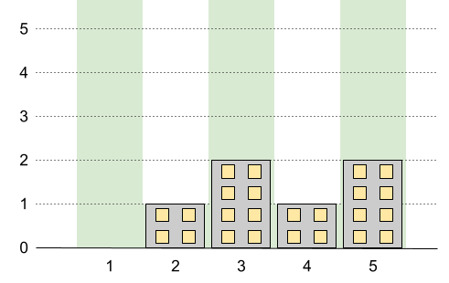

# 1840. 最高建筑高度

Hard · 难度分 2374 · [力扣原题](https://leetcode.cn/problems/maximum-building-height/)

所在刷题路径：灵神题单·贪心与思维

| 作者 | 题解 | 动画讲解 |
|---|---|---|
| 灵茶山艾府 | [📄 题解](灵茶山艾府.md) | [▶︎ 动画（GIF）](1840%20最高建筑高度%20·%20灵茶山艾府.gif) · [mp4 文件](1840%20最高建筑高度%20·%20灵茶山艾府.mp4) |
| yiduobo | [📄 题解](yiduobo.md) | [▶︎ 动画（GIF）](1840%20最高建筑高度%20·%20yiduobo.gif) · [mp4 文件](1840%20最高建筑高度%20·%20yiduobo.mp4) |

## 动画讲解

> 动图会循环播放；想暂停、拖进度条请下载上面表格里的 mp4 文件。

### 灵茶山艾府


### yiduobo


## 题目描述

在一座城市里，你需要建 `n` 栋新的建筑。这些新的建筑会从 `1` 到 `n` 编号排成一列。

这座城市对这些新建筑有一些规定：

- 每栋建筑的高度必须是一个非负整数。

- 第一栋建筑的高度 **必须** 是 `0` 。

- 任意两栋相邻建筑的高度差 **不能超过**  `1` 。

除此以外，某些建筑还有额外的最高高度限制。这些限制会以二维整数数组 `restrictions` 的形式给出，其中 `restrictions[i] = [id_i, maxHeight_i]` ，表示建筑 `id_i` 的高度 **不能超过** `maxHeight_i` 。

题目保证每栋建筑在 `restrictions` 中 **至多出现一次** ，同时建筑 `1` **不会** 出现在 `restrictions` 中。

请你返回 **最高** 建筑能达到的 **最高高度** 。

**示例 1：**



```

输入：n = 5, restrictions = [[2,1],[4,1]]
输出：2
解释：上图中的绿色区域为每栋建筑被允许的最高高度。
我们可以使建筑高度分别为 [0,1,2,1,2] ，最高建筑的高度为 2 。
```

**示例 2：**


```

输入：n = 6, restrictions = []
输出：5
解释：上图中的绿色区域为每栋建筑被允许的最高高度。
我们可以使建筑高度分别为 [0,1,2,3,4,5] ，最高建筑的高度为 5 。
```

**示例 3：**


```

输入：n = 10, restrictions = [[5,3],[2,5],[7,4],[10,3]]
输出：5
解释：上图中的绿色区域为每栋建筑被允许的最高高度。
我们可以使建筑高度分别为 [0,1,2,3,3,4,4,5,4,3] ，最高建筑的高度为 5 。
```

**提示：**

- `2 <= n <= 10⁹`

- `0 <= restrictions.length <= min(n - 1, 10⁵)`

- `2 <= id_i <= n`

- `id_i` 是 **唯一的** 。

- `0 <= maxHeight_i <= 10⁹`

---
[↑ 返回 1800-1899](../README.md) · [总索引](../../../索引.md) · [仓库首页](../../../README.md)
