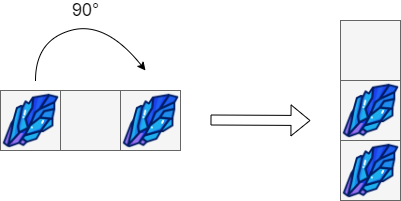
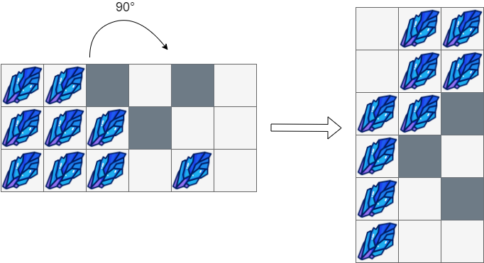

# 两种方法：正序遍历 / 倒序遍历（Python/Java/C++/C/Go/JS/Rust）

> **[1861. 旋转盒子](https://leetcode.cn/problems/rotating-the-box/solutions/778595/mei-xing-fen-duan-tong-ji-by-endlesschen-umie/) · Medium · 难度分 1537**

> **所属题单**
> - [滑动窗口与双指针 · 三、单序列双指针](../../../刷题路径/灵神原版题单/滑动窗口与双指针/三、单序列双指针.md) · §3.2 相向双指针
> - [滑动窗口与双指针 · 六、分组循环](../../../刷题路径/灵神原版题单/滑动窗口与双指针/六、分组循环.md)

> **题目描述**
> 给你一个 `m x n` 的字符矩阵 `boxGrid` ，它表示一个箱子的侧视图。箱子的每一个格子可能为：
>
> - `'#'` 表示石头
>
> - `'*'` 表示固定的障碍物
>
> - `'.'` 表示空位置
>
> 这个箱子被 **顺时针旋转 90 度** ，由于重力原因，部分石头的位置会发生改变。每个石头会垂直掉落，直到它遇到障碍物，另一个石头或者箱子的底部。重力 **不会** 影响障碍物的位置，同时箱子旋转不会产生**惯性** ，也就是说石头的水平位置不会发生改变。
>
> 题目保证初始时 `boxGrid` 中的石头要么在一个障碍物上，要么在另一个石头上，要么在箱子的底部。
>
> 请你返回一个 `n x m` 的矩阵，表示按照上述旋转后，箱子内的结果。
>
> **示例 1：**
>
> 
>
> ```
>
> 输入：box = [["#",".","#"]]
> 输出：[["."],
>       ["#"],
>       ["#"]]
> ```
>
> **示例 2：**
>
> 
>
> ```
>
> 输入：box = [["#",".","*","."],
>             ["#","#","*","."]]
> 输出：[["#","."],
>       ["#","#"],
>       ["*","*"],
>       [".","."]]
> ```
>
> **示例 3：**
>
> 
>
> ```
>
> 输入：box = [["#","#","*",".","*","."],
>             ["#","#","#","*",".","."],
>             ["#","#","#",".","#","."]]
> 输出：[[".","#","#"],
>       [".","#","#"],
>       ["#","#","*"],
>       ["#","*","."],
>       ["#",".","*"],
>       ["#",".","."]]
> ```
>
> **提示：**
>
> - `m == boxGrid.length`
>
> - `n == boxGrid[i].length`
>
> - `1 <= m, n <= 500`
>
> - `boxGrid[i][j]` 只可能是 `'#'` ，`'*'` 或者 `'.'` 。

> **题解**
> ## 方法一：正序遍历
>
> $\textit{boxGrid}$ 的每一行互相独立，可以分别计算。
>
> 单独看每一行，我们需要知道每个障碍物（$\texttt{*}$）的左边有多少个石头（$\texttt{#}$）。
>
> 具体地，设当前障碍物到上一个障碍物之间有 $\textit{cnt}$ 个石头。那么旋转后，当前障碍物的左边有连续 $\textit{cnt}$ 个石头。据此：
>
> - 在遍历过程中，统计石头的个数 $\textit{cnt}$。
> - 如果下一个格子是障碍物，或者当前格子是最后一个格子，那么从当前格子往前填入连续 $\textit{cnt}$ 个石头，并重置计数器 $\textit{cnt}=0$。
>
> **细节**：第 $i$ 行的格子旋转后在倒数第 $i$ 列，第 $j$ 列的格子旋转后在第 $j$ 行。所以 $(i,j)$ 旋转后位于 $(j,m-1-i)$。
>
> ```python
> class Solution:
>     def rotateTheBox(self, boxGrid: list[list[str]]) -> list[list[str]]:
>         m, n = len(boxGrid), len(boxGrid[0])
>         ans = [[''] * m for _ in range(n)]
>
>         for i, row in enumerate(boxGrid):
>             cnt = 0
>             for j, ch in enumerate(row):
>                 if ch == '#':  # 石头
>                     cnt += 1
>                     ch = '.'  # 先把石头清空
>                 ans[j][-1 - i] = ch
>                 if j == n - 1 or row[j + 1] == '*':  # 下一个格子是障碍物
>                     # 石头垂直掉落后，从 j 往前 cnt 个格子都是石头
>                     for k in range(j, j - cnt, -1):
>                         ans[k][-1 - i] = '#'
>                     cnt = 0  # 重置计数器
>
>         return ans
> ```
>
>
> #### 复杂度分析
>
> - 时间复杂度：$\mathcal{O}(mn)$，其中 $m$ 和 $n$ 分别是 $\textit{boxGrid}$ 的行数和列数。
> - 空间复杂度：$\mathcal{O}(1)$。返回值不计入。
>
> ## 方法二：倒序遍历 + 双指针
>
> 对于每一行 $\textit{row}$，倒着遍历，我们可以直接确定每个石头落入的位置：
>
> - 如果 $\textit{row}[j]$ 是障碍物，那么它左边最近的石头，在旋转后掉落到 $\textit{row}[j-1]$。我们用一个变量 $k$ 维护石头掉落后的位置，如果 $\textit{row}[j]$ 是障碍物，那么更新 $\textit{k} = j-1$。注：如果 $\textit{row}[j]$ 左边最近的不是石头而是障碍物，那么 $k$ 会继续更新，无需担心石头落到错误的位置。
> - 如果 $\textit{row}[j]$ 是石头，那么它掉落到 $\textit{row}[\textit{k}]$。然后把 $k$ 减一，表示左边下一块石头掉落后的位置。
>
> ```python
> class Solution:
>     def rotateTheBox(self, boxGrid: list[list[str]]) -> list[list[str]]:
>         m, n = len(boxGrid), len(boxGrid[0])
>         ans = [['.'] * m for _ in range(n)]
>
>         for i, row in enumerate(boxGrid):
>             k = n - 1
>             for j in range(n - 1, -1, -1):
>                 if row[j] == '*':  # 障碍物
>                     ans[j][-1 - i] = '*'
>                     k = j - 1  # 障碍物左边最近的石头，在旋转后掉落到 j-1
>                 elif row[j] == '#':  # 石头
>                     ans[k][-1 - i] = '#'  # 旋转后，石头掉落到 k
>                     k -= 1
>
>         return ans
> ```
>
>
> #### 复杂度分析
>
> - 时间复杂度：$\mathcal{O}(mn)$，其中 $m$ 和 $n$ 分别是 $\textit{boxGrid}$ 的行数和列数。
> - 空间复杂度：$\mathcal{O}(1)$。返回值不计入。
>
> ## 专题训练
>
> 见下面双指针题单的「**六、分组循环**」。
>
> ## 分类题单
>
> [如何科学刷题？](https://leetcode.cn/circle/discuss/RvFUtj/)
>
> 1. [滑动窗口与双指针（定长/不定长/单序列/双序列/三指针/分组循环）](https://leetcode.cn/circle/discuss/0viNMK/)
> 2. [二分算法（二分答案/最小化最大值/最大化最小值/第K小）](https://leetcode.cn/circle/discuss/SqopEo/)
> 3. [单调栈（基础/矩形面积/贡献法/最小字典序）](https://leetcode.cn/circle/discuss/9oZFK9/)
> 4. [网格图（DFS/BFS/综合应用）](https://leetcode.cn/circle/discuss/YiXPXW/)
> 5. [位运算（基础/性质/拆位/试填/恒等式/思维）](https://leetcode.cn/circle/discuss/dHn9Vk/)
> 6. [图论算法（DFS/BFS/拓扑排序/基环树/最短路/最小生成树/网络流）](https://leetcode.cn/circle/discuss/01LUak/)
> 7. [动态规划（入门/背包/划分/状态机/区间/状压/数位/数据结构优化/树形/博弈/概率期望）](https://leetcode.cn/circle/discuss/tXLS3i/)
> 8. [常用数据结构（前缀和/差分/栈/队列/堆/字典树/并查集/树状数组/线段树）](https://leetcode.cn/circle/discuss/mOr1u6/)
> 9. [数学算法（数论/组合/概率期望/博弈/计算几何/随机算法）](https://leetcode.cn/circle/discuss/IYT3ss/)
> 10. [贪心与思维（基本贪心策略/反悔/区间/字典序/数学/思维/脑筋急转弯/构造）](https://leetcode.cn/circle/discuss/g6KTKL/)
> 11. [链表、树与回溯（前后指针/快慢指针/DFS/BFS/直径/LCA）](https://leetcode.cn/circle/discuss/K0n2gO/)
> 12. [字符串（KMP/Z函数/Manacher/字符串哈希/AC自动机/后缀数组/子序列自动机）](https://leetcode.cn/circle/discuss/SJFwQI/)
>
> [我的题解精选（已分类）](https://github.com/EndlessCheng/codeforces-go/blob/master/leetcode/SOLUTIONS.md)
>
> 欢迎关注 [B站@灵茶山艾府](https://space.bilibili.com/206214)
