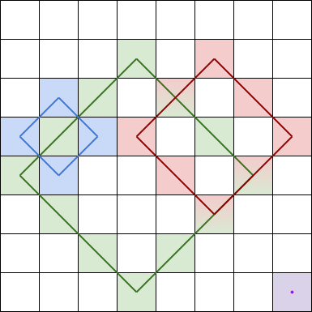
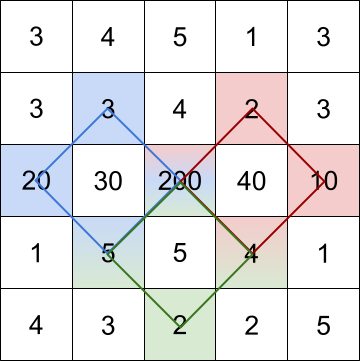
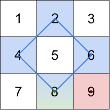

# 斜向前缀和（Python/Java/C++/Go）

> **[1878. 矩阵中最大的三个菱形和](https://leetcode.cn/problems/get-biggest-three-rhombus-sums-in-a-grid/solutions/803561/go-qian-zhui-he-by-endlesscheng-30l0/) · Medium · 难度分 1898**

> **所属题单**
> - [常用数据结构 · 一、前缀和](../../../刷题路径/灵神原版题单/常用数据结构/一、前缀和.md) · §1.5 进阶

> **题目描述**
> 给你一个 `m x n` 的整数矩阵 `grid` 。
>
> **菱形和** 指的是 `grid` 中一个正菱形 **边界** 上的元素之和。本题中的菱形必须为正方形旋转45度，且四个角都在一个格子当中。下图是四个可行的菱形，每个菱形和应该包含的格子都用了相应颜色标注在图中。
>
> 
>
> 注意，菱形可以是一个面积为 0 的区域，如上图中右下角的紫色菱形所示。
>
> 请你按照 **降序** 返回 `grid` 中三个最大的 **互不相同的菱形和** 。如果不同的和少于三个，则将它们全部返回。
>
> **示例 1：**
>
> 
>
> ```
>
> 输入：grid = [[3,4,5,1,3],[3,3,4,2,3],[20,30,200,40,10],[1,5,5,4,1],[4,3,2,2,5]]
> 输出：[228,216,211]
> 解释：最大的三个菱形和如上图所示。
> - 蓝色：20 + 3 + 200 + 5 = 228
> - 红色：200 + 2 + 10 + 4 = 216
> - 绿色：5 + 200 + 4 + 2 = 211
> ```
>
> **示例 2：**
>
> 
>
> ```
>
> 输入：grid = [[1,2,3],[4,5,6],[7,8,9]]
> 输出：[20,9,8]
> 解释：最大的三个菱形和如上图所示。
> - 蓝色：4 + 2 + 6 + 8 = 20
> - 红色：9 （右下角红色的面积为 0 的菱形）
> - 绿色：8 （下方中央面积为 0 的菱形）
> ```
>
> **示例 3：**
>
> ```
>
> 输入：grid = [[7,7,7]]
> 输出：[7]
> 解释：所有三个可能的菱形和都相同，所以返回 [7] 。
> ```
>
> **提示：**
>
> - `m == grid.length`
>
> - `n == grid[i].length`
>
> - `1 <= m, n <= 100`
>
> - `1 <= grid[i][j] <= 10⁵`

> **题解**
> 如何枚举菱形？描述一个菱形需要几个变量？
>
> 如果确定了菱形的正中心 $(i,j)$，以及菱形顶点到正中心的距离 $k$，就确定了菱形的四个顶点的位置。
>
> 下图的蓝色菱形，正中心在 $(1,1)$，顶点到正中心的距离为 $1$。
>
> {:width=170px}
>
> 如何快速计算菱形四条边的元素和？
>
> 可以用**斜向前缀和**加速：
>
> - 定义 $\textit{diagSum}[i+1][j+1]$ 表示从矩阵最上边或最左边出发，向右下↘到 $(i,j)$，这条线段的元素和。
> - 定义 $\textit{antiSum}[i+1][j]$ 表示从矩阵最上边或最右边出发，向左下↙到 $(i,j)$，这条线段的元素和。
>
> 为什么这里有一些 $+1$？原理在 [前缀和](../../0300-0399/0303%20区域和检索%20-%20数组不可变/灵茶山艾府.md) 中讲了，类似一维数组的子数组和，即使子数组是前缀，我们仍然可以用两个前缀和之差算出子数组和，无需特判。
>
> 根据定义：
>
> - 从 $(x,y)$ 开始，向右下↘连续 $k$ 个数的和为 $\textit{diagSum}[x+k][y+k] - \textit{diagSum}[x][y]$。
> - 从 $(x,y)$ 开始，向左下↙连续 $k$ 个数的和为 $\textit{antiSum}[x+k][y+1-k] - \textit{antiSum}[x][y+1]$。
>
> ```python
> class Solution:
>     def getBiggestThree(self, grid: List[List[int]]) -> List[int]:
>         m, n = len(grid), len(grid[0])
>         diag_sum = [[0] * (n + 1) for _ in range(m + 1)]  # ↘ 前缀和
>         anti_sum = [[0] * (n + 1) for _ in range(m + 1)]  # ↙ 前缀和
>         for i, row in enumerate(grid):
>             for j, v in enumerate(row):
>                 diag_sum[i + 1][j + 1] = diag_sum[i][j] + v
>                 anti_sum[i + 1][j] = anti_sum[i][j + 1] + v
>
>         # 从 (x,y) 开始，向 ↘，连续 k 个数的和
>         def query_diagonal(x: int, y: int, k: int) -> int:
>             return diag_sum[x + k][y + k] - diag_sum[x][y]
>
>         # 从 (x,y) 开始，向 ↙，连续 k 个数的和
>         def query_anti_diagonal(x: int, y: int, k: int) -> int:
>             return anti_sum[x + k][y + 1 - k] - anti_sum[x][y + 1]
>
>         x = y = z = 0  # 最大，次大，第三大
>
>         def update(v: int) -> None:
>             nonlocal x, y, z
>             if v > x:
>                 x, y, z = v, x, y
>             elif x > v > y:
>                 y, z = v, y
>             elif y > v > z:
>                 z = v
>
>         # 枚举菱形正中心 (i,j)
>         for i, row in enumerate(grid):
>             for j, v in enumerate(row):
>                 update(v)  # 一个数也算菱形
>                 # 枚举菱形顶点到正中心的距离 k，注意菱形顶点不能出界
>                 # i-k >= 0 且 i+k <= m-1，所以 k <= min(i, m-1-i)，对于 j 同理
>                 mx = min(i, m - 1 - i, j, n - 1 - j)
>                 for k in range(1, mx + 1):
>                     a = query_diagonal(i - k, j, k)                   # 菱形右上的边
>                     b = query_diagonal(i, j - k, k)                   # 菱形左下的边
>                     c = query_anti_diagonal(i - k + 1, j - 1, k - 1)  # 菱形左上的边
>                     d = query_anti_diagonal(i, j + k, k + 1)          # 菱形右下的边
>                     update(a + b + c + d)
>
>         ans = [x, y, z]
>         while ans[-1] == 0:  # 不同的和少于三个
>             ans.pop()
>         return ans
> ```
>
>
> #### 复杂度分析
>
> - 时间复杂度：$\mathcal{O}(mn\min(m,n))$，其中 $m$ 和 $n$ 分别是 $\textit{grid}$ 的行数和列数。
> - 空间复杂度：$\mathcal{O}(mn)$。
>
> ## 相似题目
>
> [1895. 最大的幻方](https://leetcode.cn/problems/largest-magic-square/)
>
> ## 分类题单
>
> [如何科学刷题？](https://leetcode.cn/circle/discuss/RvFUtj/)
>
> 1. [滑动窗口与双指针（定长/不定长/单序列/双序列/三指针/分组循环）](https://leetcode.cn/circle/discuss/0viNMK/)
> 2. [二分算法（二分答案/最小化最大值/最大化最小值/第K小）](https://leetcode.cn/circle/discuss/SqopEo/)
> 3. [单调栈（基础/矩形面积/贡献法/最小字典序）](https://leetcode.cn/circle/discuss/9oZFK9/)
> 4. [网格图（DFS/BFS/综合应用）](https://leetcode.cn/circle/discuss/YiXPXW/)
> 5. [位运算（基础/性质/拆位/试填/恒等式/思维）](https://leetcode.cn/circle/discuss/dHn9Vk/)
> 6. [图论算法（DFS/BFS/拓扑排序/基环树/最短路/最小生成树/网络流）](https://leetcode.cn/circle/discuss/01LUak/)
> 7. [动态规划（入门/背包/划分/状态机/区间/状压/数位/数据结构优化/树形/博弈/概率期望）](https://leetcode.cn/circle/discuss/tXLS3i/)
> 8. [常用数据结构（前缀和/差分/栈/队列/堆/字典树/并查集/树状数组/线段树）](https://leetcode.cn/circle/discuss/mOr1u6/)
> 9. [数学算法（数论/组合/概率期望/博弈/计算几何/随机算法）](https://leetcode.cn/circle/discuss/IYT3ss/)
> 10. [贪心与思维（基本贪心策略/反悔/区间/字典序/数学/思维/脑筋急转弯/构造）](https://leetcode.cn/circle/discuss/g6KTKL/)
> 11. [链表、树与回溯（前后指针/快慢指针/DFS/BFS/直径/LCA）](https://leetcode.cn/circle/discuss/K0n2gO/)
> 12. [字符串（KMP/Z函数/Manacher/字符串哈希/AC自动机/后缀数组/子序列自动机）](https://leetcode.cn/circle/discuss/SJFwQI/)
>
> [我的题解精选（已分类）](https://github.com/EndlessCheng/codeforces-go/blob/master/leetcode/SOLUTIONS.md)
>
> 欢迎关注 [B站@灵茶山艾府](https://space.bilibili.com/206214)
