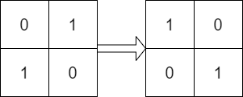
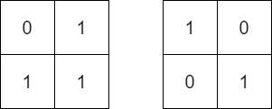

# 1886. 判断矩阵经轮转后是否一致

Easy · [力扣原题](https://leetcode.cn/problems/determine-whether-matrix-can-be-obtained-by-rotation/)

| 作者 | 题解 | 动画讲解 |
|---|---|---|
| 灵茶山艾府 | [📄 题解](灵茶山艾府.md) | [▶︎ 1886 判断矩阵经轮转后是否一致 · 灵茶山艾府.mp4](1886%20判断矩阵经轮转后是否一致%20·%20灵茶山艾府.mp4) |
| yiduobo | [📄 题解](yiduobo.md) | [▶︎ 1886 判断矩阵经轮转后是否一致 · yiduobo.mp4](1886%20判断矩阵经轮转后是否一致%20·%20yiduobo.mp4) |

## 题目描述

给你两个大小为 `n x n` 的二进制矩阵 `mat` 和 `target` 。现 **以 90 度顺时针轮转** 矩阵 `mat` 中的元素 **若干次** ，如果能够使 `mat` 与 `target` 一致，返回 `true` ；否则，返回 `false` <em>。</em>

**示例 1：**



```

输入：mat = [[0,1],[1,0]], target = [[1,0],[0,1]]
输出：true
解释：顺时针轮转 90 度一次可以使 mat 和 target 一致。
```

**示例 2：**



```

输入：mat = [[0,1],[1,1]], target = [[1,0],[0,1]]
输出：false
解释：无法通过轮转矩阵中的元素使 equal 与 target 一致。
```

**示例 3：**


```

输入：mat = [[0,0,0],[0,1,0],[1,1,1]], target = [[1,1,1],[0,1,0],[0,0,0]]
输出：true
解释：顺时针轮转 90 度两次可以使 mat 和 target 一致。
```

**提示：**

- `n == mat.length == target.length`

- `n == mat[i].length == target[i].length`

- `1 <= n <= 10`

- `mat[i][j]` 和 `target[i][j]` 不是 `0` 就是 `1`

---
[↑ 返回 1800-1899](../README.md) · [总索引](../../../索引.md) · [仓库首页](../../../README.md)
