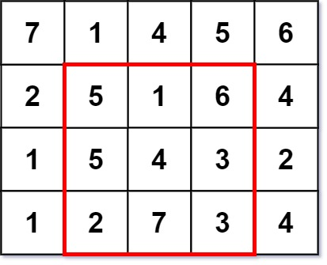
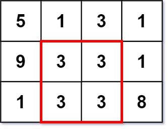

# 从 O(N^4) 优化到 O(N^3)（Python/Java/C++/Go）

> **[1895. 最大的幻方](https://leetcode.cn/problems/largest-magic-square/solutions/825422/go-qian-zhui-he-by-endlesscheng-59wj/) · Medium · 难度分 1781**

> **所属题单**
> - [常用数据结构 · 一、前缀和](../../../刷题路径/灵神原版题单/常用数据结构/一、前缀和.md) · §1.5 进阶

> **题目描述**
> 一个 `k x k` 的 **幻方** 指的是一个 `k x k` 填满整数的方格阵，且每一行、每一列以及两条对角线的和 **全部相等** 。幻方中的整数 **不需要互不相同** 。显然，每个 `1 x 1` 的方格都是一个幻方。
>
> 给你一个 `m x n` 的整数矩阵 `grid` ，请你返回矩阵中 **最大幻方** 的 **尺寸** （即边长 `k`）。
>
> **示例 1：**
>
> 
>
> ```
> 输入：grid = [[7,1,4,5,6],[2,5,1,6,4],[1,5,4,3,2],[1,2,7,3,4]]
> 输出：3
> 解释：最大幻方尺寸为 3 。
> 每一行，每一列以及两条对角线的和都等于 12 。
> - 每一行的和：5+1+6 = 5+4+3 = 2+7+3 = 12
> - 每一列的和：5+5+2 = 1+4+7 = 6+3+3 = 12
> - 对角线的和：5+4+3 = 6+4+2 = 12
> ```
>
> **示例 2：**
>
> 
>
> ```
> 输入：grid = [[5,1,3,1],[9,3,3,1],[1,3,3,8]]
> 输出：2
> ```
>
> **提示：**
>
> - `m == grid.length`
>
> - `n == grid[i].length`
>
> - `1 <= m, n <= 50`
>
> - `1 <= grid[i][j] <= 10⁶`

> **题解**
> > 注：本题不能二分答案。「每行每列的元素和都相等」是一个非常刁钻的要求，可能中间的某个 $k$ 满足要求，$k$ 大一点或小一点都无法让每行每列的元素和都相等。
>
> ## 方法一：四种前缀和
>
> 从大到小枚举 $k$，判断 $\textit{grid}$ 是否存在一个 $k\times k$ 的子矩阵 $M$，满足如下要求：
>
> - 设 $M$ 第一行的元素和为 $s$。
> - $M$ 每行的元素和都是 $s$。
> - $M$ 每列的元素和都是 $s$。
> - $M$ 主对角线的元素和为 $s$。
> - $M$ 反对角线的元素和为 $s$。
>
> 这些参与求和的元素，在 $\textit{grid}$ 中都是连续的，我们可以用四种前缀和计算：
>
> - $\textit{rowSum}[i][j+1]$ 表示 $\textit{grid}$ 的 $i$ 行的前缀 $[0,j]$ 的元素和，即 $(i,0),(i,1),\ldots,(i,j)$ 的元素和。
> - $\textit{colSum}[i+1][j]$ 表示 $\textit{grid}$ 的 $j$ 列的前缀 $[0,i]$ 的元素和，即 $(0,j),(1,j),\ldots,(i,j)$ 的元素和。
> - $\textit{diagSum}[i+1][j+1]$ 表示从最上边或最左边出发，向右下↘到 $(i,j)$ 这条线上的元素和。
> - $\textit{antiSum}[i+1][j]$ 表示从最上边或最右边出发，向左下↙到 $(i,j)$ 这条线上的元素和。
>
> 为什么这里有一些 $+1$？原理在 [前缀和](../../0300-0399/0303%20区域和检索%20-%20数组不可变/灵茶山艾府.md) 中讲了，是为了兼容子数组恰好是前缀的情况，此时仍然可以用两个前缀和之差算出子数组和，无需特判。
>
> 写个三重循环，依次枚举 $k,i,j$，其中 $k\times k$ 子矩阵的左上角为 $(i-k,j-k)$，右下角为 $(i-1,j-1)$，那么：
>
> - 主对角线的元素和为 $\textit{diagSum}[i][j] - \textit{diagSum}[i-k][j-k]$。
> - 反对角线的元素和为 $\textit{antiSum}[i][j-k]-\textit{antiSum}[i-k][j]$。
> - 在 $[i-k,i-1]$ 中枚举行号 $r$，行元素和为 $\textit{rowSum}[r][j] - \textit{rowSum}[r][j-k]$。
> - 在 $[j-k,j-1]$ 中枚举列号 $c$，列元素和为 $\textit{colSum}[i][c] - \textit{colSum}[i-k][c]$。
>
> 代码实现时，可以先求主对角线的元素和、反对角线的元素和，如果二者不相等，则无需枚举 $r$ 和 $c$。
>
> ```python
> class Solution:
>     def largestMagicSquare(self, grid: List[List[int]]) -> int:
>         m, n = len(grid), len(grid[0])
>         row_sum = [[0] * (n + 1) for _ in range(m)]       # → 前缀和
>         col_sum = [[0] * n for _ in range(m + 1)]         # ↓ 前缀和
>         diag_sum = [[0] * (n + 1) for _ in range(m + 1)]  # ↘ 前缀和
>         anti_sum = [[0] * (n + 1) for _ in range(m + 1)]  # ↙ 前缀和
>
>         for i, row in enumerate(grid):
>             for j, x in enumerate(row):
>                 row_sum[i][j + 1] = row_sum[i][j] + x
>                 col_sum[i + 1][j] = col_sum[i][j] + x
>                 diag_sum[i + 1][j + 1] = diag_sum[i][j] + x
>                 anti_sum[i + 1][j] = anti_sum[i][j + 1] + x
>
>         # k×k 子矩阵的左上角为 (i−k, j−k)，右下角为 (i−1, j−1)
>         for k in range(min(m, n), 0, -1):
>             for i in range(k, m + 1):
>                 for j in range(k, n + 1):
>                     # 子矩阵主对角线的和
>                     s = diag_sum[i][j] - diag_sum[i - k][j - k]
>
>                     # 子矩阵反对角线的和等于 s
>                     # 子矩阵每行的和都等于 s
>                     # 子矩阵每列的和都等于 s
>                     if anti_sum[i][j - k] - anti_sum[i - k][j] == s and \
>                        all(row_sum[r][j] - row_sum[r][j - k] == s for r in range(i - k, i)) and \
>                        all(col_sum[i][c] - col_sum[i - k][c] == s for c in range(j - k, j)):
>                         return k
> ```
>
>
> #### 复杂度分析
>
> - 时间复杂度：$\mathcal{O}(mn\min(m,n)^2)$，其中 $m$ 和 $n$ 分别是 $\textit{grid}$ 的行数和列数。
> - 空间复杂度：$\mathcal{O}(mn)$。
>
> ## 方法二：维护连续等和行列的个数
>
> 从大到小枚举 $k$，判断 $\textit{grid}$ 是否存在一个 $k\times k$ 的子矩阵 $M$，满足如下要求：
>
> - 设 $M$ 第一行的元素和为 $s$。
> - $M$ 每行的元素和都是 $s$。**优化**：想象有一个 $k\times k$ 的窗口在**向下滑动**，我们可以维护到第 $i$ 行时，有连续多少行的和都等于 $s$。维护一个计数器 $\textit{sameCnt}$，如果当前行的和等于前一行的和，那么把 $\textit{sameCnt}$ 加一，否则把 $\textit{sameCnt}$ 重置为 $1$。如果 $\textit{sameCnt}\ge k$，则说明子矩阵每行的元素和都相等。
> - $M$ 每列的元素和都是 $s$。**优化**：想象有一个 $k\times k$ 的窗口在**向右滑动**，我们可以维护到第 $j$ 列时，有连续多少列的和都等于 $s$。算法同上。
> - $M$ 主对角线的元素和为 $s$。
> - $M$ 反对角线的元素和为 $s$。
>
> ```python
> class Solution:
>     def largestMagicSquare(self, grid: List[List[int]]) -> int:
>         m, n = len(grid), len(grid[0])
>         row_sum = [[0] * (n + 1) for _ in range(m)]       # → 前缀和
>         col_sum = [[0] * n for _ in range(m + 1)]         # ↓ 前缀和
>         diag_sum = [[0] * (n + 1) for _ in range(m + 1)]  # ↘ 前缀和
>         anti_sum = [[0] * (n + 1) for _ in range(m + 1)]  # ↙ 前缀和
>
>         for i, row in enumerate(grid):
>             for j, x in enumerate(row):
>                 row_sum[i][j + 1] = row_sum[i][j] + x
>                 col_sum[i + 1][j] = col_sum[i][j] + x
>                 diag_sum[i + 1][j + 1] = diag_sum[i][j] + x
>                 anti_sum[i + 1][j] = anti_sum[i][j + 1] + x
>
>         # is_same_col_sum[i][j] 表示右下角为 (i, j) 的子矩形，每列元素和是否都相等
>         is_same_col_sum = [[False] * n for _ in range(m)]
>
>         for k in range(min(m, n), 1, -1):
>             for i in range(k, m + 1):
>                 # 想象有一个 k×k 的窗口在向右滑动
>                 same_cnt = 1
>                 for j in range(1, n):
>                     if col_sum[i][j] - col_sum[i - k][j] == col_sum[i][j - 1] - col_sum[i - k][j - 1]:
>                         same_cnt += 1
>                     else:
>                         same_cnt = 1
>                     # 连续 k 列元素和是否都一样
>                     is_same_col_sum[i - 1][j] = same_cnt >= k
>
>             for j in range(k, n + 1):
>                 # 想象有一个 k×k 的窗口在向下滑动
>                 sum_row = row_sum[0][j] - row_sum[0][j - k]
>                 same_cnt = 1
>                 for i in range(2, m + 1):
>                     row_s = row_sum[i - 1][j] - row_sum[i - 1][j - k]
>                     if row_s == sum_row:
>                         same_cnt += 1
>                         if (same_cnt >= k and  # 连续 k 行元素和都一样
>                             is_same_col_sum[i - 1][j - 1] and  # 连续 k 列元素和都一样
>                             col_sum[i][j - 1] - col_sum[i - k][j - 1] == sum_row and  # 列和 = 行和
>                             diag_sum[i][j] - diag_sum[i - k][j - k] == sum_row and  # 主对角线和 = 行和
>                             anti_sum[i][j - k] - anti_sum[i - k][j] == sum_row):  # 反对角线和 = 行和
>                             return k
>                     else:
>                         sum_row = row_s
>                         same_cnt = 1
>
>         return 1
> ```
>
>
> #### 复杂度分析
>
> - 时间复杂度：$\mathcal{O}(mn\min(m,n))$，其中 $m$ 和 $n$ 分别是 $\textit{grid}$ 的行数和列数。
> - 空间复杂度：$\mathcal{O}(mn)$。
>
> ## 相似题目
>
> [1878. 矩阵中最大的三个菱形和](https://leetcode.cn/problems/get-biggest-three-rhombus-sums-in-a-grid/)
>
> ## 专题训练
>
> 见下面数据结构题单的「**一、前缀和**」。
>
> ## 分类题单
>
> [如何科学刷题？](https://leetcode.cn/circle/discuss/RvFUtj/)
>
> 1. [滑动窗口与双指针（定长/不定长/单序列/双序列/三指针/分组循环）](https://leetcode.cn/circle/discuss/0viNMK/)
> 2. [二分算法（二分答案/最小化最大值/最大化最小值/第K小）](https://leetcode.cn/circle/discuss/SqopEo/)
> 3. [单调栈（基础/矩形面积/贡献法/最小字典序）](https://leetcode.cn/circle/discuss/9oZFK9/)
> 4. [网格图（DFS/BFS/综合应用）](https://leetcode.cn/circle/discuss/YiXPXW/)
> 5. [位运算（基础/性质/拆位/试填/恒等式/思维）](https://leetcode.cn/circle/discuss/dHn9Vk/)
> 6. [图论算法（DFS/BFS/拓扑排序/基环树/最短路/最小生成树/网络流）](https://leetcode.cn/circle/discuss/01LUak/)
> 7. [动态规划（入门/背包/划分/状态机/区间/状压/数位/数据结构优化/树形/博弈/概率期望）](https://leetcode.cn/circle/discuss/tXLS3i/)
> 8. [常用数据结构（前缀和/差分/栈/队列/堆/字典树/并查集/树状数组/线段树）](https://leetcode.cn/circle/discuss/mOr1u6/)
> 9. [数学算法（数论/组合/概率期望/博弈/计算几何/随机算法）](https://leetcode.cn/circle/discuss/IYT3ss/)
> 10. [贪心与思维（基本贪心策略/反悔/区间/字典序/数学/思维/脑筋急转弯/构造）](https://leetcode.cn/circle/discuss/g6KTKL/)
> 11. [链表、树与回溯（前后指针/快慢指针/DFS/BFS/直径/LCA）](https://leetcode.cn/circle/discuss/K0n2gO/)
> 12. [字符串（KMP/Z函数/Manacher/字符串哈希/AC自动机/后缀数组/子序列自动机）](https://leetcode.cn/circle/discuss/SJFwQI/)
>
> [我的题解精选（已分类）](https://github.com/EndlessCheng/codeforces-go/blob/master/leetcode/SOLUTIONS.md)
>
> 欢迎关注 [B站@灵茶山艾府](https://space.bilibili.com/206214)
