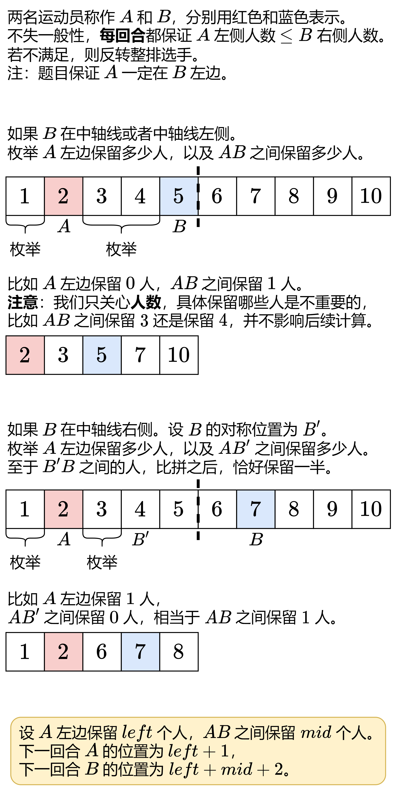
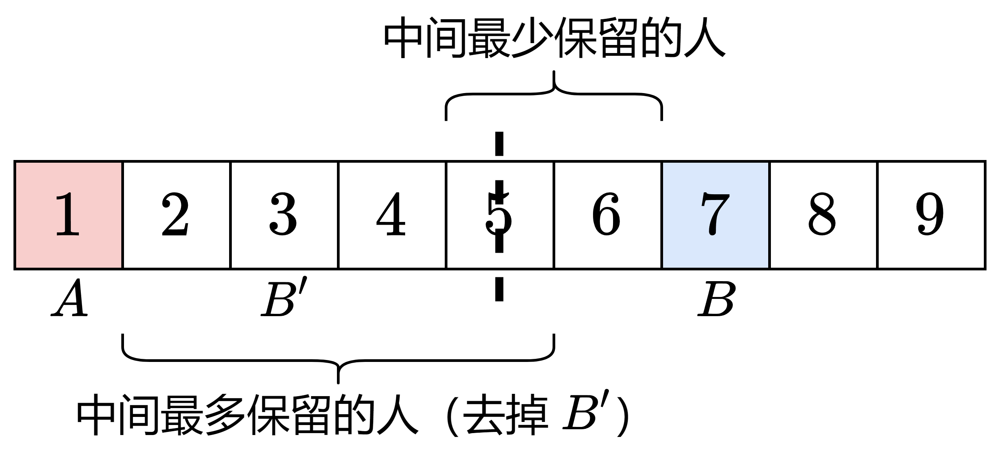
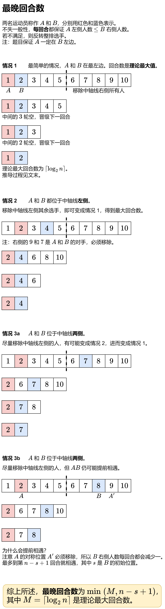

# 【图解】从 O(n^4) 到 O(1)：动态规划 / 贪心（Python/Java/C++/Go）

> **[1900. 最佳运动员的比拼回合](https://leetcode.cn/problems/the-earliest-and-latest-rounds-where-players-compete/solutions/825860/dpmei-ju-xia-yi-lun-liang-ming-xuan-shou-okfu/) · Hard · 难度分 2455**

> **所属题单**
> - [动态规划 · 七、其他线性 DP](../../../刷题路径/灵神原版题单/动态规划/七、其他线性%20DP.md) · §7.6 多维 DP
> - [贪心算法 · 五、思维题](../../../刷题路径/灵神原版题单/贪心算法/五、思维题.md) · §5.8 分类讨论

> **题目描述**
> `n` 名运动员参与一场锦标赛，所有运动员站成一排，并根据 **最开始的** 站位从 `1` 到 `n` 编号（运动员 `1` 是这一排中的第一个运动员，运动员 `2` 是第二个运动员，依此类推）。
>
> 锦标赛由多个回合组成（从回合 `1` 开始）。每一回合中，这一排从前往后数的第 `i` 名运动员需要与从后往前数的第 `i` 名运动员比拼，获胜者将会进入下一回合。如果当前回合中运动员数目为奇数，那么中间那位运动员将轮空晋级下一回合。
>
> - 例如，当前回合中，运动员 `1, 2, 4, 6, 7` 站成一排
>
>     - 运动员 `1` 需要和运动员 `7` 比拼
>
>     - 运动员 `2` 需要和运动员 `6` 比拼
>
>     - 运动员 `4` 轮空晋级下一回合
>
> 每回合结束后，获胜者将会基于最开始分配给他们的原始顺序（升序）重新排成一排。
>
> 编号为 `firstPlayer` 和 `secondPlayer` 的运动员是本场锦标赛中的最佳运动员。在他们开始比拼之前，完全可以战胜任何其他运动员。而任意两个其他运动员进行比拼时，其中任意一个都有获胜的可能，因此你可以 **裁定** 谁是这一回合的获胜者。
>
> 给你三个整数 `n`、`firstPlayer` 和 `secondPlayer` 。返回一个由两个值组成的整数数组，分别表示两位最佳运动员在本场锦标赛中比拼的 **最早** 回合数和 **最晚** 回合数。
>
> **示例 1：**
>
> ```
> 输入：n = 11, firstPlayer = 2, secondPlayer = 4
> 输出：[3,4]
> 解释：
> 一种能够产生最早回合数的情景是：
> 回合 1：1, 2, 3, 4, 5, 6, 7, 8, 9, 10, 11
> 回合 2：2, 3, 4, 5, 6, 11
> 回合 3：2, 3, 4
> 一种能够产生最晚回合数的情景是：
> 回合 1：1, 2, 3, 4, 5, 6, 7, 8, 9, 10, 11
> 回合 2：1, 2, 3, 4, 5, 6
> 回合 3：1, 2, 4
> 回合 4：2, 4
> ```
>
> **示例 2：**
>
> ```
> 输入：n = 5, firstPlayer = 1, secondPlayer = 5
> 输出：[1,1]
> 解释：两名最佳运动员 1 和 5 将会在回合 1 进行比拼。
> 不存在使他们在其他回合进行比拼的可能。
> ```
>
> **提示：**
>
> - `2 <= n <= 28`
>
> - `1 <= firstPlayer < secondPlayer <= n`

> **题解**
> ## 方法一：动态规划
>
> 想一想，第二回合，两名运动员可以在哪些位置？怎么**枚举**？
>
> {:width=550}
>
> 不失一般性（减少分类讨论的情况），可以在枚举前处理一下两名选手的位置：如果 $A$ 左侧的人比 $B$ 右侧的人还多，则将 $A$ 的位置改为 $B$ 的对称位置 $B'$，$B$ 的位置改为 $A$ 的对称位置 $A'$。这样 $A$ 一定位于中轴线左侧，我们无需讨论 $A$ 在中轴线右侧的情况。
>
> 根据上图，定义 $\textit{dfs}(n,\textit{first},\textit{second})$ 表示在当前有 $n$ 人，$A$ 的位置为 $\textit{first}$，$B$ 的位置为 $\textit{second}$ 的情况下，最早回合数和最晚回合数（$\textit{dfs}$ 返回两个数）。
>
> 枚举 $A$ 左侧保留 $\textit{left}=0,1,2,\ldots, \textit{first}-1$ 个人。
>
> 无论 $B$ 在中轴线左侧还是右侧，我们统一成枚举 $AB$ 之间保留的人数，记作 $\textit{mid}$：
>
> - 如果 $B$ 在中轴线或中轴线左侧，那么 $\textit{mid}$ 最小是 $0$，最大是 $\textit{second}-\textit{first}-1$。
> - 如果 $B$ 在中轴线右侧。如下图所示，$\textit{mid}$ 最小为 $B$ 到中轴线（含）的人数 $\textit{second}-\left\lfloor\dfrac{n}{2}\right\rfloor-1$；最大为 $A$ 到中轴线（含）的人数 $\left\lceil\dfrac{n}{2}\right\rceil - \textit{first}-1$，其中 $-1$ 是去掉 $B'$。
>
> {:width=550}
>
> 现在问题变成：计算在当前有 $m = \left\lceil\dfrac{n}{2}\right\rceil$ 人，$A$ 的位置为 $\textit{left}+1$，$B$ 的位置为 $\textit{left}+\textit{mid} + 2$ 的情况下，最早回合数和最晚回合数，即 $\textit{dfs}(m, \textit{left}+1, \textit{left}+\textit{mid} + 2)$。用子问题的返回结果，更新最早回合数的最小值，以及最晚回合数的最大值。
>
> **递归边界**：如果 $\textit{first}+\textit{second}=n+1$，两人相遇，返回 $(1,1)$。
>
> **递归入口**：$\textit{dfs}(n,\textit{firstPlayer}, \textit{secondPlayer})$。
>
> 注：$\left\lceil\dfrac{n}{2}\right\rceil = \left\lfloor\dfrac{n+1}{2}\right\rfloor$。
>
> 关于记忆化搜索，见 [动态规划入门：从记忆化搜索到递推【基础算法精讲 17】](https://www.bilibili.com/video/BV1Xj411K7oF/)。
>
> ```python
> class Solution:
>     def earliestAndLatest(self, n: int, firstPlayer: int, secondPlayer: int) -> List[int]:
>         @cache  # 缓存装饰器，避免重复计算 dfs（一行代码实现记忆化）
>         def dfs(n: int, first: int, second: int) -> Tuple[int, int]:
>             # AB 相遇
>             if first + second == n + 1:
>                 return 1, 1
>
>             # 保证 A 左边人数比 B 右边人数少
>             # 注：题目已保证 first < second
>             if first + second > n + 1:
>                 first, second = n + 1 - second, n + 1 - first
>
>             m = (n + 1) // 2  # 下一回合人数
>             # AB 之间保留 [min_mid, max_mid) 个人
>             min_mid = 0 if second <= m else second - n // 2 - 1
>             max_mid = second - first if second <= m else m - first  # 左闭右开区间，无需减一
>             earliest, latest = inf, 0
>
>             for left in range(first):  # 枚举 A 左侧保留 left 个人
>                 for mid in range(min_mid, max_mid):  # 枚举 AB 之间保留 mid 个人
>                     # 无需枚举 B 右侧保留多少个人，因为剩下的 m-2-left-mid 个人都在 B 右侧
>                     e, l = dfs(m, left + 1, left + mid + 2)
>                     earliest = min(earliest, e)
>                     latest = max(latest, l)
>
>             # 加上当前回合
>             return earliest + 1, latest + 1
>
>         return list(dfs(n, firstPlayer, secondPlayer))
> ```
>
> > [!example]- Python3 写法二
> > ```python
> > @cache  # 缓存装饰器，避免重复计算 dfs（一行代码实现记忆化）
> > def dfs(n: int, first: int, second: int) -> Tuple[int, int]:
> >     # AB 相遇
> >     if first + second == n + 1:
> >         return 1, 1
> >
> >     # 保证 A 左边人数比 B 右边人数少
> >     # 注：题目已保证 first < second
> >     if first + second > n + 1:
> >         first, second = n + 1 - second, n + 1 - first
> >
> >     m = (n + 1) // 2  # 下一回合人数
> >     # AB 之间保留 [min_mid, max_mid) 个人
> >     min_mid = 0 if second <= m else second - n // 2 - 1
> >     max_mid = second - first if second <= m else m - first  # 左闭右开区间，无需减一
> >     earliest, latest = inf, 0
> >
> >     for left in range(first):  # 枚举 A 左侧保留 left 个人
> >         for mid in range(min_mid, max_mid):  # 枚举 AB 之间保留 mid 个人
> >             # 无需枚举 B 右侧保留多少个人，因为剩下的 m-2-left-mid 个人都在 B 右侧
> >             e, l = dfs(m, left + 1, left + mid + 2)
> >             earliest = min(earliest, e)
> >             latest = max(latest, l)
> >
> >     # 加上当前回合
> >     return earliest + 1, latest + 1
> >
> >
> > class Solution:
> >     def earliestAndLatest(self, n: int, firstPlayer: int, secondPlayer: int) -> List[int]:
> >         return list(dfs(n, firstPlayer, secondPlayer))
> > ```
>
>
> #### 复杂度分析
>
> - 时间复杂度：$\mathcal{O}(n^4)$。由于每个状态只会计算一次，动态规划的时间复杂度 $=$ 状态个数 $\times$ 单个状态的计算时间。由于 $\textit{first}$ 和 $\textit{second}$ 都不超过当前回合的人数 $n$，状态数不超过等比数列之和 $n^2 + \left(\dfrac{n}{2}\right)^2 + \left(\dfrac{n}{4}\right)^2 + \cdots = \mathcal{O}(n^2)$，单个状态的计算时间为 $\mathcal{O}(n^2)$，所以总的时间复杂度为 $\mathcal{O}(n^4)$。
> - 空间复杂度：$\mathcal{O}(n^3)$ 或 $\mathcal{O}(n^2)$。如果用哈希表记忆化（Python）则空间复杂度为 $\mathcal{O}(n^2)$。数组写法也可以把第一维度优化为 $\mathcal{O}(\log n)$，第二三维度的大小根据当前回合数计算，也可以做到 $\mathcal{O}(n^2)$ 的空间。
>
> **注**：可以把 $\textit{memo}$ 写到类外，使记忆化的内容能够在不同测试数据间共享。
>
> ## 方法二：分类讨论
>
> 方法二可以解决 $n\le 10^{18}$ 的数据范围。
>
> 首先特判两人一开始就相遇的情况，返回 $[1,1]$。
>
> **下文假定两人一开始没有相遇。**
>
> {:width=700}
>
> 最早回合数的情况很多，建议阅读时在纸上画画。
>
> 
>
> **理论最大回合数**
>
> 根据 [下取整恒等式及其应用](https://zhuanlan.zhihu.com/p/1893240318645732760) 的证明过程，我们有
>
> $$
> \left\lceil\dfrac{\lceil {n/2} \rceil}{2}\right\rceil = \left\lceil\dfrac{n}{4}\right\rceil
> $$
>
> 设理论最大回合数为 $k$。从 $1$ 到 $k$，会发生 $k-1$ 次除以 $2$ 上取整，剩余人数为
>
> $$
> \left\lceil\dfrac{n}{2^{k-1}}\right\rceil = 2
> $$
>
> 由于
>
> $$
> \dfrac{n}{2^{k-1}} \le \left\lceil\dfrac{n}{2^{k-1}}\right\rceil = 2
> $$
>
> 所以有
>
> $$
> 2^k \ge n
> $$
>
> 即
>
> $$
> k \ge \log_2 n
> $$
>
> 取整数 $k=\left\lceil\log_2 n \right\rceil$，即为理论最大回合数。
>
> **注**：编程计算时，$\left\lceil\log_2 n \right\rceil$ 等价于 $n-1$ 的二进制长度。（规定 $0$ 的二进制长度为 $0$）
>
> ### 优化前
>
> ```python
> class Solution:
>     def earliestAndLatest(self, n: int, first: int, second: int) -> List[int]:
>         # AB 一开始就相遇
>         if first + second == n + 1:
>             return [1, 1]
>
>         # 保证 A 左边人数比 B 右边人数少
>         # 注：题目已保证 first < second
>         if first + second > n + 1:
>             first, second = n + 1 - second, n + 1 - first
>
>         def calc_earliest_rounds(n: int) -> int:
>             res = 1  # 初始回合
>
>             # 情况 5：AB 太靠左了
>             if first + second <= (n + 1) // 2:
>                 while first + second <= (n + 1) // 2:
>                     res += 1
>                     n = (n + 1) // 2
>
>                 # 情况 5a：AB 不相邻
>                 # 在上面循环的最后一回合，总是可以把局面调整为某些情况，使 AB 下回合就能相遇
>                 if second - first > 1:
>                     return res + 1
>
>                 # 情况 5b：AB 相邻
>                 # 上面循环结束后，转化为情况 1
>
>             # 情况 1：AB 相邻（由于 AB 不相遇，B 不可能在中轴线右侧。注意我们已保证 A 左边人数比 B 右边人数少）
>             if second - first == 1:
>                 # 先过一回合
>                 res += 1
>                 n = (n + 1) // 2
>                 # 在 AB 相邻的情况下，当且仅当 n 是偶数的时候相遇（推导过程见图）
>                 while n % 2 > 0:
>                     res += 1
>                     n = (n + 1) // 2
>                 return res
>
>             # 情况 2：B 在中轴线或中轴线左侧
>             if second <= (n + 1) // 2:
>                 # 可以让 AB 左右人数一样多（构造方式见图），下回合就能相遇
>                 return res + 1
>
>             # 情况 3：AB 之间恰有一个人
>             if second - first == 2:
>                 # 下回合 AB 必定相邻，变成情况 1
>                 res += 1
>                 n = (n + 1) // 2
>                 while n % 2 > 0:
>                     res += 1
>                     n = (n + 1) // 2
>                 return res
>
>             # 情况 4c：A 左侧有奇数个人，且 B 与 A' 相邻
>             if first % 2 == 0 and first + second == n:
>                 # 一回合后，转化为情况 4a
>                 res += 1
>
>             # 情况 4a：A 左侧有偶数个人
>             # 情况 4b：A 左侧有奇数个人，且 B 与 A' 不相邻
>             # 下回合就能相遇
>             return res + 1
>
>         # 计算最早回合数
>         earliest = calc_earliest_rounds(n)
>
>         # 计算最晚回合数
>         latest = min((n - 1).bit_length(), n + 1 - second)
>
>         return [earliest, latest]
> ```
>
>
> #### 复杂度分析
>
> - 时间复杂度：$\mathcal{O}(\log n)$。
> - 空间复杂度：$\mathcal{O}(1)$。
>
> ## 位运算优化
>
> 需要把情况 5 和情况 1 的循环优化成 $\mathcal{O}(1)$。（情况 3 合并到情况 1 中）
>
> #### 情况 5 的循环
>
> 设 $m = \textit{first} + \textit{second}$，我们需要计算最小的 $k$，满足
>
> $$
> m > \left\lceil\dfrac{n}{2^{k+1}}\right\rceil
> $$
>
> 即
>
> $$
> m-1 \ge \left\lceil\dfrac{n}{2^{k+1}}\right\rceil \ge \dfrac{n}{2^{k+1}}
> $$
>
> 即
>
> $$
> 2^{k+1} \ge \dfrac{n}{m-1}
> $$
>
> 由于 $2^{k+1}$ 是整数，上式等价于
>
> $$
> 2^{k+1} \ge \left\lceil\dfrac{n}{m-1}\right\rceil = \left\lfloor\dfrac{n-1}{m-1}\right\rfloor + 1
> $$
>
> 右边等号见 [上取整下取整转换公式的证明](https://zhuanlan.zhihu.com/p/1890356682149838951)。
>
> 解得
>
> $$
> k\ge \log_2 \left(\left\lfloor\dfrac{n-1}{m-1}\right\rfloor + 1\right) - 1
> $$
>
> **结论**：$k$ 最小为 $\left\lfloor\dfrac{n-1}{m-1}\right\rfloor$ 的二进制长度减一。
>
> 我们还需要计算 $\left\lceil\dfrac{n}{2^k}\right\rceil$ 的值，由上取整下取整转换公式可得 
>
> $$
> \left\lceil\dfrac{n}{2^k}\right\rceil = \left\lfloor\dfrac{n-1}{2^k}\right\rfloor + 1
> $$
>
> #### 情况 1 的循环
>
> 不断地把 $n$ 变成 $\left\lceil\dfrac{n}{2}\right\rceil$，多少次循环后 $n$ 是偶数？
>
> 分类讨论：
>
> - 如果 $n$ 是偶数，循环 $0$ 次。
> - 如果 $n=4k+3$，即二进制末尾是 $11$，那么一轮循环后 $n=2k+2$，是偶数，所以只需循环 $1$ 次。
> - 如果 $n=4k+1$，即二进制末尾是 $01$，那么一轮循环后 $n=2k+1$，还是奇数，需要继续循环，直到二进制末尾是 $11$。比如二进制 $1001$，流程是 $1001\to 101\to 11\to 10$，循环 $3$ 次，相当于找倒数第二个比特 $1$ 的位置。这等于 $n-1$ 二进制尾零的个数。这一结论也适用于 $n$ 是偶数以及 $n=4k+3$ 的情况。
>
> **结论**：循环次数为 $n-1$ 二进制尾零的个数。注意本题 $n\ge 2$。
>
> > 注：Python 没有直接计算二进制尾零个数的库函数，可以计算 lowbit 的二进制长度，减一即为二进制尾零个数。什么是 lowbit？见【[从集合论到位运算，常见位运算技巧分类总结](https://leetcode.cn/circle/discuss/CaOJ45/)】。
>
> ```python
> class Solution:
>     def earliestAndLatest(self, n: int, first: int, second: int) -> List[int]:
>         if first + second == n + 1:
>             return [1, 1]
>
>         if first + second > n + 1:
>             first, second = n + 1 - second, n + 1 - first
>
>         def calc_earliest_rounds(n: int) -> int:
>             res = 1
>
>             if first + second <= (n + 1) // 2:
>                 # 计算满足 first+second > ceil(n / 2^(k+1)) 的最小 k，推导过程见题解
>                 k = ((n - 1) // (first + second - 1)).bit_length() - 1
>                 n = ((n - 1) >> k) + 1  # n = ceil(n / 2^k)
>                 res += k
>
>                 if second - first > 1:
>                     return res + 1
>
>             # 情况 1 和情况 3 合并，情况 2 合并到最后的 return
>             if second - first == 1 or second > (n + 1) // 2 and second - first == 2:
>                 # 先把 n 变成 ceil(n/2)，然后计算需要多少次 ceil(n/2) 的操作才能把 n 变成偶数，推导过程见题解
>                 # 这里把 (n+1)/2 和 n-1 合并，得到 (n+1)/2-1 = (n-1)/2
>                 n = (n - 1) // 2
>                 # n 的二进制尾零个数等价于 lowbit(n) 的二进制长度减一，由于还要加一回合，加一减一抵消了
>                 return res + (n & -n).bit_length()
>
>             if second > (n + 1) // 2 and first % 2 == 0 and first + second == n:
>                 res += 1
>
>             return res + 1
>
>         earliest = calc_earliest_rounds(n)
>         latest = min((n - 1).bit_length(), n + 1 - second)
>         return [earliest, latest]
> ```
>
>
> #### 复杂度分析
>
> - 时间复杂度：$\mathcal{O}(1)$。
> - 空间复杂度：$\mathcal{O}(1)$。
>
> ## 相似题目
>
> [1040. 移动石子直到连续 II](https://leetcode.cn/problems/moving-stones-until-consecutive-ii/)，这题也有我的 [详细图解](../../1000-1099/1040%20移动石子直到连续%20II/灵茶山艾府.md)。
>
> 另见动态规划题单的「**§7.6 多维 DP**」。
>
> ## 分类题单
>
> [如何科学刷题？](https://leetcode.cn/circle/discuss/RvFUtj/)
>
> 1. [滑动窗口与双指针（定长/不定长/单序列/双序列/三指针/分组循环）](https://leetcode.cn/circle/discuss/0viNMK/)
> 2. [二分算法（二分答案/最小化最大值/最大化最小值/第K小）](https://leetcode.cn/circle/discuss/SqopEo/)
> 3. [单调栈（基础/矩形面积/贡献法/最小字典序）](https://leetcode.cn/circle/discuss/9oZFK9/)
> 4. [网格图（DFS/BFS/综合应用）](https://leetcode.cn/circle/discuss/YiXPXW/)
> 5. [位运算（基础/性质/拆位/试填/恒等式/思维）](https://leetcode.cn/circle/discuss/dHn9Vk/)
> 6. [图论算法（DFS/BFS/拓扑排序/基环树/最短路/最小生成树/网络流）](https://leetcode.cn/circle/discuss/01LUak/)
> 7. [动态规划（入门/背包/划分/状态机/区间/状压/数位/数据结构优化/树形/博弈/概率期望）](https://leetcode.cn/circle/discuss/tXLS3i/)
> 8. [常用数据结构（前缀和/差分/栈/队列/堆/字典树/并查集/树状数组/线段树）](https://leetcode.cn/circle/discuss/mOr1u6/)
> 9. [数学算法（数论/组合/概率期望/博弈/计算几何/随机算法）](https://leetcode.cn/circle/discuss/IYT3ss/)
> 10. [贪心与思维（基本贪心策略/反悔/区间/字典序/数学/思维/脑筋急转弯/构造）](https://leetcode.cn/circle/discuss/g6KTKL/)
> 11. [链表、二叉树与回溯（前后指针/快慢指针/DFS/BFS/直径/LCA/一般树）](https://leetcode.cn/circle/discuss/K0n2gO/)
> 12. [字符串（KMP/Z函数/Manacher/字符串哈希/AC自动机/后缀数组/子序列自动机）](https://leetcode.cn/circle/discuss/SJFwQI/)
>
> [我的题解精选（已分类）](https://github.com/EndlessCheng/codeforces-go/blob/master/leetcode/SOLUTIONS.md)
>
> 欢迎关注 [B站@灵茶山艾府](https://space.bilibili.com/206214)
