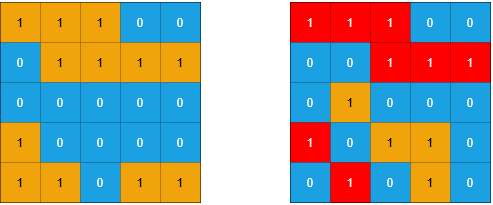
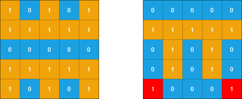

# 1905. 统计子岛屿

Medium · 难度分 1679 · [力扣原题](https://leetcode.cn/problems/count-sub-islands/)

所在刷题路径：labuladong、灵神核心路线、灵神题单·网格图

| 作者 | 题解 | 动画讲解 |
|---|---|---|
| 灵茶山艾府 | [📄 题解](灵茶山艾府.md) | [▶︎ 1905 统计子岛屿 · 灵茶山艾府.mp4](1905%20统计子岛屿%20·%20灵茶山艾府.mp4) |
| yiduobo | [📄 题解](yiduobo.md) | [▶︎ 1905 统计子岛屿 · yiduobo.mp4](1905%20统计子岛屿%20·%20yiduobo.mp4) |

## 题目描述

给你两个 `m x n` 的二进制矩阵 `grid1` 和 `grid2` ，它们只包含 `0` （表示水域）和 `1` （表示陆地）。一个 **岛屿** 是由 **四个方向** （水平或者竖直）上相邻的 `1` 组成的区域。任何矩阵以外的区域都视为水域。

如果 `grid2` 的一个岛屿，被 `grid1` 的一个岛屿 **完全** 包含，也就是说 `grid2` 中该岛屿的每一个格子都被 `grid1` 中同一个岛屿完全包含，那么我们称 `grid2` 中的这个岛屿为 **子岛屿** 。

请你返回 `grid2` 中 **子岛屿** 的 **数目** 。

**示例 1：**



```
输入：grid1 = [[1,1,1,0,0],[0,1,1,1,1],[0,0,0,0,0],[1,0,0,0,0],[1,1,0,1,1]], grid2 = [[1,1,1,0,0],[0,0,1,1,1],[0,1,0,0,0],[1,0,1,1,0],[0,1,0,1,0]]
输出：3
解释：如上图所示，左边为 grid1 ，右边为 grid2 。
grid2 中标红的 1 区域是子岛屿，总共有 3 个子岛屿。
```

**示例 2：**



```
输入：grid1 = [[1,0,1,0,1],[1,1,1,1,1],[0,0,0,0,0],[1,1,1,1,1],[1,0,1,0,1]], grid2 = [[0,0,0,0,0],[1,1,1,1,1],[0,1,0,1,0],[0,1,0,1,0],[1,0,0,0,1]]
输出：2
解释：如上图所示，左边为 grid1 ，右边为 grid2 。
grid2 中标红的 1 区域是子岛屿，总共有 2 个子岛屿。
```

**提示：**

- `m == grid1.length == grid2.length`

- `n == grid1[i].length == grid2[i].length`

- `1 <= m, n <= 500`

- `grid1[i][j]` 和 `grid2[i][j]` 都要么是 `0` 要么是 `1` 。

---
[↑ 返回 1900-1999](../README.md) · [总索引](../../../索引.md) · [仓库首页](../../../README.md)
