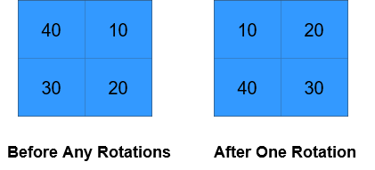
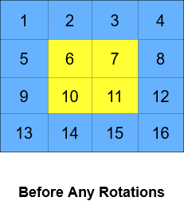

# 1914. 循环轮转矩阵

Medium · [力扣原题](https://leetcode.cn/problems/cyclically-rotating-a-grid/)

| 作者 | 题解 | 动画讲解 |
|---|---|---|
| 灵茶山艾府 | [📄 题解](灵茶山艾府.md) | [▶︎ 动画（GIF）](1914%20循环轮转矩阵%20·%20灵茶山艾府.gif) · [mp4 文件](1914%20循环轮转矩阵%20·%20灵茶山艾府.mp4) |
| yiduobo | [📄 题解](yiduobo.md) | [▶︎ 动画（GIF）](1914%20循环轮转矩阵%20·%20yiduobo.gif) · [mp4 文件](1914%20循环轮转矩阵%20·%20yiduobo.mp4) |

## 动画讲解

> 动图会循环播放；想暂停、拖进度条请下载上面表格里的 mp4 文件。

### 灵茶山艾府


### yiduobo


## 题目描述

给你一个大小为 `m x n` 的整数矩阵 `grid`​​​ ，其中 `m` 和 `n` 都是 **偶数** ；另给你一个整数 `k` 。

矩阵由若干层组成，如下图所示，每种颜色代表一层：


矩阵的循环轮转是通过分别循环轮转矩阵中的每一层完成的。在对某一层进行一次循环旋转操作时，层中的每一个元素将会取代其 **逆时针** 方向的相邻元素。轮转示例如下：


返回执行 `k` 次循环轮转操作后的矩阵。

**示例 1：**



```
输入：grid = [[40,10],[30,20]], k = 1
输出：[[10,20],[40,30]]
解释：上图展示了矩阵在执行循环轮转操作时每一步的状态。
```

**示例 2：**




```
输入：grid = [[1,2,3,4],[5,6,7,8],[9,10,11,12],[13,14,15,16]], k = 2
输出：[[3,4,8,12],[2,11,10,16],[1,7,6,15],[5,9,13,14]]
解释：上图展示了矩阵在执行循环轮转操作时每一步的状态。
```

**提示：**

- `m == grid.length`

- `n == grid[i].length`

- `2 <= m, n <= 50`

- `m` 和 `n` 都是 **偶数**

- `1 <= grid[i][j] <= 5000`

- `1 <= k <= 10⁹`

---
[↑ 返回 1900-1999](../README.md) · [总索引](../../../索引.md) · [仓库首页](../../../README.md)
