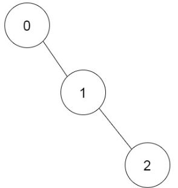

# 1916. 统计为蚁群构筑房间的不同顺序

Hard · 难度分 2486 · [力扣原题](https://leetcode.cn/problems/count-ways-to-build-rooms-in-an-ant-colony/)

所在刷题路径：灵神题单·动态规划、灵神题单·数学算法

| 作者 | 题解 | 动画讲解 |
|---|---|---|
| 灵茶山艾府 | [📄 题解](灵茶山艾府.md) | [▶︎ 动画（GIF）](1916%20统计为蚁群构筑房间的不同顺序%20·%20灵茶山艾府.gif) · [mp4 文件](1916%20统计为蚁群构筑房间的不同顺序%20·%20灵茶山艾府.mp4) |
| yiduobo | [📄 题解](yiduobo.md) | [▶︎ 动画（GIF）](1916%20统计为蚁群构筑房间的不同顺序%20·%20yiduobo.gif) · [mp4 文件](1916%20统计为蚁群构筑房间的不同顺序%20·%20yiduobo.mp4) |

## 动画讲解

> 动图会循环播放；想暂停、拖进度条请下载上面表格里的 mp4 文件。

### 灵茶山艾府


### yiduobo


## 题目描述

你是一只蚂蚁，负责为蚁群构筑 `n` 间编号从 `0` 到 `n-1` 的新房间。给你一个 **下标从 0 开始** 且长度为 `n` 的整数数组 `prevRoom` 作为扩建计划。其中，`prevRoom[i]` 表示在构筑房间 `i` 之前，你必须先构筑房间 `prevRoom[i]` ，并且这两个房间必须 **直接** 相连。房间 `0` 已经构筑完成，所以 `prevRoom[0] = -1` 。扩建计划中还有一条硬性要求，在完成所有房间的构筑之后，从房间 `0` 可以访问到每个房间。

你一次只能构筑 **一个** 房间。你可以在 **已经构筑好的** 房间之间自由穿行，只要这些房间是 **相连的** 。如果房间 `prevRoom[i]` 已经构筑完成，那么你就可以构筑房间 `i`。

返回你构筑所有房间的 **不同顺序的数目** 。由于答案可能很大，请返回对 `10⁹ + 7` **取余** 的结果。

**示例 1：**



```

输入：prevRoom = [-1,0,1]
输出：1
解释：仅有一种方案可以完成所有房间的构筑：0 → 1 → 2
```

**示例 2：**


```

输入：prevRoom = [-1,0,0,1,2]
输出：6
解释：
有 6 种不同顺序：
0 → 1 → 3 → 2 → 4
0 → 2 → 4 → 1 → 3
0 → 1 → 2 → 3 → 4
0 → 1 → 2 → 4 → 3
0 → 2 → 1 → 3 → 4
0 → 2 → 1 → 4 → 3
```

**提示：**

- `n == prevRoom.length`

- `2 <= n <= 10⁵`

- `prevRoom[0] == -1`

- 对于所有的 `1 <= i < n` ，都有 `0 <= prevRoom[i] < n`

- 题目保证所有房间都构筑完成后，从房间 `0` 可以访问到每个房间

---
[↑ 返回 1900-1999](../README.md) · [总索引](../../../索引.md) · [仓库首页](../../../README.md)
