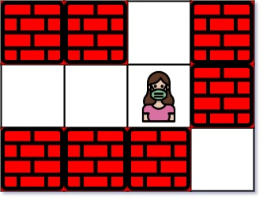
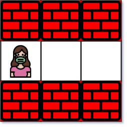

# 【模板】网格图 BFS（Python/Java/C++/Go）

> **[1926. 迷宫中离入口最近的出口](https://leetcode.cn/problems/nearest-exit-from-entrance-in-maze/solutions/869437/go-bfs-by-endlesscheng-k2cu/) · Medium · 难度分 1638**

> **所属题单**
> - [网格图 · 二、网格图 BFS](../../../刷题路径/灵神原版题单/网格图/二、网格图%20BFS.md)

> **题目描述**
> 给你一个 `m x n` 的迷宫矩阵 `maze` （**下标从 0 开始**），矩阵中有空格子（用 `'.'` 表示）和墙（用 `'+'` 表示）。同时给你迷宫的入口 `entrance` ，用 `entrance = [entrance_row, entrance_col]` 表示你一开始所在格子的行和列。
>
> 每一步操作，你可以往 **上**，**下**，**左** 或者 **右** 移动一个格子。你不能进入墙所在的格子，你也不能离开迷宫。你的目标是找到离 `entrance` **最近** 的出口。**出口** 的含义是 `maze` **边界** 上的 **空格子**。`entrance` 格子 **不算** 出口。
>
> 请你返回从 `entrance` 到最近出口的最短路径的 **步数** ，如果不存在这样的路径，请你返回 `-1` 。
>
> **示例 1：**
>
> 
>
> ```
> 输入：maze = [["+","+",".","+"],[".",".",".","+"],["+","+","+","."]], entrance = [1,2]
> 输出：1
> 解释：总共有 3 个出口，分别位于 (1,0)，(0,2) 和 (2,3) 。
> 一开始，你在入口格子 (1,2) 处。
> - 你可以往左移动 2 步到达 (1,0) 。
> - 你可以往上移动 1 步到达 (0,2) 。
> 从入口处没法到达 (2,3) 。
> 所以，最近的出口是 (0,2) ，距离为 1 步。
> ```
>
> **示例 2：**
>
> 
>
> ```
> 输入：maze = [["+","+","+"],[".",".","."],["+","+","+"]], entrance = [1,0]
> 输出：2
> 解释：迷宫中只有 1 个出口，在 (1,2) 处。
> (1,0) 不算出口，因为它是入口格子。
> 初始时，你在入口与格子 (1,0) 处。
> - 你可以往右移动 2 步到达 (1,2) 处。
> 所以，最近的出口为 (1,2) ，距离为 2 步。
> ```
>
> **示例 3：**
>
> 
>
> ```
> 输入：maze = [[".","+"]], entrance = [0,0]
> 输出：-1
> 解释：这个迷宫中没有出口。
> ```
>
> **提示：**
>
> - `maze.length == m`
>
> - `maze[i].length == n`
>
> - `1 <= m, n <= 100`
>
> - `maze[i][j]` 要么是 `'.'` ，要么是 `'+'` 。
>
> - `entrance.length == 2`
>
> - `0 <= entrance_row < m`
>
> - `0 <= entrance_col < n`
>
> - `entrance` 一定是空格子。

> **题解**
> 首先，请先学会更简单的**二叉树 BFS**，讲解请看[【基础算法精讲 13】](https://www.bilibili.com/video/BV1hG4y1277i/)，本文用双列表实现。
>
> 网格图 BFS 与二叉树 BFS 的区别是，二叉树只会往下访问左右儿子，不会往上访问父节点；而网格图存在左右横跳的可能，我们要**避免重复访问**之前访问过的格子。
>
> 为此，我们可以在格子坐标 $(i,j)$ 入队前，用一个二维布尔数组 $\textit{vis}$ 标记 $\textit{vis}[i][j] = \texttt{true}$。
>
> 这样做的好处是，如果发现要入队的格子坐标的 $\textit{vis}[i][j] = \texttt{true}$，那么就不入队。
>
> 这可以避免反复横跳，或者重复访问之前访问过的格子。也能保证队列（列表）中没有重复的格子坐标。
>
> ## 写法一
>
> ```python
> class Solution:
>     def nearestExit(self, maze: List[List[str]], entrance: List[int]) -> int:
>         m, n = len(maze), len(maze[0])
>         vis = [[False] * n for _ in range(m)]
>
>         sx, sy = entrance  # 起点
>         vis[sx][sy] = True  # 访问标记
>         q = [(sx, sy)]
>
>         ans = 1
>         while q:
>             tmp = q
>             q = []
>             for i, j in tmp:
>                 # 注意起点不算终点，不能在这里判断 (i,j) 是不是终点
>                 for x, y in (i, j - 1), (i, j + 1), (i - 1, j), (i + 1, j):  # 访问相邻的格子
>                     if 0 <= x < m and 0 <= y < n and maze[x][y] == '.' and not vis[x][y]:  # 之前没有访问过
>                         if x == 0 or y == 0 or x == m - 1 or y == n - 1:  # 到达终点
>                             return ans
>                         vis[x][y] = True  # 访问标记
>                         q.append((x, y))
>             ans += 1
>         return -1  # 无法到达终点
> ```
>
>
> #### 复杂度分析
>
> - 时间复杂度：$\mathcal{O}(mn)$，其中 $m$ 和 $n$ 分别为 $\textit{maze}$ 的行数和列数。
> - 空间复杂度：$\mathcal{O}(mn)$。
>
> ## 写法二
>
> 把 $(i,j)$ 入队时，直接修改 $\textit{maze}[i][j] = 0$，这样可以去掉 $\textit{vis}$。
>
> ```python
> class Solution:
>     def nearestExit(self, maze: List[List[str]], entrance: List[int]) -> int:
>         m, n = len(maze), len(maze[0])
>         sx, sy = entrance  # 起点
>         maze[sx][sy] = None  # 访问标记
>         q = [(sx, sy)]
>
>         ans = 1
>         while q:
>             tmp = q
>             q = []
>             for i, j in tmp:
>                 # 注意起点不算终点，不能在这里判断 (i,j) 是不是终点
>                 for x, y in (i, j - 1), (i, j + 1), (i - 1, j), (i + 1, j):  # 访问相邻的格子
>                     if 0 <= x < m and 0 <= y < n and maze[x][y] == '.':  # 之前没有访问过
>                         if x == 0 or y == 0 or x == m - 1 or y == n - 1:  # 到达终点
>                             return ans
>                         maze[x][y] = None  # 访问标记
>                         q.append((x, y))
>             ans += 1
>         return -1  # 无法到达终点
> ```
>
>
> #### 复杂度分析
>
> - 时间复杂度：$\mathcal{O}(mn)$，其中 $m$ 和 $n$ 分别为 $\textit{maze}$ 的行数和列数。
> - 空间复杂度：$\mathcal{O}(\min(m,n))$。BFS 按曼哈顿距离逐层扩展。在无限平面上，距离起点为 $d$ 的格子个数为 $4d$（菱形周长）。在网格图上，这会受到 $\min(m,n)$ 的限制，导致每次扩展的格子个数是 $\mathcal{O}(\min(m,n))$。所以队列的大小只有 $\mathcal{O}(\min(m,n))$。
>
> ## 专题训练
>
> 见下面网格图题单的「**二、网格图 BFS**」。
>
> ## 分类题单
>
> [如何科学刷题？](https://leetcode.cn/circle/discuss/RvFUtj/)
>
> 1. [滑动窗口与双指针（定长/不定长/单序列/双序列/三指针/分组循环）](https://leetcode.cn/circle/discuss/0viNMK/)
> 2. [二分算法（二分答案/最小化最大值/最大化最小值/第K小）](https://leetcode.cn/circle/discuss/SqopEo/)
> 3. [单调栈（基础/矩形面积/贡献法/最小字典序）](https://leetcode.cn/circle/discuss/9oZFK9/)
> 4. [网格图（DFS/BFS/综合应用）](https://leetcode.cn/circle/discuss/YiXPXW/)
> 5. [位运算（基础/性质/拆位/试填/恒等式/思维）](https://leetcode.cn/circle/discuss/dHn9Vk/)
> 6. [图论算法（DFS/BFS/拓扑排序/基环树/最短路/最小生成树/网络流）](https://leetcode.cn/circle/discuss/01LUak/)
> 7. [动态规划（入门/背包/划分/状态机/区间/状压/数位/数据结构优化/树形/博弈/概率期望）](https://leetcode.cn/circle/discuss/tXLS3i/)
> 8. [常用数据结构（前缀和/差分/栈/队列/堆/字典树/并查集/树状数组/线段树）](https://leetcode.cn/circle/discuss/mOr1u6/)
> 9. [数学算法（数论/组合/概率期望/博弈/计算几何/随机算法）](https://leetcode.cn/circle/discuss/IYT3ss/)
> 10. [贪心与思维（基本贪心策略/反悔/区间/字典序/数学/思维/脑筋急转弯/构造）](https://leetcode.cn/circle/discuss/g6KTKL/)
> 11. [链表、树与回溯（前后指针/快慢指针/DFS/BFS/直径/LCA）](https://leetcode.cn/circle/discuss/K0n2gO/)
> 12. [字符串（KMP/Z函数/Manacher/字符串哈希/AC自动机/后缀数组/子序列自动机）](https://leetcode.cn/circle/discuss/SJFwQI/)
>
> [我的题解精选（已分类）](https://github.com/EndlessCheng/codeforces-go/blob/master/leetcode/SOLUTIONS.md)
>
> 欢迎关注 [B站@灵茶山艾府](https://space.bilibili.com/206214)
