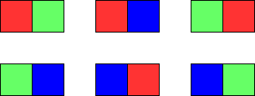

# 1931. 用三种不同颜色为网格涂色

Hard · 难度分 2170 · [力扣原题](https://leetcode.cn/problems/painting-a-grid-with-three-different-colors/)

所在刷题路径：灵神题单·动态规划

| 作者 | 题解 | 动画讲解 |
|---|---|---|
| 灵茶山艾府 | [📄 题解](灵茶山艾府.md) | [▶︎ 动画（GIF）](1931%20用三种不同颜色为网格涂色%20·%20灵茶山艾府.gif) · [mp4 文件](1931%20用三种不同颜色为网格涂色%20·%20灵茶山艾府.mp4) |
| yiduobo | [📄 题解](yiduobo.md) | [▶︎ 动画（GIF）](1931%20用三种不同颜色为网格涂色%20·%20yiduobo.gif) · [mp4 文件](1931%20用三种不同颜色为网格涂色%20·%20yiduobo.mp4) |

## 动画讲解

> 动图会循环播放；想暂停、拖进度条请下载上面表格里的 mp4 文件。

### 灵茶山艾府


### yiduobo


## 题目描述

给你两个整数 `m` 和 `n` 。构造一个 `m x n` 的网格，其中每个单元格最开始是白色。请你用 **红、绿、蓝** 三种颜色为每个单元格涂色。所有单元格都需要被涂色。

涂色方案需要满足：**不存在相邻两个单元格颜色相同的情况** 。返回网格涂色的方法数。因为答案可能非常大， 返回 **对** `10⁹ + 7` **取余** 的结果。

**示例 1：**


```

输入：m = 1, n = 1
输出：3
解释：如上图所示，存在三种可能的涂色方案。
```

**示例 2：**



```

输入：m = 1, n = 2
输出：6
解释：如上图所示，存在六种可能的涂色方案。
```

**示例 3：**

```

输入：m = 5, n = 5
输出：580986
```

**提示：**

- `1 <= m <= 5`

- `1 <= n <= 1000`

---
[↑ 返回 1900-1999](../README.md) · [总索引](../../../索引.md) · [仓库首页](../../../README.md)
