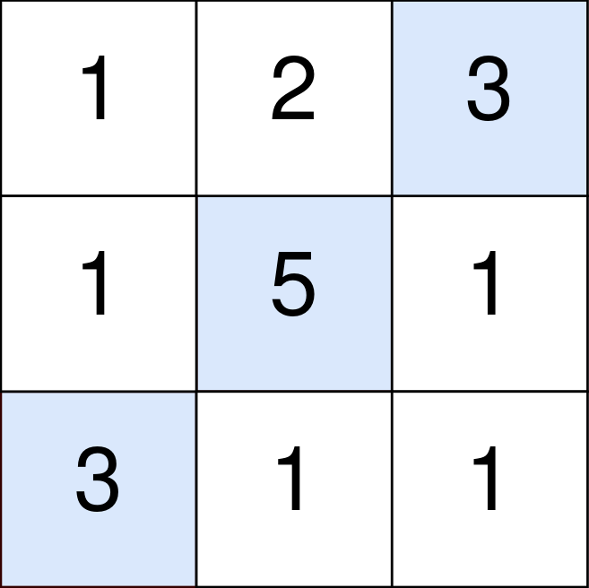
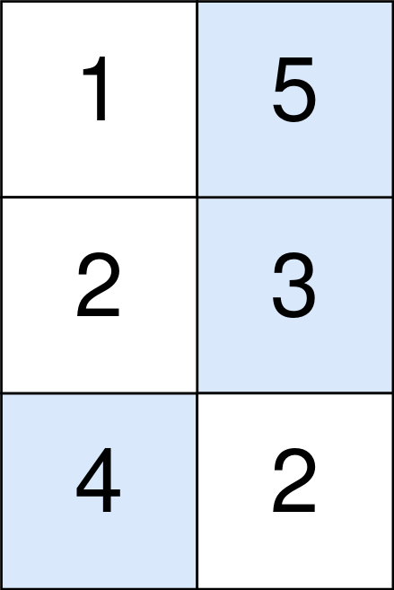

# 1937. 扣分后的最大得分

Medium · 难度分 2106 · [力扣原题](https://leetcode.cn/problems/maximum-number-of-points-with-cost/)

所在刷题路径：灵神题单·动态规划

| 作者 | 题解 | 动画讲解 |
|---|---|---|
| 灵茶山艾府 | [📄 题解](灵茶山艾府.md) | [▶︎ 1937 扣分后的最大得分 · 灵茶山艾府.mp4](1937%20扣分后的最大得分%20·%20灵茶山艾府.mp4) |
| yiduobo | [📄 题解](yiduobo.md) | [▶︎ 1937 扣分后的最大得分 · yiduobo.mp4](1937%20扣分后的最大得分%20·%20yiduobo.mp4) |

## 题目描述

给你一个 `m x n` 的整数矩阵 `points` （下标从 **0** 开始）。一开始你的得分为 `0` ，你想最大化从矩阵中得到的分数。

你的得分方式为：**每一行** 中选取一个格子，选中坐标为 `(r, c)` 的格子会给你的总得分 **增加** `points[r][c]` 。

然而，相邻行之间被选中的格子如果隔得太远，你会失去一些得分。对于相邻行 `r` 和 `r + 1` （其中 `0 <= r < m - 1`），选中坐标为 `(r, c₁)` 和 `(r + 1, c₂)` 的格子，你的总得分 **减少** `abs(c₁ - c₂)` 。

请你返回你能得到的 **最大** 得分。

`abs(x)` 定义为：

- 如果 `x >= 0` ，那么值为 `x` 。

- 如果 `x < 0` ，那么值为 `-x` 。

**示例 1：**



```

输入：points = [[1,2,3],[1,5,1],[3,1,1]]
输出：9
解释：
蓝色格子是最优方案选中的格子，坐标分别为 (0, 2)，(1, 1) 和 (2, 0) 。
你的总得分增加 3 + 5 + 3 = 11 。
但是你的总得分需要扣除 abs(2 - 1) + abs(1 - 0) = 2 。
你的最终得分为 11 - 2 = 9 。
```

**示例 2：**



```

输入：points = [[1,5],[2,3],[4,2]]
输出：11
解释：
蓝色格子是最优方案选中的格子，坐标分别为 (0, 1)，(1, 1) 和 (2, 0) 。
你的总得分增加 5 + 3 + 4 = 12 。
但是你的总得分需要扣除 abs(1 - 1) + abs(1 - 0) = 1 。
你的最终得分为 12 - 1 = 11 。
```

**提示：**

- `m == points.length`

- `n == points[r].length`

- `1 <= m, n <= 10⁵`

- `1 <= m * n <= 10⁵`

- `0 <= points[r][c] <= 10⁵`

---
[↑ 返回 1900-1999](../README.md) · [总索引](../../../索引.md) · [仓库首页](../../../README.md)
