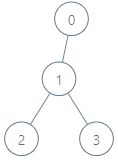
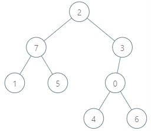

# 1938. 查询最大基因差

Hard · 难度分 2503 · [力扣原题](https://leetcode.cn/problems/maximum-genetic-difference-query/)

所在刷题路径：灵神题单·常用数据结构

| 作者 | 题解 | 动画讲解 |
|---|---|---|
| 灵茶山艾府 | [📄 题解](灵茶山艾府.md) | 灵神这篇题解指向 421 题的题解，请看那道题的视频：[▶︎ 0421 数组中两个数的最大异或值 · 灵茶山艾府.mp4](../../0400-0499/0421%20数组中两个数的最大异或值/0421%20数组中两个数的最大异或值%20·%20灵茶山艾府.mp4) |
| yiduobo | [📄 题解](yiduobo.md) | [▶︎ 1938 查询最大基因差 · yiduobo.mp4](1938%20查询最大基因差%20·%20yiduobo.mp4) |

## 题目描述

给你一棵 `n` 个节点的有根树，节点编号从 `0` 到 `n - 1` 。每个节点的编号表示这个节点的 **独一无二的基因值** （也就是说节点 `x` 的基因值为 `x`）。两个基因值的 **基因差** 是两者的 **异或和** 。给你整数数组 `parents` ，其中 `parents[i]` 是节点 `i` 的父节点。如果节点 `x` 是树的 **根** ，那么 `parents[x] == -1` 。

给你查询数组 `queries` ，其中 `queries[i] = [node_i, val_i]` 。对于查询 `i` ，请你找到 `val_i` 和 `p_i` 的 **最大基因差** ，其中 `p_i` 是节点 `node_i` 到根之间的任意节点（包含 `node_i` 和根节点）。更正式的，你想要最大化 `val_i XOR p_i`<sub> </sub>。

请你返回数组 `ans` ，其中 `ans[i]` 是第 `i` 个查询的答案。

**示例 1：**



```
输入：parents = [-1,0,1,1], queries = [[0,2],[3,2],[2,5]]
输出：[2,3,7]
解释：查询数组处理如下：
- [0,2]：最大基因差的对应节点为 0 ，基因差为 2 XOR 0 = 2 。
- [3,2]：最大基因差的对应节点为 1 ，基因差为 2 XOR 1 = 3 。
- [2,5]：最大基因差的对应节点为 2 ，基因差为 5 XOR 2 = 7 。
```

**示例 2：**



```
输入：parents = [3,7,-1,2,0,7,0,2], queries = [[4,6],[1,15],[0,5]]
输出：[6,14,7]
解释：查询数组处理如下：
- [4,6]：最大基因差的对应节点为 0 ，基因差为 6 XOR 0 = 6 。
- [1,15]：最大基因差的对应节点为 1 ，基因差为 15 XOR 1 = 14 。
- [0,5]：最大基因差的对应节点为 2 ，基因差为 5 XOR 2 = 7 。
```

**提示：**

- `2 <= parents.length <= 10⁵`

- 对于每个 **不是** 根节点的 `i` ，有 `0 <= parents[i] <= parents.length - 1` 。

- `parents[root] == -1`

- `1 <= queries.length <= 3 * 10⁴`

- `0 <= node_i <= parents.length - 1`

- `0 <= val_i <= 2 * 10⁵`

---
[↑ 返回 1900-1999](../README.md) · [总索引](../../../索引.md) · [仓库首页](../../../README.md)
