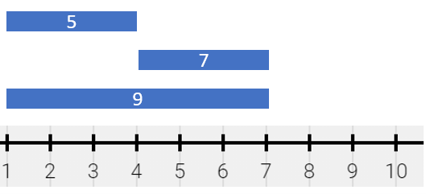
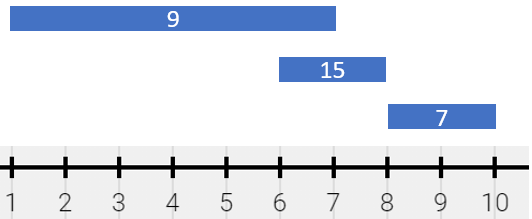
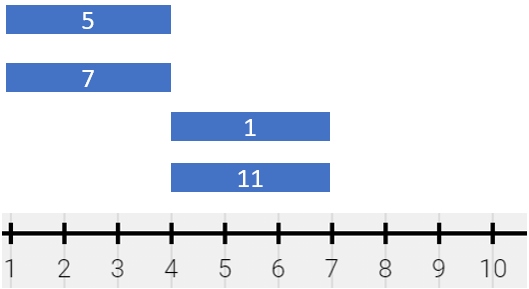

# 1943. 描述绘画结果

Medium · 难度分 1969 · [力扣原题](https://leetcode.cn/problems/describe-the-painting/)

所在刷题路径：灵神题单·常用数据结构

| 作者 | 题解 | 动画讲解 |
|---|---|---|
| 灵茶山艾府 | [📄 题解](灵茶山艾府.md) | — |
| yiduobo | [📄 题解](yiduobo.md) | [▶︎ 1943 描述绘画结果 · yiduobo.mp4](1943%20描述绘画结果%20·%20yiduobo.mp4) |

## 题目描述

给你一个细长的画，用数轴表示。这幅画由若干有重叠的线段表示，每个线段有 **独一无二** 的颜色。给你二维整数数组 `segments` ，其中 `segments[i] = [start_i, end_i, color_i]` 表示线段为 **半开区间** `[start_i, end_i)` 且颜色为 `color_i` 。

线段间重叠部分的颜色会被 **混合** 。如果有两种或者更多颜色混合时，它们会形成一种新的颜色，用一个 **集合** 表示这个混合颜色。

- 比方说，如果颜色 `2` ，`4` 和 `6` 被混合，那么结果颜色为 `{2,4,6}` 。

为了简化题目，你不需要输出整个集合，只需要用集合中所有元素的 **和** 来表示颜色集合。

你想要用 **最少数目** 不重叠 **半开区间** 来 **表示** 这幅混合颜色的画。这些线段可以用二维数组 `painting` 表示，其中 `painting[j] = [left_j, right_j, mix_j]` 表示一个 **半开区间**`[left_j, right_j)` 的颜色 **和** 为 `mix_j` 。

- 比方说，这幅画由 `segments = [[1,4,5],[1,7,7]]` 组成，那么它可以表示为 `painting = [[1,4,12],[4,7,7]]` ，因为：

    - `[1,4)` 由颜色 `{5,7}` 组成（和为 `12`），分别来自第一个线段和第二个线段。

    - `[4,7)` 由颜色 `{7}` 组成，来自第二个线段。

请你返回二维数组 `painting` ，它表示最终绘画的结果（**没有** 被涂色的部分不出现在结果中）。你可以按 **任意顺序** 返回最终数组的结果。

**半开区间** `[a, b)` 是数轴上点 `a` 和点 `b` 之间的部分，**包含** 点 `a` 且 **不包含** 点 `b` 。

**示例 1：**



```

输入：segments = [[1,4,5],[4,7,7],[1,7,9]]
输出：[[1,4,14],[4,7,16]]
解释：绘画结果可以表示为：
- [1,4) 颜色为 {5,9} （和为 14），分别来自第一和第二个线段。
- [4,7) 颜色为 {7,9} （和为 16），分别来自第二和第三个线段。
```

**示例 2：**



```

输入：segments = [[1,7,9],[6,8,15],[8,10,7]]
输出：[[1,6,9],[6,7,24],[7,8,15],[8,10,7]]
解释：绘画结果可以以表示为：
- [1,6) 颜色为 9 ，来自第一个线段。
- [6,7) 颜色为 {9,15} （和为 24），来自第一和第二个线段。
- [7,8) 颜色为 15 ，来自第二个线段。
- [8,10) 颜色为 7 ，来自第三个线段。
```

**示例 3：**



```

输入：segments = [[1,4,5],[1,4,7],[4,7,1],[4,7,11]]
输出：[[1,4,12],[4,7,12]]
解释：绘画结果可以表示为：
- [1,4) 颜色为 {5,7} （和为 12），分别来自第一和第二个线段。
- [4,7) 颜色为 {1,11} （和为 12），分别来自第三和第四个线段。
注意，只返回一个单独的线段 [1,7) 是不正确的，因为混合颜色的集合不相同。
```

**提示：**

- `1 <= segments.length <= 2 * 10⁴`

- `segments[i].length == 3`

- `1 <= start_i < end_i <= 10⁵`

- `1 <= color_i <= 10⁹`

- 每种颜色 `color_i` 互不相同。

---
[↑ 返回 1900-1999](../README.md) · [总索引](../../../索引.md) · [仓库首页](../../../README.md)
