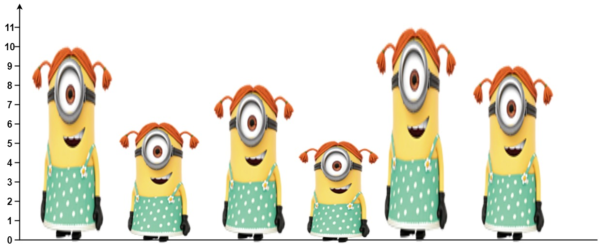

# 单调栈的本质：及时去掉无用数据（Python/Java/C++/Go/JS/Rust）

> **[1944. 队列中可以看到的人数](https://leetcode.cn/problems/number-of-visible-people-in-a-queue/solutions/2591558/dan-diao-zhan-de-ben-zhi-ji-shi-qu-diao-8tp3s/) · Hard · 难度分 2105**

> **所属题单**
> - [单调栈 · 一、单调栈](../../../刷题路径/灵神原版题单/单调栈/一、单调栈.md) · §1.2 进阶

> **题目描述**
> 有 `n` 个人排成一个队列，**从左到右** 编号为 `0` 到 `n - 1` 。给你以一个整数数组 `heights` ，每个整数 **互不相同**，`heights[i]` 表示第 `i` 个人的高度。
>
> 一个人能 **看到** 他右边另一个人的条件是这两人之间的所有人都比他们两人 **矮** 。更正式的，第 `i` 个人能看到第 `j` 个人的条件是 `i < j` 且 `min(heights[i], heights[j]) > max(heights[i+1], heights[i+2], ..., heights[j-1])` 。
>
> 请你返回一个长度为 `n` 的数组 `answer` ，其中 `answer[i]` 是第 `i` 个人在他右侧队列中能 **看到** 的 **人数** 。
>
> **示例 1：**
>
> 
>
> ```
>
> 输入：heights = [10,6,8,5,11,9]
> 输出：[3,1,2,1,1,0]
> 解释：
> 第 0 个人能看到编号为 1 ，2 和 4 的人。
> 第 1 个人能看到编号为 2 的人。
> 第 2 个人能看到编号为 3 和 4 的人。
> 第 3 个人能看到编号为 4 的人。
> 第 4 个人能看到编号为 5 的人。
> 第 5 个人谁也看不到因为他右边没人。
> ```
>
> **示例 2：**
>
> ```
>
> 输入：heights = [5,1,2,3,10]
> 输出：[4,1,1,1,0]
> ```
>
> **提示：**
>
> - `n == heights.length`
>
> - `1 <= n <= 10⁵`
>
> - `1 <= heights[i] <= 10⁵`
>
> - `heights` 中所有数 **互不相同** 。

> **题解**
> ### 前置知识
>
> 请看视频讲解：[单调栈【基础算法精讲 26】](https://www.bilibili.com/video/BV1VN411J7S7/)
>
> ### 思路
>
> 为方便描述，下文将 $\textit{heights}$ 简记为 $h$。
>
> 如果暴力枚举，对于每个 $i$，我们需要遍历 $i$ 右边所有的 $j$，一个一个地判断是否满足题目要求。
>
> 怎么优化？如果某个 $j$ 一定不会被 $i$ 看到，我们就不需要去遍历这样的 $j$ 了。根据题目要求，如果在 $i$ 和 $j$ 之间，存在一个 $k$，使得 $h[k]>h[j]$，那么 $j$ 就一定不会被 $i$ 看到。注意题目保证所有元素互不相同，无需处理身高相等的情况。
>
> 从右往左遍历 $h$，如果发现一个 $h[k]$ 比右边的数 $h[j]$ 大，那么 $h[k]$ 就把 $h[j]$「挡住」，$k$ 左边的人**再也不会**看到 $j$ 了。
>
> 这启发我们用一个数据结构（栈）维护**没有被挡住**的人的身高。对于那些被挡住的人，永远不会去遍历他们了（及时去掉无用数据）。
>
> 看示例 1：
>
> | $i$ | $h[i]$ | 入栈前  | 入栈后  | $\textit{ans}[i]$  |解释|
> |---|:---:|---|---|:---:|---|
> | $5$ | $9$  | $[]$  | $[9]$   | $0$  ||
> | $4$ | $11$  |  $[9]$ |  $[11]$ | $1$  |$11$ 挡住 $9$|
> | $3$ | $5$  | $[11]$  | $[11,5]$  | $1$  ||
> | $2$ | $8$  | $[11,5]$  | $[11,8]$  | $2$  |$8$ 挡住 $5$|
> | $1$ | $6$  |  $[11,8]$ | $[11,8,6]$  | $1$  ||
> | $0$ | $10$  |  $[11,8,6]$ | $[11,10]$  | $3$  |$10$ 挡住 $8,6$|
>
> 从右往左遍历到 $i$ 时，如果栈顶比 $h[i]$ 小，就不断弹出栈顶，直到栈为空或者栈顶大于 $h[i]$。统计弹出的元素个数，作为 $i$ 能看到的人数 $\textit{ans}[i]$。出栈结束后，若栈不为空，说明第 $i$ 个人还可以再看到一个人（栈顶），把 $\textit{ans}[i]$ 加一。
>
> 对于比栈顶更靠右的人，由于栈顶比 $h[i]$ 大，根据题目要求，$i$ 无法看到比栈顶更靠右的人，所以无需遍历这些更靠右的人。
>
> ```python
> class Solution:
>     def canSeePersonsCount(self, heights: List[int]) -> List[int]:
>         n = len(heights)
>         ans = [0] * n
>         st = []
>         for i in range(n - 1, -1, -1):
>             while st and st[-1] < heights[i]:
>                 st.pop()
>                 ans[i] += 1
>             if st:  # 还可以再看到一个人
>                 ans[i] += 1
>             st.append(heights[i])
>         return ans
> ```
>
>
> #### 复杂度分析
>
> - 时间复杂度：$\mathcal{O}(n)$，其中 $n$ 为 $h$ 的长度。每个人至多入栈出栈各一次，所以二重循环的总循环次数是 $\mathcal{O}(n)$。
> - 空间复杂度：$\mathcal{O}(n)$。
>
> [【题单】单调栈（矩形系列/字典序最小/贡献法）](https://leetcode.cn/circle/discuss/9oZFK9/)
>
> 更多精彩题解，请看 [往期题解精选（已分类）](https://github.com/EndlessCheng/codeforces-go/blob/master/leetcode/SOLUTIONS.md)
