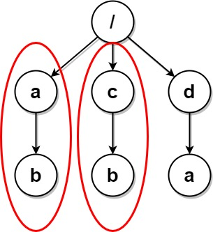
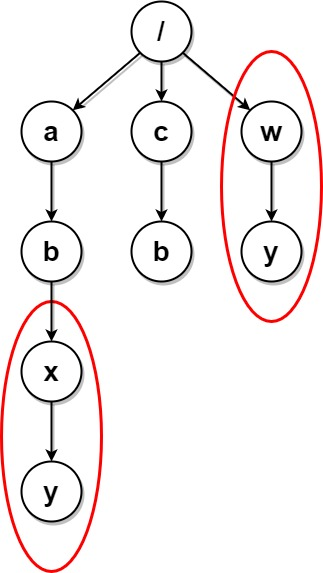
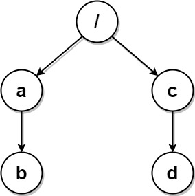
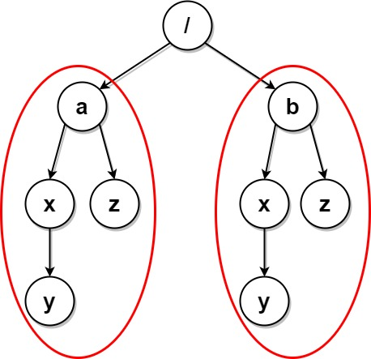
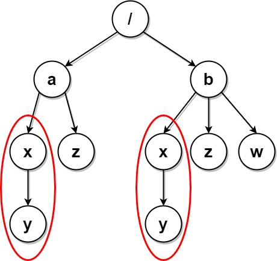

# 括号表示法 + 字典树（Python/Java/C++/Go）

> **[1948. 删除系统中的重复文件夹](https://leetcode.cn/problems/delete-duplicate-folders-in-system/solutions/895148/zi-dian-shu-ha-xi-biao-by-endlesscheng-115r/) · Hard · 难度分 2534**

> **所属题单**
> - [常用数据结构 · 六、字典树（trie）](../../../刷题路径/灵神原版题单/常用数据结构/六、字典树（trie）.md) · §6.2 进阶

> **题目描述**
> 由于一个漏洞，文件系统中存在许多重复文件夹。给你一个二维数组 `paths`，其中 `paths[i]` 是一个表示文件系统中第 `i` 个文件夹的绝对路径的数组。
>
> - 例如，`["one", "two", "three"]` 表示路径 `"/one/two/three"` 。
>
> 如果两个文件夹（不需要在同一层级）包含 **非空且相同的** 子文件夹 **集合** 并具有相同的子文件夹结构，则认为这两个文件夹是相同文件夹。相同文件夹的根层级 **不** 需要相同。如果存在两个（或两个以上）**相同** 文件夹，则需要将这些文件夹和所有它们的子文件夹 **标记** 为待删除。
>
> - 例如，下面文件结构中的文件夹 `"/a"` 和 `"/b"` 相同。它们（以及它们的子文件夹）应该被 **全部** 标记为待删除：
>
>     - `/a`
>
>     - `/a/x`
>
>     - `/a/x/y`
>
>     - `/a/z`
>
>     - `/b`
>
>     - `/b/x`
>
>     - `/b/x/y`
>
>     - `/b/z`
>
> - 然而，如果文件结构中还包含路径 `"/b/w"` ，那么文件夹 `"/a"` 和 `"/b"` 就不相同。注意，即便添加了新的文件夹 `"/b/w"` ，仍然认为 `"/a/x"` 和 `"/b/x"` 相同。
>
> 一旦所有的相同文件夹和它们的子文件夹都被标记为待删除，文件系统将会 **删除** 所有上述文件夹。文件系统只会执行一次删除操作。执行完这一次删除操作后，不会删除新出现的相同文件夹。
>
> 返回二维数组 `ans` ，该数组包含删除所有标记文件夹之后剩余文件夹的路径。路径可以按 **任意顺序** 返回。
>
> **示例 1：**
>
> 
>
> ```
>
> 输入：paths = [["a"],["c"],["d"],["a","b"],["c","b"],["d","a"]]
> 输出：[["d"],["d","a"]]
> 解释：文件结构如上所示。
> 文件夹 "/a" 和 "/c"（以及它们的子文件夹）都会被标记为待删除，因为它们都包含名为 "b" 的空文件夹。
> ```
>
> **示例 2：**
>
> 
>
> ```
>
> 输入：paths = [["a"],["c"],["a","b"],["c","b"],["a","b","x"],["a","b","x","y"],["w"],["w","y"]]
> 输出：[["c"],["c","b"],["a"],["a","b"]]
> 解释：文件结构如上所示。
> 文件夹 "/a/b/x" 和 "/w"（以及它们的子文件夹）都会被标记为待删除，因为它们都包含名为 "y" 的空文件夹。
> 注意，文件夹 "/a" 和 "/c" 在删除后变为相同文件夹，但这两个文件夹不会被删除，因为删除只会进行一次，且它们没有在删除前被标记。
> ```
>
> **示例 3：**
>
> 
>
> ```
>
> 输入：paths = [["a","b"],["c","d"],["c"],["a"]]
> 输出：[["c"],["c","d"],["a"],["a","b"]]
> 解释：文件系统中所有文件夹互不相同。
> 注意，返回的数组可以按不同顺序返回文件夹路径，因为题目对顺序没有要求。
> ```
>
> **示例 4：**
>
> 
>
> ```
>
> 输入：paths = [["a"],["a","x"],["a","x","y"],["a","z"],["b"],["b","x"],["b","x","y"],["b","z"]]
> 输出：[]
> 解释：文件结构如上所示。
> 文件夹 "/a/x" 和 "/b/x"（以及它们的子文件夹）都会被标记为待删除，因为它们都包含名为 "y" 的空文件夹。
> 文件夹 "/a" 和 "/b"（以及它们的子文件夹）都会被标记为待删除，因为它们都包含一个名为 "z" 的空文件夹以及上面提到的文件夹 "x" 。
> ```
>
> **示例 5：**
>
> 
>
> ```
>
> 输入：paths = [["a"],["a","x"],["a","x","y"],["a","z"],["b"],["b","x"],["b","x","y"],["b","z"],["b","w"]]
> 输出：[["b"],["b","w"],["b","z"],["a"],["a","z"]]
> 解释：本例与上例的结构基本相同，除了新增 "/b/w" 文件夹。
> 文件夹 "/a/x" 和 "/b/x" 仍然会被标记，但 "/a" 和 "/b" 不再被标记，因为 "/b" 中有名为 "w" 的空文件夹而 "/a" 没有。
> 注意，"/a/z" 和 "/b/z" 不会被标记，因为相同子文件夹的集合必须是非空集合，但这两个文件夹都是空的。
> ```
>
> **提示：**
>
> - `1 <= paths.length <= 2 * 10⁴`
>
> - `1 <= paths[i].length <= 500`
>
> - `1 <= paths[i][j].length <= 10`
>
> - `1 <= sum(paths[i][j].length) <= 2 * 10⁵`
>
> - `path[i][j]` 由小写英文字母组成
>
> - 不会存在两个路径都指向同一个文件夹的情况
>
> - 对于不在根层级的任意文件夹，其父文件夹也会包含在输入中

> **题解**
> **核心思路**：把**相同的子树映射为相同的字符串**，就能用哈希表去重了。
>
> 如何把子树转化成字符串？为了准确判断两棵子树的结构是否相同，需要做到两点：
>
> 1. 字符串需要包含子树所有节点的**文件夹名**。
> 2. 字符串要能够表达节点的**父子关系**。
>
> 考察树的递归过程，把向下「递」的动作用一个非字母字符表示，向上「归」的动作用另一个非字母字符表示，就可以描述一棵树的形状了（用非字母字符是为了与文件夹名区分开）。比如说，**用左括号表示递，用右括号表示归**。从节点 $\texttt{x}$ 向下递到节点 $\texttt{y}$，再归回 $\texttt{x}$，就可以表示为 $\texttt{x(y)}$。如果 $\texttt{x}$ 有两个儿子 $\texttt{y}$ 和 $\texttt{z}$（并且这两个儿子都是叶子），那么子树 $\texttt{x}$ 就可以表示为 $\texttt{x(y)(z)}$。
>
> 一般地，定义如下括号表达式：
>
> - 对于叶子节点，设其文件夹名为 $S$，则其括号表达式就是 $S$。
> - 对于任意子树 $x$，设 $x$ 的儿子为 $y_1,y_2,\ldots,y_k$，则子树 $x$ 的括号表达式为 
>     $$
>     x\ 的文件夹名 + (子树\ y_1\ 的表达式) + (子树\ y_2\ 的表达式) + \cdots + (子树\ y_k\ 的表达式)
>     $$
>
> {:width=300}
>
> 看示例 4，子树 $\texttt{x}$ 的括号表达式为 $\texttt{x(y)}$，子树 $\texttt{a}$ 的括号表达式为 $\texttt{a(x(y))(z)}$，子树 $\texttt{b}$ 的括号表达式为 $\texttt{b(x(y))(z)}$。
>
> 根据题意，我们不关心子树根节点的文件夹名。去掉子树根节点后，子树 $\texttt{a}$ 和子树 $\texttt{b}$ 的括号表达式都是 $\texttt{(x(y))(z)}$，所以这两个文件夹「包含非空且相同的子文件夹集合，并具有相同的子文件夹结构」。
>
> 括号表达式既包含了文件夹名，又通过**括号的嵌套关系**表达了父子关系，因此可用于判断两个文件夹是否为相同文件夹。
>
> 你可能会问：如果子树 $\texttt{b}$ 的两棵子树是 $\texttt{z}$ 在左，$\texttt{x(y)}$ 在右呢？得到的表达式为 $\texttt{(z)(x(y))}$，这样没法判断两棵子树相同呀？
>
> 解决办法：在构造括号表达式时，先把子树 $y_1,y_2,\ldots,y_k$ 的表达式按照字典序**排序**，再把表达式依次拼接，就可以避免出现上述情况了。
>
> 代码实现时，用 [字典树](../../0200-0299/0208%20实现%20Trie%20%28前缀树%29/灵茶山艾府.md) 表示这个文件系统，节点保存文件夹名称。注意这与一般的字典树不同，不是二十六叉树那种用单个字母对应节点，而是用一整个字符串（文件夹名）对应节点。这棵字典树一个节点（文件夹）最多能有 $20000$ 个儿子（子文件夹）。
>
> 用 $\textit{paths}$ 构建完字典树后，DFS 这棵树，按照前文的规则生成括号表达式 $\textit{subTreeExpr}$：
>
> - 如果首次遇到 $\textit{subTreeExpr}$，那么把 $\textit{subTreeExpr}$ 及其对应的子树根节点保存到哈希表中。
> - 否则我们找到了重复的文件夹，把哈希表中 $\textit{subTreeExpr}$ 对应的节点，以及当前节点，都标记为待删除。
>
> 最后，再次 DFS（回溯）这棵字典树，仅访问未被删除的节点，同时用一个列表 $\textit{path}$ 记录路径上的文件夹名。每次递归到一个节点，就把 $\textit{path}$ 的一个拷贝加到答案中。做法类似 [257. 二叉树的所有路径](https://leetcode.cn/problems/binary-tree-paths/)。
>
> ```python
> class TrieNode:
>     __slots__ = 'son', 'name', 'deleted'
>
>     def __init__(self):
>         self.son = {}
>         self.name = ''  # 文件夹名称
>         self.deleted = False  # 删除标记
>
>
> class Solution:
>     def deleteDuplicateFolder(self, paths: List[List[str]]) -> List[List[str]]:
>         root = TrieNode()
>         for path in paths:
>             # 把 path 插到字典树中，见 208. 实现 Trie
>             cur = root
>             for s in path:
>                 if s not in cur.son:
>                     cur.son[s] = TrieNode()
>                 cur = cur.son[s]
>                 cur.name = s
>
>         expr_to_node = {}  # 子树括号表达式 -> 子树根节点
>
>         def gen_expr(node: TrieNode) -> str:
>             if not node.son:  # 叶子
>                 return node.name  # 表达式就是文件夹名
>
>             # 每个子树的表达式外面套一层括号
>             expr = sorted('(' + gen_expr(son) + ')' for son in node.son.values())
>             sub_tree_expr = ''.join(expr)  # 按字典序拼接所有子树的表达式
>             if sub_tree_expr in expr_to_node:  # 哈希表中有 sub_tree_expr，说明有重复的文件夹
>                 expr_to_node[sub_tree_expr].deleted = True  # 哈希表中记录的节点标记为删除
>                 node.deleted = True  # 当前节点标记为删除
>             else:
>                 expr_to_node[sub_tree_expr] = node
>
>             return node.name + sub_tree_expr
>
>         for son in root.son.values():
>             gen_expr(son)
>
>         ans = []
>         path = []
>
>         # 在字典树上回溯，仅访问未被删除的节点，并将路径记录到答案中
>         # 类似 257. 二叉树的所有路径
>         def dfs(node: TrieNode) -> None:
>             if node.deleted:
>                 return
>             path.append(node.name)
>             ans.append(path.copy())  # path[:]
>             for child in node.son.values():
>                 dfs(child)
>             path.pop()  # 恢复现场
>
>         for son in root.son.values():
>             dfs(son)
>
>         return ans
> ```
>
>
> #### 复杂度分析
>
> - 时间复杂度：$\mathcal{O}(\ell\cdot m\log m)$，其中 $m$ 是字符串的总个数，$\ell\le 10$ 是单个字符串的长度，题目保证 $\ell\cdot m\le 2\cdot 10^5$。瓶颈在排序上。字符串拼接的复杂度是 $\mathcal{O}(\ell\cdot m)$。
>     - 排序：最坏情况下一个节点有 $\mathcal{O}(m)$ 个儿子，我们会对 $\mathcal{O}(m)$ 个字符串排序。会发生 $\mathcal{O}(m\log m)$ 次字符串比较，每次 $\mathcal{O}(\ell)$ 时间，所以排序的时间复杂度为 $\mathcal{O}(\ell\cdot m\log m)$。
>     - 字符串拼接：可能读者会认为当树退化成链时，代码会跑到 $\mathcal{O}((\ell\cdot m)^2)$ 时间，但这是不可能的。注意题目的这句话：「对于不在根层级的任意文件夹，其父文件夹也会包含在输入中。」这意味着如果一棵树的高度是 $d$，那么至少要 $1+2+3+\cdots+d = \mathcal{O}(d^2)$ 个字符串才能生成这棵树（可以参考示例 2），所以树的高度只有 $\mathcal{O}(\sqrt m)$。相应地，代码中的 `node.name + subTreeExpr` 会对长为 $\mathcal{O}(\ell\sqrt m)$ 的字符串复制拼接 $\mathcal{O}(\sqrt m)$ 次，所以时间复杂度为 $\mathcal{O}(\ell(\sqrt m)^2) = \mathcal{O}(\ell\cdot m)$。
> - 空间复杂度：$\mathcal{O}(\ell\cdot m)$。
>
> ## 专题训练
>
> - [297. 二叉树的序列化与反序列化](https://leetcode.cn/problems/serialize-and-deserialize-binary-tree/)
> - 下面数据结构题单的「**六、字典树（trie）**」。
>
> ## 分类题单
>
> [如何科学刷题？](https://leetcode.cn/circle/discuss/RvFUtj/)
>
> 1. [滑动窗口与双指针（定长/不定长/单序列/双序列/三指针/分组循环）](https://leetcode.cn/circle/discuss/0viNMK/)
> 2. [二分算法（二分答案/最小化最大值/最大化最小值/第K小）](https://leetcode.cn/circle/discuss/SqopEo/)
> 3. [单调栈（基础/矩形面积/贡献法/最小字典序）](https://leetcode.cn/circle/discuss/9oZFK9/)
> 4. [网格图（DFS/BFS/综合应用）](https://leetcode.cn/circle/discuss/YiXPXW/)
> 5. [位运算（基础/性质/拆位/试填/恒等式/思维）](https://leetcode.cn/circle/discuss/dHn9Vk/)
> 6. [图论算法（DFS/BFS/拓扑排序/基环树/最短路/最小生成树/网络流）](https://leetcode.cn/circle/discuss/01LUak/)
> 7. [动态规划（入门/背包/划分/状态机/区间/状压/数位/数据结构优化/树形/博弈/概率期望）](https://leetcode.cn/circle/discuss/tXLS3i/)
> 8. [常用数据结构（前缀和/差分/栈/队列/堆/字典树/并查集/树状数组/线段树）](https://leetcode.cn/circle/discuss/mOr1u6/)
> 9. [数学算法（数论/组合/概率期望/博弈/计算几何/随机算法）](https://leetcode.cn/circle/discuss/IYT3ss/)
> 10. [贪心与思维（基本贪心策略/反悔/区间/字典序/数学/思维/脑筋急转弯/构造）](https://leetcode.cn/circle/discuss/g6KTKL/)
> 11. [链表、二叉树与回溯（前后指针/快慢指针/DFS/BFS/直径/LCA/一般树）](https://leetcode.cn/circle/discuss/K0n2gO/)
> 12. [字符串（KMP/Z函数/Manacher/字符串哈希/AC自动机/后缀数组/子序列自动机）](https://leetcode.cn/circle/discuss/SJFwQI/)
>
> [我的题解精选（已分类）](https://github.com/EndlessCheng/codeforces-go/blob/master/leetcode/SOLUTIONS.md)
>
> 欢迎关注 [B站@灵茶山艾府](https://space.bilibili.com/206214)
