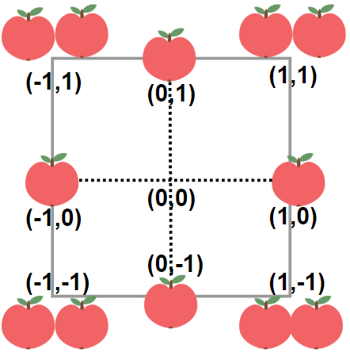

# 1954. 收集足够苹果的最小花园周长

Medium · 难度分 1759 · [力扣原题](https://leetcode.cn/problems/minimum-garden-perimeter-to-collect-enough-apples/)

所在刷题路径：灵神题单·数学算法

| 作者 | 题解 | 动画讲解 |
|---|---|---|
| 灵茶山艾府 | [📄 题解](灵茶山艾府.md) | [▶︎ 动画（GIF）](1954%20收集足够苹果的最小花园周长%20·%20灵茶山艾府.gif) · [mp4 文件](1954%20收集足够苹果的最小花园周长%20·%20灵茶山艾府.mp4) |
| yiduobo | [📄 题解](yiduobo.md) | [▶︎ 动画（GIF）](1954%20收集足够苹果的最小花园周长%20·%20yiduobo.gif) · [mp4 文件](1954%20收集足够苹果的最小花园周长%20·%20yiduobo.mp4) |

## 动画讲解

> 动图会循环播放；想暂停、拖进度条请下载上面表格里的 mp4 文件。

### 灵茶山艾府


### yiduobo


## 题目描述

给你一个用无限二维网格表示的花园，**每一个** 整数坐标处都有一棵苹果树。整数坐标 `(i, j)` 处的苹果树有 `|i| + |j|` 个苹果。

你将会买下正中心坐标是 `(0, 0)` 的一块 **正方形土地** ，且每条边都与两条坐标轴之一平行。

给你一个整数 `neededApples` ，请你返回土地的 **最小周长** ，使得 **至少** 有 `neededApples` 个苹果在土地 **里面或者边缘上**。

`|x|` 的值定义为：

- 如果 `x >= 0` ，那么值为 `x`

- 如果 `x < 0` ，那么值为 `-x`

**示例 1：**



```

输入：neededApples = 1
输出：8
解释：边长长度为 1 的正方形不包含任何苹果。
但是边长为 2 的正方形包含 12 个苹果（如上图所示）。
周长为 2 * 4 = 8 。
```

**示例 2：**

```

输入：neededApples = 13
输出：16
```

**示例 3：**

```

输入：neededApples = 1000000000
输出：5040
```

**提示：**

- `1 <= neededApples <= 10¹⁵`

---
[↑ 返回 1900-1999](../README.md) · [总索引](../../../索引.md) · [仓库首页](../../../README.md)
