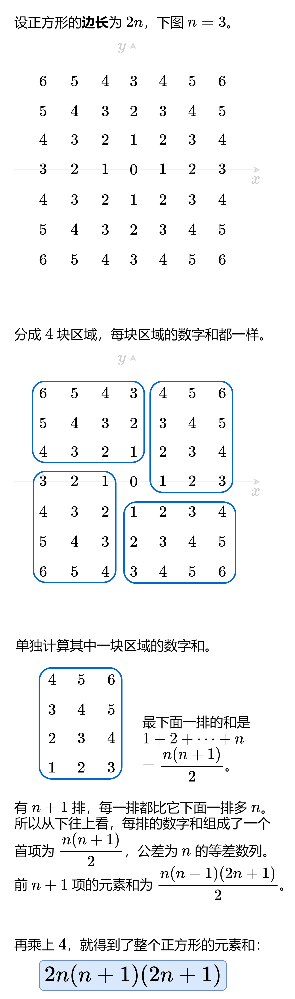

# 【图解】O(1) 做法（Python/Java/C++/Go/JS/Rust）

> **[1954. 收集足够苹果的最小花园周长](https://leetcode.cn/problems/minimum-garden-perimeter-to-collect-enough-apples/solutions/2577652/tu-jie-o1-zuo-fa-pythonjavacgojsrust-by-oms4k/) · Medium · 难度分 1759**

> **所属题单**
> - [数学算法 · 七、杂项](../../../刷题路径/灵神原版题单/数学算法/七、杂项.md) · §7.10 其他

> **题目描述**
> 给你一个用无限二维网格表示的花园，**每一个** 整数坐标处都有一棵苹果树。整数坐标 `(i, j)` 处的苹果树有 `|i| + |j|` 个苹果。
>
> 你将会买下正中心坐标是 `(0, 0)` 的一块 **正方形土地** ，且每条边都与两条坐标轴之一平行。
>
> 给你一个整数 `neededApples` ，请你返回土地的 **最小周长** ，使得 **至少** 有 `neededApples` 个苹果在土地 **里面或者边缘上**。
>
> `|x|` 的值定义为：
>
> - 如果 `x >= 0` ，那么值为 `x`
>
> - 如果 `x < 0` ，那么值为 `-x`
>
> **示例 1：**
>
> 
>
> ```
>
> 输入：neededApples = 1
> 输出：8
> 解释：边长长度为 1 的正方形不包含任何苹果。
> 但是边长为 2 的正方形包含 12 个苹果（如上图所示）。
> 周长为 2 * 4 = 8 。
> ```
>
> **示例 2：**
>
> ```
>
> 输入：neededApples = 13
> 输出：16
> ```
>
> **示例 3：**
>
> ```
>
> 输入：neededApples = 1000000000
> 输出：5040
> ```
>
> **提示：**
>
> - `1 <= neededApples <= 10¹⁵`

> **题解**
> 
>
> 设正方形的**周长**为 $8n$，则其**边长**为 $2n$。
>
> 问题相当于求最小的 $n$，满足
>
> $$
> 2n(n+1)(2n+1)\ge \textit{neededApples}
> $$
>
> 上式变形为
>
> $$
> n(n+1)(n+\dfrac{1}{2})\ge \dfrac{1}{4}\textit{neededApples}
> $$
>
> 设 $m = \left\lfloor \sqrt[3]{\dfrac{1}{4}\textit{neededApples}} \right\rfloor$。
>
> - 由于 $(m-1)m(m-\dfrac{1}{2}) < m^3 \le \dfrac{1}{4}\textit{neededApples}$，所以 $m-1$ 必不满足要求。
> - 由于 $(m+1)(m+2)(m+\dfrac{3}{2}) > (m+1)^3 > \dfrac{1}{4}\textit{neededApples}$，所以 $m+1$ 必满足要求。注意 $m+1>\left\lceil\sqrt[3]{\dfrac{1}{4}\textit{neededApples}}\right\rceil$。
> - $m$ 是否满足要求？计算一下就知道了。
>
> 因此，直接计算出 $n = \left\lfloor \sqrt[3]{\dfrac{1}{4}\textit{neededApples}} \right\rfloor$，如果 $2n(n+1)(2n+1)< \textit{neededApples}$ 则将 $n$ 加一。
>
> > 注：在本题的数据范围下，`cbrt` 算出的整数部分是正确的，不会因为浮点误差导致对 `xxx.999999` 下取整的错误。
>
> ```python
> class Solution:
>     def minimumPerimeter(self, neededApples: int) -> int:
>         n = int(cbrt(neededApples / 4))
>         if 2 * n * (n + 1) * (2 * n + 1) < neededApples:
>             n += 1
>         return 8 * n
> ```
>
>
> #### 复杂度分析
>
> - 时间复杂度：$\mathcal{O}(1)$。开立方有专用的计算函数 `cbrt`，时间可以视作 $\mathcal{O}(1)$。
> - 空间复杂度：$\mathcal{O}(1)$。
>
> #### 相似题目
>
> - [1739. 放置盒子](https://leetcode.cn/problems/building-boxes/)
>
> 欢迎关注 [B站@灵茶山艾府](https://space.bilibili.com/206214)
>
> 更多精彩题解，请看 [往期题解精选（已分类）](https://github.com/EndlessCheng/codeforces-go/blob/master/leetcode/SOLUTIONS.md)
