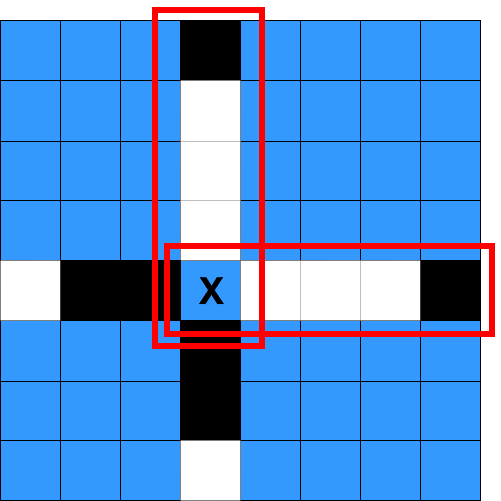

# 1958. 检查操作是否合法

Medium · [力扣原题](https://leetcode.cn/problems/check-if-move-is-legal/)

| 作者 | 题解 | 动画讲解 |
|---|---|---|
| 灵茶山艾府 | [📄 题解](灵茶山艾府.md) | [▶︎ 动画（GIF）](1958%20检查操作是否合法%20·%20灵茶山艾府.gif) · [mp4 文件](1958%20检查操作是否合法%20·%20灵茶山艾府.mp4) |
| yiduobo | [📄 题解](yiduobo.md) | [▶︎ 动画（GIF）](1958%20检查操作是否合法%20·%20yiduobo.gif) · [mp4 文件](1958%20检查操作是否合法%20·%20yiduobo.mp4) |

## 动画讲解

> 动图会循环播放；想暂停、拖进度条请下载上面表格里的 mp4 文件。

### 灵茶山艾府


### yiduobo


## 题目描述

给你一个下标从 **0** 开始的 `8 x 8` 网格 `board` ，其中 `board[r][c]` 表示游戏棋盘上的格子 `(r, c)` 。棋盘上空格用 `'.'` 表示，白色格子用 `'W'` 表示，黑色格子用 `'B'` 表示。

游戏中每次操作步骤为：选择一个空格子，将它变成你正在执行的颜色（要么白色，要么黑色）。但是，**合法** 操作必须满足：涂色后这个格子是 **好线段的一个端点** （好线段可以是水平的，竖直的或者是对角线）。

**好线段** 指的是一个包含 **三个或者更多格子（包含端点格子）**的线段，线段两个端点格子为 **同一种颜色** ，且中间剩余格子的颜色都为 **另一种颜色** （线段上不能有任何空格子）。你可以在下图找到好线段的例子：


给你两个整数 `rMove` 和 `cMove` 以及一个字符 `color` ，表示你正在执行操作的颜色（白或者黑），如果将格子 `(rMove, cMove)` 变成颜色 `color` 后，是一个 **合法** 操作，那么返回 `true` ，如果不是合法操作返回 `false` 。

**示例 1：**



```

输入：board = [[".",".",".","B",".",".",".","."],[".",".",".","W",".",".",".","."],[".",".",".","W",".",".",".","."],[".",".",".","W",".",".",".","."],["W","B","B",".","W","W","W","B"],[".",".",".","B",".",".",".","."],[".",".",".","B",".",".",".","."],[".",".",".","W",".",".",".","."]], rMove = 4, cMove = 3, color = "B"
输出：true
解释：'.'，'W' 和 'B' 分别用颜色蓝色，白色和黑色表示。格子 (rMove, cMove) 用 'X' 标记。
以选中格子为端点的两个好线段在上图中用红色矩形标注出来了。
```

**示例 2：**


```

输入：board = [[".",".",".",".",".",".",".","."],[".","B",".",".","W",".",".","."],[".",".","W",".",".",".",".","."],[".",".",".","W","B",".",".","."],[".",".",".",".",".",".",".","."],[".",".",".",".","B","W",".","."],[".",".",".",".",".",".","W","."],[".",".",".",".",".",".",".","B"]], rMove = 4, cMove = 4, color = "W"
输出：false
解释：虽然选中格子涂色后，棋盘上产生了好线段，但选中格子是作为中间格子，没有产生以选中格子为端点的好线段。
```

**提示：**

- `board.length == board[r].length == 8`

- `0 <= rMove, cMove < 8`

- `board[rMove][cMove] == '.'`

- `color` 要么是 `'B'` 要么是 `'W'` 。

---
[↑ 返回 1900-1999](../README.md) · [总索引](../../../索引.md) · [仓库首页](../../../README.md)
