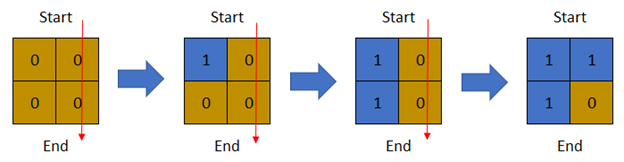

# 1970. 你能穿过矩阵的最后一天

Hard · 难度分 2124 · [力扣原题](https://leetcode.cn/problems/last-day-where-you-can-still-cross/)

所在刷题路径：灵神题单·网格图、灵神题单·常用数据结构、灵神题单·贪心与思维

| 作者 | 题解 | 动画讲解 |
|---|---|---|
| 灵茶山艾府 | [📄 题解](灵茶山艾府.md) | [▶︎ 1970 你能穿过矩阵的最后一天 · 灵茶山艾府.mp4](1970%20你能穿过矩阵的最后一天%20·%20灵茶山艾府.mp4) |
| yiduobo | [📄 题解](yiduobo.md) | [▶︎ 1970 你能穿过矩阵的最后一天 · yiduobo.mp4](1970%20你能穿过矩阵的最后一天%20·%20yiduobo.mp4) |

## 题目描述

给你一个下标从 **1** 开始的二进制矩阵，其中 `0` 表示陆地，`1` 表示水域。同时给你 `row` 和 `col` 分别表示矩阵中行和列的数目。

一开始在第 `0` 天，**整个** 矩阵都是 **陆地** 。但每一天都会有一块新陆地被 **水** 淹没变成水域。给你一个下标从 **1** 开始的二维数组 `cells` ，其中 `cells[i] = [r_i, c_i]` 表示在第 `i` 天，第 `r_i` 行 `c_i` 列（下标都是从 **1** 开始）的陆地会变成 **水域** （也就是 `0` 变成 `1` ）。

你想知道从矩阵最 **上面** 一行走到最 **下面** 一行，且只经过陆地格子的 **最后一天** 是哪一天。你可以从最上面一行的 **任意** 格子出发，到达最下面一行的 **任意** 格子。你只能沿着 **四个** 基本方向移动（也就是上下左右）。

请返回只经过陆地格子能从最 **上面** 一行走到最 **下面** 一行的 **最后一天** 。

**示例 1：**



```
输入：row = 2, col = 2, cells = [[1,1],[2,1],[1,2],[2,2]]
输出：2
解释：上图描述了矩阵从第 0 天开始是如何变化的。
可以从最上面一行到最下面一行的最后一天是第 2 天。
```

**示例 2：**


```
输入：row = 2, col = 2, cells = [[1,1],[1,2],[2,1],[2,2]]
输出：1
解释：上图描述了矩阵从第 0 天开始是如何变化的。
可以从最上面一行到最下面一行的最后一天是第 1 天。
```

**示例 3：**


```
输入：row = 3, col = 3, cells = [[1,2],[2,1],[3,3],[2,2],[1,1],[1,3],[2,3],[3,2],[3,1]]
输出：3
解释：上图描述了矩阵从第 0 天开始是如何变化的。
可以从最上面一行到最下面一行的最后一天是第 3 天。
```

**提示：**

- `2 <= row, col <= 2 * 10⁴`

- `4 <= row * col <= 2 * 10⁴`

- `cells.length == row * col`

- `1 <= r_i <= row`

- `1 <= c_i <= col`

- `cells` 中的所有格子坐标都是 **唯一** 的。

---
[↑ 返回 1900-1999](../README.md) · [总索引](../../../索引.md) · [仓库首页](../../../README.md)
