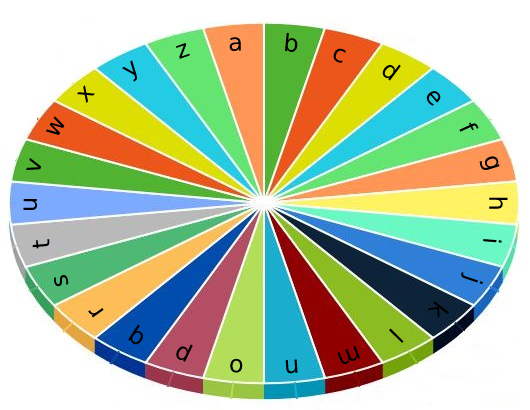

# Go 贪心

> **[1974. 使用特殊打字机键入单词的最少时间](https://leetcode.cn/problems/minimum-time-to-type-word-using-special-typewriter/solutions/950416/go-tan-xin-by-endlesscheng-wz53/) · Easy**

> **题目描述**
> 有一个特殊打字机，它由一个 **圆盘** 和一个 **指针** 组成， 圆盘上标有小写英文字母 `'a'` 到 `'z'`。**只有** 当指针指向某个字母时，它才能被键入。指针 **初始时** 指向字符 `'a'` 。
>
> 
>
> 每一秒钟，你可以执行以下操作之一：
>
> - 将指针 **顺时针** 或者 **逆时针** 移动一个字符。
>
> - 键入指针 **当前** 指向的字符。
>
> 给你一个字符串 `word` ，请你返回键入 `word` 所表示单词的 **最少** 秒数 。
>
> **示例 1：**
>
> ```
>
> 输入：word = "abc"
> 输出：5
> 解释：
> 单词按如下操作键入：
> - 花 1 秒键入字符 'a'，因为指针初始指向 'a' ，故不需移动指针。
> - 花 1 秒将指针顺时针移到 'b' 。
> - 花 1 秒键入字符 'b' 。
> - 花 1 秒将指针顺时针移到 'c' 。
> - 花 1 秒键入字符 'c' 。
> ```
>
> **示例 2：**
>
> ```
>
> 输入：word = "bza"
> 输出：7
> 解释：
> 单词按如下操作键入：
> - 花 1 秒将指针顺时针移到 'b' 。
> - 花 1 秒键入字符 'b' 。
> - 花 2 秒将指针逆时针移到 'z' 。
> - 花 1 秒键入字符 'z' 。
> - 花 1 秒将指针顺时针移到 'a' 。
> - 花 1 秒键入字符 'a' 。
> ```
>
> **示例 3：**
>
> ```
>
> 输入：word = "zjpc"
> 输出：34
> 解释：
> 单词按如下操作键入：
> - 花 1 秒将指针逆时针移到 'z' 。
> - 花 1 秒键入字符 'z' 。
> - 花 10 秒将指针顺时针移到 'j' 。
> - 花 1 秒键入字符 'j' 。
> - 花 6 秒将指针顺时针移到 'p' 。
> - 花 1 秒键入字符 'p' 。
> - 花 13 秒将指针逆时针移到 'c' 。
> - 花 1 秒键入字符 'c' 。
> ```
>
> **提示：**
>
> - `1 <= word.length <= 100`
>
> - `word` 只包含小写英文字母。


