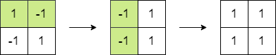
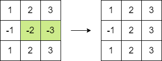
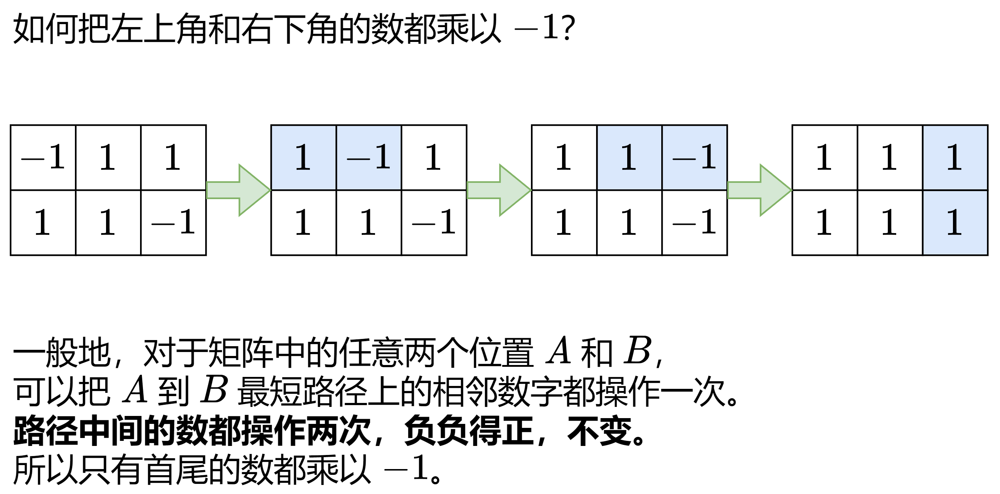

# 脑筋急转弯 + 分类讨论（Python/Java/C++/C/Go/JS/Rust）

> **[1975. 最大方阵和](https://leetcode.cn/problems/maximum-matrix-sum/solutions/950421/go-tan-xin-by-endlesscheng-opwm/) · Medium · 难度分 1648**

> **所属题单**
> - [贪心算法 · 五、思维题](../../../刷题路径/灵神原版题单/贪心算法/五、思维题.md) · §5.2 脑筋急转弯

> **题目描述**
> 给你一个 `n x n` 的整数方阵 `matrix` 。你可以执行以下操作 **任意次** ：
>
> - 选择 `matrix` 中 **相邻** 两个元素，并将它们都 **乘以** `-1` 。
>
> 如果两个元素有 **公共边** ，那么它们就是 **相邻** 的。
>
> 你的目的是 **最大化** 方阵元素的和。请你在执行以上操作之后，返回方阵的 **最大** 和。
>
> **示例 1：**
>
> 
>
> ```
> 输入：matrix = [[1,-1],[-1,1]]
> 输出：4
> 解释：我们可以执行以下操作使和等于 4 ：
> - 将第一行的 2 个元素乘以 -1 。
> - 将第一列的 2 个元素乘以 -1 。
> ```
>
> **示例 2：**
>
> 
>
> ```
> 输入：matrix = [[1,2,3],[-1,-2,-3],[1,2,3]]
> 输出：16
> 解释：我们可以执行以下操作使和等于 16 ：
> - 将第二行的最后 2 个元素乘以 -1 。
> ```
>
> **提示：**
>
> - `n == matrix.length == matrix[i].length`
>
> - `2 <= n <= 250`
>
> - `-10⁵ <= matrix[i][j] <= 10⁵`

> **题解**
> 虽然题目规定我们只能操作相邻的元素，但我们可以通过多次操作，把任意两个元素都乘以 $-1$。
>
> 
>
> 每次操作，恰好改变两个数的正负号。
>
> 多次操作，恰好改变偶数个数的正负号。
>
> 分类讨论：
>
> - 如果 $\textit{matrix}$ 有偶数个负数，那么可以把所有数都变成非负数。
> - 如果 $\textit{matrix}$ 有奇数个负数且没有 $0$，那么最终必然剩下奇数个负数。剩下一个负数是最优的。贪心地，选择 $\textit{matrix}$ 中的绝对值最小的数，给它加上负号。
> - 如果 $\textit{matrix}$ 有奇数个负数且有 $0$，那么可以把一个 $0$ 和最终剩下的一个负数操作一次，从而把所有数都变成非负数。
>
> 代码实现时，无需特判是否有 $0$。如果有 $0$，那么代码中的 $\textit{mn}=0$，对 $\textit{total}$ 无影响。
>
> ```python
> class Solution:
>     def maxMatrixSum(self, matrix: List[List[int]]) -> int:
>         total = neg_cnt = 0
>         mn = inf
>         for row in matrix:
>             for x in row:
>                 if x < 0:
>                     neg_cnt += 1
>                     x = -x  # 先把负数都变成正数
>                 mn = min(mn, x)
>                 total += x
>
>         if neg_cnt % 2:
>             total -= mn * 2  # 给绝对值最小的数添加负号
>         return total
> ```
>
>
> #### 复杂度分析
>
> - 时间复杂度：$\mathcal{O}(mn)$，其中 $m$ 和 $n$ 分别是 $\textit{matrix}$ 的行数和列数。
> - 空间复杂度：$\mathcal{O}(1)$。
>
> ## 专题训练
>
> 见下面贪心与思维题单的「**§5.2 脑筋急转弯**」。
>
> ## 分类题单
>
> [如何科学刷题？](https://leetcode.cn/circle/discuss/RvFUtj/)
>
> 1. [滑动窗口与双指针（定长/不定长/单序列/双序列/三指针/分组循环）](https://leetcode.cn/circle/discuss/0viNMK/)
> 2. [二分算法（二分答案/最小化最大值/最大化最小值/第K小）](https://leetcode.cn/circle/discuss/SqopEo/)
> 3. [单调栈（基础/矩形面积/贡献法/最小字典序）](https://leetcode.cn/circle/discuss/9oZFK9/)
> 4. [网格图（DFS/BFS/综合应用）](https://leetcode.cn/circle/discuss/YiXPXW/)
> 5. [位运算（基础/性质/拆位/试填/恒等式/思维）](https://leetcode.cn/circle/discuss/dHn9Vk/)
> 6. [图论算法（DFS/BFS/拓扑排序/基环树/最短路/最小生成树/网络流）](https://leetcode.cn/circle/discuss/01LUak/)
> 7. [动态规划（入门/背包/划分/状态机/区间/状压/数位/数据结构优化/树形/博弈/概率期望）](https://leetcode.cn/circle/discuss/tXLS3i/)
> 8. [常用数据结构（前缀和/差分/栈/队列/堆/字典树/并查集/树状数组/线段树）](https://leetcode.cn/circle/discuss/mOr1u6/)
> 9. [数学算法（数论/组合/概率期望/博弈/计算几何/随机算法）](https://leetcode.cn/circle/discuss/IYT3ss/)
> 10. [贪心与思维（基本贪心策略/反悔/区间/字典序/数学/思维/脑筋急转弯/构造）](https://leetcode.cn/circle/discuss/g6KTKL/)
> 11. [链表、树与回溯（前后指针/快慢指针/DFS/BFS/直径/LCA）](https://leetcode.cn/circle/discuss/K0n2gO/)
> 12. [字符串（KMP/Z函数/Manacher/字符串哈希/AC自动机/后缀数组/子序列自动机）](https://leetcode.cn/circle/discuss/SJFwQI/)
>
> [我的题解精选（已分类）](https://github.com/EndlessCheng/codeforces-go/blob/master/leetcode/SOLUTIONS.md)
>
> 欢迎关注 [B站@灵茶山艾府](https://space.bilibili.com/206214)
