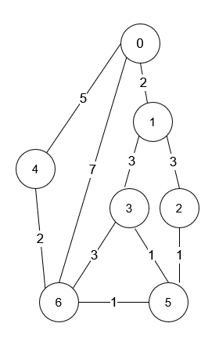

# 在计算最短路的同时 DP（Python/Java/C++/Go/JS/Rust）

> **[1976. 到达目的地的方案数](https://leetcode.cn/problems/number-of-ways-to-arrive-at-destination/solutions/2668041/zai-ji-suan-zui-duan-lu-de-tong-shi-dpfu-g4f3/) · Medium · 难度分 2095**

> **所属题单**
> - [动态规划 · 十三、图 DP](../../../刷题路径/灵神原版题单/动态规划/十三、图%20DP.md)
> - [图论算法 · 三、最短路](../../../刷题路径/灵神原版题单/图论算法/三、最短路.md) · §3.1 单源最短路：Dijkstra 算法

> **题目描述**
> 你在一个城市里，城市由 `n` 个路口组成，路口编号为 `0` 到 `n - 1` ，某些路口之间有 **双向** 道路。输入保证你可以从任意路口出发到达其他任意路口，且任意两个路口之间最多有一条路。
>
> 给你一个整数 `n` 和二维整数数组 `roads` ，其中 `roads[i] = [u_i, v_i, time_i]` 表示在路口 `u_i` 和 `v_i` 之间有一条需要花费 `time_i` 时间才能通过的道路。你想知道花费 **最少时间** 从路口 `0` 出发到达路口 `n - 1` 的方案数。
>
> 请返回花费 **最少时间** 到达目的地的 **路径数目** 。由于答案可能很大，将结果对 `10⁹ + 7` **取余** 后返回。
>
> **示例 1：**
>
> 
>
> ```
>
> 输入：n = 7, roads = [[0,6,7],[0,1,2],[1,2,3],[1,3,3],[6,3,3],[3,5,1],[6,5,1],[2,5,1],[0,4,5],[4,6,2]]
> 输出：4
> 解释：从路口 0 出发到路口 6 花费的最少时间是 7 分钟。
> 四条花费 7 分钟的路径分别为：
> - 0 ➝ 6
> - 0 ➝ 4 ➝ 6
> - 0 ➝ 1 ➝ 2 ➝ 5 ➝ 6
> - 0 ➝ 1 ➝ 3 ➝ 5 ➝ 6
> ```
>
> **示例 2：**
>
> ```
>
> 输入：n = 2, roads = [[1,0,10]]
> 输出：1
> 解释：只有一条从路口 0 到路口 1 的路，花费 10 分钟。
> ```
>
> **提示：**
>
> - `1 <= n <= 200`
>
> - `n - 1 <= roads.length <= n * (n - 1) / 2`
>
> - `roads[i].length == 3`
>
> - `0 <= u_i, v_i <= n - 1`
>
> - `1 <= time_i <= 10⁹`
>
> - `u_i != v_i`
>
> - 任意两个路口之间至多有一条路。
>
> - 从任意路口出发，你能够到达其他任意路口。

> **题解**
> [Dijkstra 算法介绍](../../0700-0799/0743%20网络延迟时间/灵茶山艾府.md)
>
> 定义 $f[i]$ 表示节点 $0$ 到节点 $i$ 的最短路个数。
>
> 在用 $\textit{dis}[x]$ 更新 $\textit{dis}[y]$ 时：
>
> - 如果 $\textit{dis}[x] + g[x][y] < \textit{dis}[y]$，说明从 $0$ 到 $x$ 再到 $y$ 的路径是目前最短的，所以更新 $f[y]$ 为 $f[x]$。
> - 如果 $\textit{dis}[x] + g[x][y] = \textit{dis}[y]$，说明从 $0$ 到 $x$ 再到 $y$ 的路径与之前找到的路径一样短，所以把 $f[y]$ 增加 $f[x]$。
>
> 初始值：$f[0]=1$，因为 $0$ 到 $0$ 只有一种方案，即原地不动。
>
> 答案：$f[n-1]$。
>
> 代码实现时，如果当前确定的最小最短路是 $\textit{dis}[n-1]$，可以直接返回 $f[n-1]$，不再继续循环。这是因为本题边权均为正数，后面不可能算出小于或等于 $\textit{dis}[n-1]$ 的最短路，所以 $f[n-1]$ 不会改变。
>
> 最后，别忘了对 $10^9+7$ 取模。
>
> ## 写法一：朴素 Dijkstra（适用于稠密图）
>
> ```python
> class Solution:
>     def countPaths(self, n: int, roads: List[List[int]]) -> int:
>         g = [[inf for _ in range(n)] for _ in range(n)]  # 邻接矩阵
>         for x, y, d in roads:
>             g[x][y] = g[y][x] = d
>
>         dis = [inf] * n
>         dis[0] = 0
>         f = [0] * n
>         f[0] = 1
>         done = [False] * n
>         while True:
>             x = -1
>             for i, ok in enumerate(done):
>                 if not ok and (x < 0 or dis[i] < dis[x]):
>                     x = i
>             if x == n - 1:
>                 # 不可能找到比 dis[-1] 更短，或者一样短的最短路了（注意本题边权都是正数）
>                 return f[-1]
>             done[x] = True  # 最短路长度已确定（无法变得更小）
>             dx = dis[x]
>             for y, d in enumerate(g[x]):  # 尝试更新 x 的邻居的最短路
>                 new_dis = dx + d
>                 if new_dis < dis[y]:
>                     # 就目前来说，最短路必须经过 x
>                     dis[y] = new_dis
>                     f[y] = f[x]
>                 elif new_dis == dis[y]:
>                     # 和之前求的最短路一样长
>                     f[y] = (f[y] + f[x]) % 1_000_000_007
> ```
>
>
> #### 复杂度分析
>
> - 时间复杂度：$\mathcal{O}(n^2)$。
> - 空间复杂度：$\mathcal{O}(n^2)$。
>
> ## 写法二：堆优化 Dijkstra（适用于稀疏图）
>
> 寻找最小值的过程可以用一个最小堆来快速完成：
>
> - 一开始把 $(\textit{dis}[0],0)$ 二元组入堆。
> - 当节点 $x$ 首次出堆时，$\textit{dis}[x]$ 就是写法一中寻找的最小最短路。
> - 更新 $\textit{dis}[y]$ 时，把 $(\textit{dis}[y],y)$ 二元组入堆。
>
> 注意，如果一个节点 $x$ 在出堆前，其最短路长度 $\textit{dis}[x]$ 被多次更新，那么堆中会有多个重复的 $x$，并且包含 $x$ 的二元组中的 $\textit{dis}[x]$ 是互不相同的（因为我们只在找到更小的最短路时才会把二元组入堆）。
>
> 所以写法一中的 $\textit{done}$ 数组可以省去，取而代之的是用出堆的最短路值（记作 $\textit{dx}$）与当前的 $\textit{dis}[x]$ 比较，如果 $\textit{dx} > \textit{dis}[x]$ 说明 $x$ 之前出堆过，我们已经更新了 $x$ 的邻居的最短路，所以这次就不用更新了，继续外层循环。
>
> ```python
> class Solution:
>     def countPaths(self, n: int, roads: List[List[int]]) -> int:
>         g = [[] for _ in range(n)]  # 邻接表
>         for x, y, d in roads:
>             g[x].append((y, d))
>             g[y].append((x, d))
>
>         dis = [inf] * n
>         dis[0] = 0
>         f = [0] * n
>         f[0] = 1
>         h = [(0, 0)]
>         while True:
>             dx, x = heappop(h)
>             if x == n - 1:
>                 # 不可能找到比 dis[-1] 更短，或者一样短的最短路了（注意本题边权都是正数）
>                 return f[-1]
>             if dx > dis[x]:
>                 continue
>             for y, d in g[x]:  # 尝试更新 x 的邻居的最短路
>                 new_dis = dx + d
>                 if new_dis < dis[y]:
>                     # 就目前来说，最短路必须经过 x
>                     dis[y] = new_dis
>                     f[y] = f[x]
>                     heappush(h, (new_dis, y))
>                 elif new_dis == dis[y]:
>                     # 和之前求的最短路一样长
>                     f[y] = (f[y] + f[x]) % 1_000_000_007
> ```
>
>
> #### 复杂度分析
>
> - 时间复杂度：$\mathcal{O}(m\log m)$，其中 $m$ 为 $\textit{roads}$ 的长度。由于 $m\ge n-1$，分析复杂度时以 $m$ 为主。注意堆中会有重复节点，所以至多有 $\mathcal{O}(m)$ 个元素，单次操作的复杂度是 $\mathcal{O}(\log m)$。值得注意的是，如果输入的是稠密图，写法二的时间复杂度为 $\mathcal{O}(n^2\log n)$，不如写法一。
> - 空间复杂度：$\mathcal{O}(m)$。
>
> ## 分类题单
>
> [如何科学刷题？](https://leetcode.cn/circle/discuss/RvFUtj/)
>
> 1. [滑动窗口与双指针（定长/不定长/单序列/双序列/三指针/分组循环）](https://leetcode.cn/circle/discuss/0viNMK/)
> 2. [二分算法（二分答案/最小化最大值/最大化最小值/第K小）](https://leetcode.cn/circle/discuss/SqopEo/)
> 3. [单调栈（基础/矩形面积/贡献法/最小字典序）](https://leetcode.cn/circle/discuss/9oZFK9/)
> 4. [网格图（DFS/BFS/综合应用）](https://leetcode.cn/circle/discuss/YiXPXW/)
> 5. [位运算（基础/性质/拆位/试填/恒等式/思维）](https://leetcode.cn/circle/discuss/dHn9Vk/)
> 6. [图论算法（DFS/BFS/拓扑排序/基环树/最短路/最小生成树/网络流）](https://leetcode.cn/circle/discuss/01LUak/)
> 7. [动态规划（入门/背包/划分/状态机/区间/状压/数位/数据结构优化/树形/博弈/概率期望）](https://leetcode.cn/circle/discuss/tXLS3i/)
> 8. [常用数据结构（前缀和/差分/栈/队列/堆/字典树/并查集/树状数组/线段树）](https://leetcode.cn/circle/discuss/mOr1u6/)
> 9. [数学算法（数论/组合/概率期望/博弈/计算几何/随机算法）](https://leetcode.cn/circle/discuss/IYT3ss/)
> 10. [贪心与思维（基本贪心策略/反悔/区间/字典序/数学/思维/脑筋急转弯/构造）](https://leetcode.cn/circle/discuss/g6KTKL/)
> 11. [链表、二叉树与回溯（前后指针/快慢指针/DFS/BFS/直径/LCA/一般树）](https://leetcode.cn/circle/discuss/K0n2gO/)
> 12. [字符串（KMP/Z函数/Manacher/字符串哈希/AC自动机/后缀数组/子序列自动机）](https://leetcode.cn/circle/discuss/SJFwQI/)
>
> [我的题解精选（已分类）](https://github.com/EndlessCheng/codeforces-go/blob/master/leetcode/SOLUTIONS.md)
>
> 欢迎关注 [B站@灵茶山艾府](https://space.bilibili.com/206214)
