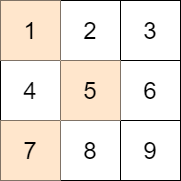
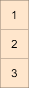
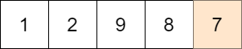

# 1981. 最小化目标值与所选元素的差

Medium · 难度分 2010 · [力扣原题](https://leetcode.cn/problems/minimize-the-difference-between-target-and-chosen-elements/)

所在刷题路径：灵神题单·动态规划

| 作者 | 题解 | 动画讲解 |
|---|---|---|
| 灵茶山艾府 | [📄 题解](灵茶山艾府.md) | — |
| yiduobo | [📄 题解](yiduobo.md) | [▶︎ 1981 最小化目标值与所选元素的差 · yiduobo.mp4](1981%20最小化目标值与所选元素的差%20·%20yiduobo.mp4) |

## 题目描述

给你一个大小为 `m x n` 的整数矩阵 `mat` 和一个整数 `target` 。

从矩阵的 **每一行** 中选择一个整数，你的目标是 **最小化** 所有选中元素之 **和** 与目标值 `target` 的 **绝对差** 。

返回 **最小的绝对差** 。

`a` 和 `b` 两数字的 **绝对差** 是 `a - b` 的绝对值。

**示例 1：**



```

输入：mat = [[1,2,3],[4,5,6],[7,8,9]], target = 13
输出：0
解释：一种可能的最优选择方案是：
- 第一行选出 1
- 第二行选出 5
- 第三行选出 7
所选元素的和是 13 ，等于目标值，所以绝对差是 0 。
```

**示例 2：**



```

输入：mat = [[1],[2],[3]], target = 100
输出：94
解释：唯一一种选择方案是：
- 第一行选出 1
- 第二行选出 2
- 第三行选出 3
所选元素的和是 6 ，绝对差是 94 。
```

**示例 3：**



```

输入：mat = [[1,2,9,8,7]], target = 6
输出：1
解释：最优的选择方案是选出第一行的 7 。
绝对差是 1 。
```

**提示：**

- `m == mat.length`

- `n == mat[i].length`

- `1 <= m, n <= 70`

- `1 <= mat[i][j] <= 70`

- `1 <= target <= 800`

---
[↑ 返回 1900-1999](../README.md) · [总索引](../../../索引.md) · [仓库首页](../../../README.md)
