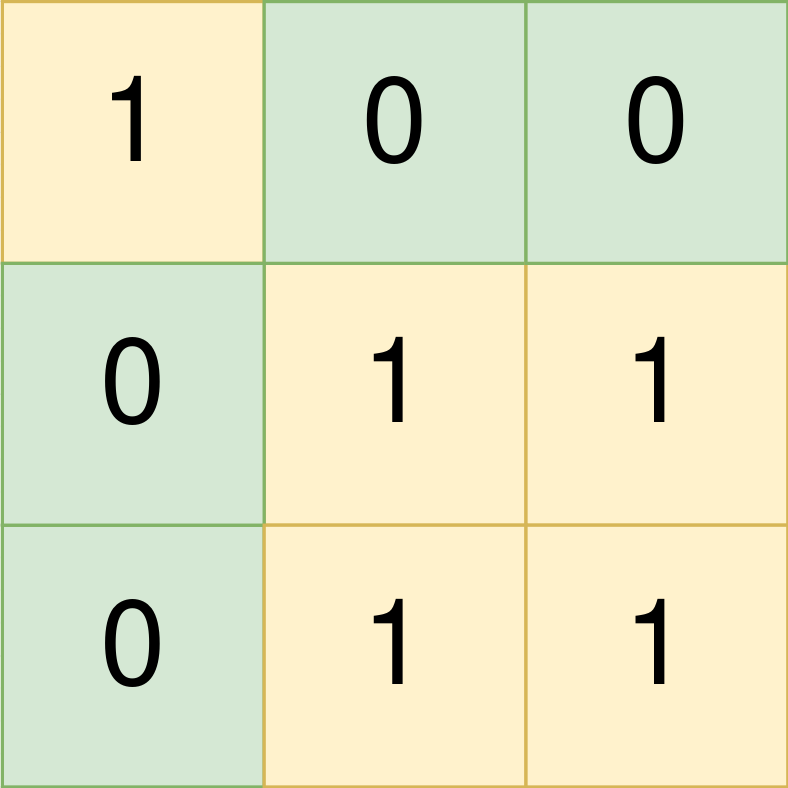
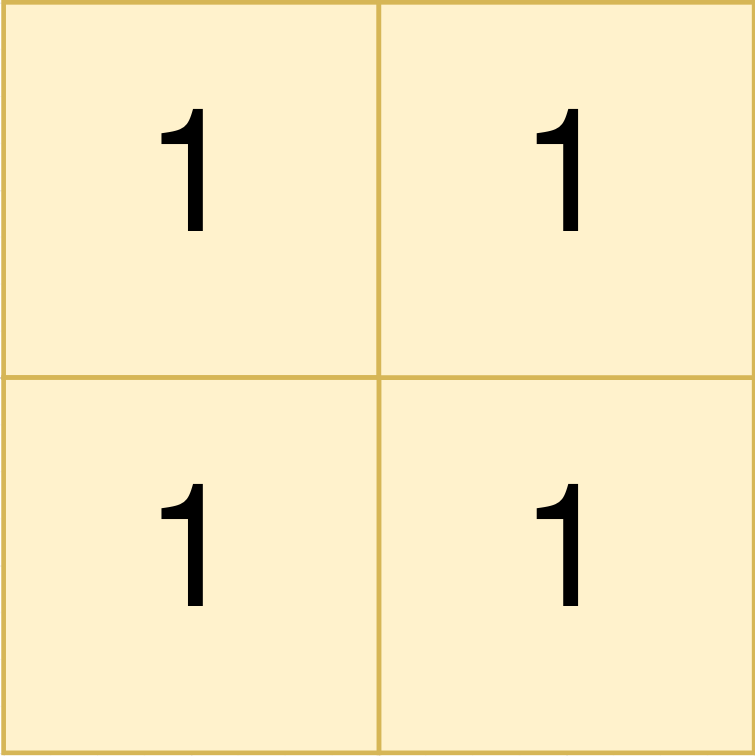

# 1992. 找到所有的农场组

Medium · 难度分 1539 · [力扣原题](https://leetcode.cn/problems/find-all-groups-of-farmland/)

所在刷题路径：灵神题单·贪心与思维

| 作者 | 题解 | 动画讲解 |
|---|---|---|
| 灵茶山艾府 | [📄 题解](灵茶山艾府.md) | — |
| yiduobo | [📄 题解](yiduobo.md) | [▶︎ 1992 找到所有的农场组 · yiduobo.mp4](1992%20找到所有的农场组%20·%20yiduobo.mp4) |

## 题目描述

给你一个下标从 **0** 开始，大小为 `m x n` 的二进制矩阵 `land` ，其中 `0` 表示一单位的森林土地，`1` 表示一单位的农场土地。

为了让农场保持有序，农场土地之间以矩形的 **农场组** 的形式存在。每一个农场组都 **仅** 包含农场土地。且题目保证不会有两个农场组相邻，也就是说一个农场组中的任何一块土地都 **不会** 与另一个农场组的任何一块土地在四个方向上相邻。

`land` 可以用坐标系统表示，其中 `land` 左上角坐标为 `(0, 0)` ，右下角坐标为 `(m-1, n-1)` 。请你找到所有 **农场组** 最左上角和最右下角的坐标。一个左上角坐标为 `(r₁, c₁)` 且右下角坐标为 `(r₂, c₂)` 的 **农场组** 用长度为 4 的数组 `[r₁, c₁, r₂, c₂]` 表示。

请你返回一个二维数组，它包含若干个长度为 4 的子数组，每个子数组表示 `land` 中的一个 **农场组** 。如果没有任何农场组，请你返回一个空数组。可以以 **任意顺序** 返回所有农场组。

**示例 1：**



```
输入：land = [[1,0,0],[0,1,1],[0,1,1]]
输出：[[0,0,0,0],[1,1,2,2]]
解释：
第一个农场组的左上角为 land[0][0] ，右下角为 land[0][0] 。
第二个农场组的左上角为 land[1][1] ，右下角为 land[2][2] 。
```

**示例 2：**



```
输入：land = [[1,1],[1,1]]
输出：[[0,0,1,1]]
解释：
第一个农场组左上角为 land[0][0] ，右下角为 land[1][1] 。
```

**示例 3：**


```
输入：land = [[0]]
输出：[]
解释：
没有任何农场组。
```

**提示：**

- `m == land.length`

- `n == land[i].length`

- `1 <= m, n <= 300`

- `land` 只包含 `0` 和 `1` 。

- 农场组都是 **矩形** 的形状。

---
[↑ 返回 1900-1999](../README.md) · [总索引](../../../索引.md) · [仓库首页](../../../README.md)
