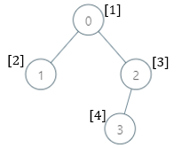
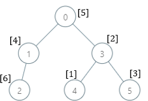
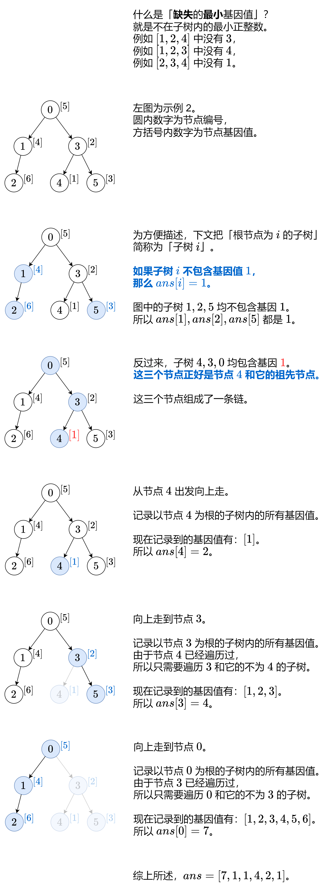

# 【图解】一张图秒懂！多种写法！（Python/Java/C++/Go/JS/Rust）

> **[2003. 每棵子树内缺失的最小基因值](https://leetcode.cn/problems/smallest-missing-genetic-value-in-each-subtree/solutions/2505883/tu-jie-yi-zhang-tu-miao-dong-duo-chong-x-q095/) · Hard · 难度分 2415**

> **所属题单**
> - [链表、二叉树与回溯 · 三、一般树](../../../刷题路径/灵神原版题单/链表、二叉树与回溯/三、一般树.md) · §3.10 树上启发式合并

> **题目描述**
> 有一棵根节点为 `0` 的 **家族树** ，总共包含 `n` 个节点，节点编号为 `0` 到 `n - 1` 。给你一个下标从 **0** 开始的整数数组 `parents` ，其中 `parents[i]` 是节点 `i` 的父节点。由于节点 `0` 是 **根** ，所以 `parents[0] == -1` 。
>
> 总共有 `10⁵` 个基因值，每个基因值都用 **闭区间** `[1, 10⁵]` 中的一个整数表示。给你一个下标从 **0** 开始的整数数组 `nums` ，其中 `nums[i]` 是节点 `i` 的基因值，且基因值 **互不相同** 。
>
> 请你返回一个数组 `ans` ，长度为 `n` ，其中 `ans[i]` 是以节点 `i` 为根的子树内 **缺失** 的 **最小** 基因值。
>
> 节点 `x` 为根的 **子树** 包含节点 `x` 和它所有的 **后代** 节点。
>
> **示例 1：**
>
> 
>
> ```
> 输入：parents = [-1,0,0,2], nums = [1,2,3,4]
> 输出：[5,1,1,1]
> 解释：每个子树答案计算结果如下：
> - 0：子树包含节点 [0,1,2,3] ，基因值分别为 [1,2,3,4] 。5 是缺失的最小基因值。
> - 1：子树只包含节点 1 ，基因值为 2 。1 是缺失的最小基因值。
> - 2：子树包含节点 [2,3] ，基因值分别为 [3,4] 。1 是缺失的最小基因值。
> - 3：子树只包含节点 3 ，基因值为 4 。1是缺失的最小基因值。
> ```
>
> **示例 2：**
>
> 
>
> ```
> 输入：parents = [-1,0,1,0,3,3], nums = [5,4,6,2,1,3]
> 输出：[7,1,1,4,2,1]
> 解释：每个子树答案计算结果如下：
> - 0：子树内包含节点 [0,1,2,3,4,5] ，基因值分别为 [5,4,6,2,1,3] 。7 是缺失的最小基因值。
> - 1：子树内包含节点 [1,2] ，基因值分别为 [4,6] 。 1 是缺失的最小基因值。
> - 2：子树内只包含节点 2 ，基因值为 6 。1 是缺失的最小基因值。
> - 3：子树内包含节点 [3,4,5] ，基因值分别为 [2,1,3] 。4 是缺失的最小基因值。
> - 4：子树内只包含节点 4 ，基因值为 1 。2 是缺失的最小基因值。
> - 5：子树内只包含节点 5 ，基因值为 3 。1 是缺失的最小基因值。
> ```
>
> **示例 3：**
>
> ```
> 输入：parents = [-1,2,3,0,2,4,1], nums = [2,3,4,5,6,7,8]
> 输出：[1,1,1,1,1,1,1]
> 解释：所有子树都缺失基因值 1 。
> ```
>
> **提示：**
>
> - `n == parents.length == nums.length`
>
> - `2 <= n <= 10⁵`
>
> - 对于 `i != 0` ，满足 `0 <= parents[i] <= n - 1`
>
> - `parents[0] == -1`
>
> - `parents` 表示一棵合法的树。
>
> - `1 <= nums[i] <= 10⁵`
>
> - `nums[i]` 互不相同。

> **题解**
> 
>
> ## 实现细节
>
> 在从下往上走的过程中，由于上面的节点（对应的子树）一定包含下面的节点，所以下面节点的基因值集合，一定是上面节点的基因值集合的子集，例如图中 $\{1\}\subset\{1,2,3\}\subset \{1,2,3,4,5,6\}$。所以上面节点的 $\textit{ans}$ 值一定大于等于下面节点的 $\textit{ans}$ 值。
>
> 这意味着，在计算 $\textit{ans}[i]$ 时，不需要从 $1$ 开始枚举，而是从 $\textit{ans}[j]$ 开始枚举（假设从 $j$ 往上走到了 $i$）。这可以将时间复杂度优化至 $\mathcal{O}(n)$，具体见文末的「复杂度分析」。
>
> 此外，「遍历子树」可以用 DFS 递归遍历，也可以用栈或者队列保存接下来需要遍历的节点，这引出了下面几种不同的写法。
>
> #### 写法一：DFS
>
> ```python
> class Solution:
>     def smallestMissingValueSubtree(self, parents: List[int], nums: List[int]) -> List[int]:
>         n = len(parents)
>         ans = [1] * n
>         if 1 not in nums:  # 不存在基因值为 1 的节点
>             return ans
>
>         # 建树
>         g = [[] for _ in range(n)]
>         for i in range(1, n):
>             g[parents[i]].append(i)
>
>         vis = set()
>         def dfs(x: int) -> None:
>             vis.add(nums[x])  # 标记基因值
>             for son in g[x]:
>                 if nums[son] not in vis:
>                     dfs(son)
>
>         mex = 2  # 缺失的最小基因值
>         node = nums.index(1)  # 出发点
>         while node >= 0:
>             dfs(node)
>             while mex in vis:  # node 子树包含这个基因值
>                 mex += 1
>             ans[node] = mex  # 缺失的最小基因值
>             node = parents[node]  # 往上走
>         return ans
> ```
>
>
> #### 写法二：非递归
>
> 改为手动记录接下来要访问的点。
>
> 此外，假设 $\textit{pre}$ 是下面的点（从 $\textit{pre}$ 往上走到当前节点），那么遍历子树的时候可以跳过 $\textit{pre}$ 子树。
>
> ```python
> class Solution:
>     def smallestMissingValueSubtree(self, parents: List[int], nums: List[int]) -> List[int]:
>         n = len(parents)
>         ans = [1] * n
>         if 1 not in nums:  # 不存在基因值为 1 的节点
>             return ans
>
>         # 建树
>         g = [[] for _ in range(n)]
>         for i in range(1, n):
>             g[parents[i]].append(i)
>
>         vis = set()
>         mex = 2  # 缺失的最小基因值
>         pre = -1
>         node = nums.index(1)  # 出发点
>         while node >= 0:
>             vis.add(nums[node])  # 标记基因值
>             nodes = [son for son in g[node] if son != pre]
>             while nodes:
>                 x = nodes.pop()
>                 vis.add(nums[x])  # 标记基因值
>                 nodes.extend(g[x])  # 保存接下来需要遍历的点
>             while mex in vis:  # node 子树包含这个基因值
>                 mex += 1
>             ans[node] = mex  # 缺失的最小基因值
>             pre = node  # 下一轮循环不会遍历 pre 子树
>             node = parents[node]  # 往上走
>         return ans
> ```
>
>
> #### 写法三：非递归+数组
>
> 注意到，即使 $\textit{nums}$ 包含了 $1$ 到 $n$ 中的所有数，$\textit{ans}[i]$ 最大也不会超过 $n+1$，所以对于超过 $n+1$ 的 $\textit{nums}[i]$ 来说，可以视作 $n+2$。
>
> 进一步地，其实可以视作 $n+1$，因为只要存在一个超过 $n$ 的 $\textit{nums}[i]$，那么 $\textit{ans}[i]$ 最大不超过 $n$。例如 $\textit{nums}=[1,2,99]$，$\textit{ans}[i]$ 最大为 $3$，也就是 $n$。
>
> 所以可以把哈希表替换成一个长为 $n+2$ 的布尔数组，记录各个节点是否访问过。
>
> > 注：还可以用链式前向星优化建树过程，感兴趣的读者可查阅相关资料。
>
> ```python
> class Solution:
>     def smallestMissingValueSubtree(self, parents: List[int], nums: List[int]) -> List[int]:
>         n = len(parents)
>         ans = [1] * n
>         if 1 not in nums:  # 不存在基因值为 1 的节点
>             return ans
>
>         # 建树
>         g = [[] for _ in range(n)]
>         for i in range(1, n):
>             g[parents[i]].append(i)
>
>         vis = [False] * (n + 2)
>         mex = 2  # 缺失的最小基因值
>         pre = -1
>         node = nums.index(1)  # 出发点
>         while node >= 0:
>             vis[min(nums[node], n + 1)] = True  # 标记基因值
>             nodes = [son for son in g[node] if son != pre]
>             while nodes:
>                 x = nodes.pop()
>                 vis[min(nums[x], n + 1)] = True  # 标记基因值
>                 nodes.extend(g[x])  # 保存接下来需要遍历的点
>             while vis[mex]:  # node 子树包含这个基因值
>                 mex += 1
>             ans[node] = mex  # 缺失的最小基因值
>             pre = node  # 下一轮循环不会遍历 pre 子树
>             node = parents[node]  # 往上走
>         return ans
> ```
>
>
> #### 复杂度分析
>
> - 时间复杂度：$\mathcal{O}(n)$，其中 $n$ 为 $\textit{nums}$ 的长度。由于不会访问之前访问过的节点，所以每个节点只会访问一次。此外，内层循环中的 `mex++` 这句话至多执行 $n-1$ 次（因为 $\textit{mex}$ 初始值为 $2$ 且不会超过 $n+1$，注意内层循环没有重置 $\textit{mex}=2$），所以二重循环的循环次数是 $\mathcal{O}(n)$ 的。所以时间复杂度为 $\mathcal{O}(n)$。
> - 空间复杂度：$\mathcal{O}(n)$。
>
> 欢迎关注 [B站@灵茶山艾府](https://space.bilibili.com/206214)
>
> 更多精彩题解，请看 [往期题解精选（已分类）](https://github.com/EndlessCheng/codeforces-go/blob/master/leetcode/SOLUTIONS.md)
